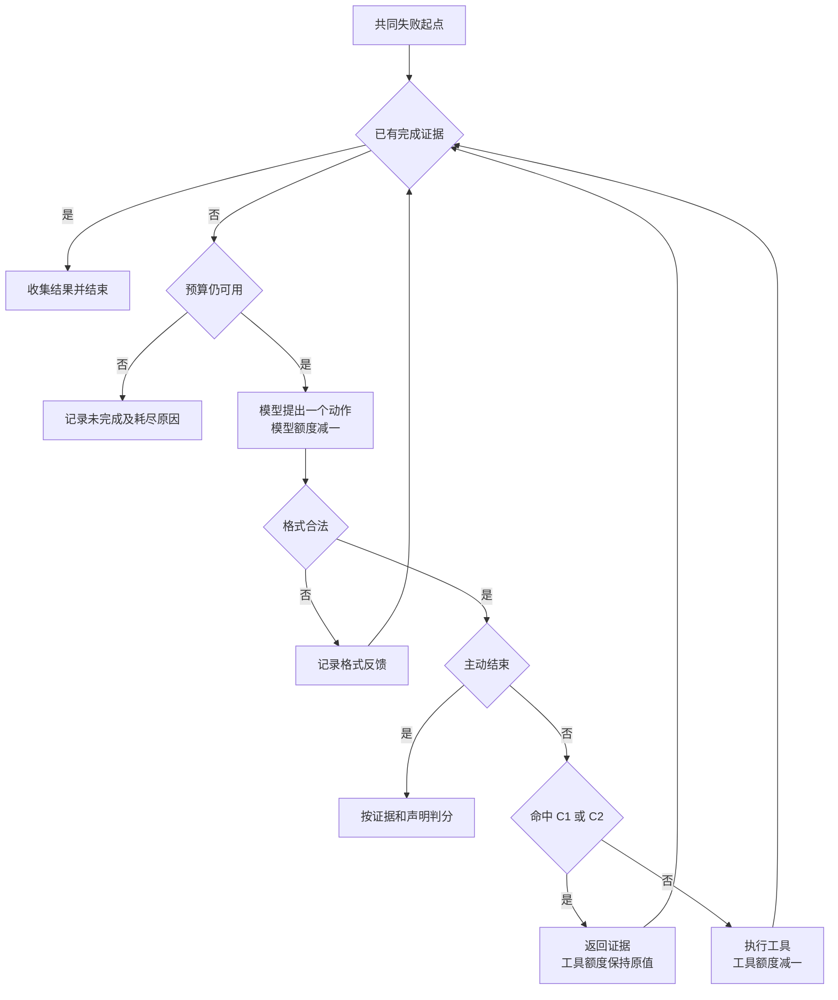

# 明确工具语义下的失败恢复：历史约束检查器的设计与零干预试跑

**公开 GitHub 仓库链接待补充，提交前须确认可公开访问**

## 摘要

本作业从 Workflow 与 Agent 的边界出发，将问题收窄到工具调用失败后的动作选择，并设计了一个依赖调用历史的执行前检查器。检查器根据工具约定，拦截再次使用已确认无效编号的查询，以及重复查询已确认缺失记录的动作，再将证据反馈给模型重新选择。实验采用固定规则、原始模型和模型加检查器三组，在相同工具与恢复预算下完成八个固定案例。真实试跑中，两模型组各提出十七个动作，可拦截提案和实际拦截均为零。检查器累计执行十七次，实测检查耗时约零点二零一毫秒。结果显示，本轮尚未观察到检查器的自然干预机会，退回重选收益仍缺少实测样本。报告同时审计了输入冗余、网关用量及终止判定，并限定结论的适用范围。

**关键词**　失败恢复；历史约束；工具调用；运行时检查；零干预结果

## 1　研究问题及其收窄过程

最初的问题是 Workflow 与 Agent 的边界，具体关注“工具调用失败之后，下一步由谁决定”。初步方案让两套程序使用相同工具完成相同任务，一套按预先规则恢复，另一套由模型选择动作，再比较完成情况和成本。

这一比较很快遇到基线问题。Workflow 可以写复杂分支，也可以在节点调用模型。若规则只包含几条简单处理方式，结果容易受到规则覆盖程度影响。进一步讨论表明，编号错误、记录缺失和临时超时都具有明确语义，合理的规则循环能够自然处理连续故障，故障串联本身未必体现模型决策的优势。

另一个问题是信息对等。曾考虑增加“模型诊断、规则决策”的中间组，但诊断字段与原始报错、完整历史仍可能包含不同信息。最终在真实运行前确定使用结构化错误，两模型组获得相同任务、工具约定和完整历史，拥有相同动作权限。

在此基础上，改进思路转向减少确定无效的调用。模型继续提出下一步动作，执行前由少量历史约束检查其有效性。运行前的问题是检查器能否节省有限工具机会，以及收益能否覆盖重选成本。零触发结果出现后，研究重点进一步明确为，在明确工具语义和正常提示下，检查器是否存在实际干预机会。这个认识来自试跑及审计。

## 2　已有方法与本作业的定位

根据规范在执行阶段约束动作已有研究基础。Alshiekh 等提出 shielding，用外部模块监测学习器动作，并在违反规范时实施干预，为本作业的执行前检查提供了方法参照。[1](https://arxiv.org/abs/1708.08611)

Ji 等的 Sentry 也包含动作检查与重新生成。其第 3.1 节说明，系统发现动作不符合环境所需格式时，会向任务模型提供动作、上下文和格式要求，要求生成修正动作。该文是 2026 年提交的预印本，本报告仅据此说明机制先例。[2](https://arxiv.org/html/2610.02994v1)

本作业的具体设计在于，结合三类错误的语义定义两条历史约束，明确证据的匹配范围，处理退回后的预算扣减，并检验模型正常运行时是否自然提出可拦截动作。原创性定位为已有约束执行思路的一次具体设计与实验验证。

## 3　实验环境与改进机制

### 3.1　任务与共同约定

任务是查询指定站点、日期的温度，返回摄氏度数值及数据来源。本地模拟器提供站点编号解析、主源 P 查询和备用源 B 查询。模型通过 JSON 每次提出一个动作，由本地程序执行。

环境采用运行前确定的三个简化条件。两源共享标准编号体系，任务使用固定只读快照，站点编号解析始终成功。编号验证先于记录查询，因此 `NO_RECORD` 只会在参数有效后返回。`TIMEOUT` 表示本次未取得结果，无法确认数据是否存在。

### 3.2　两条历史约束

**C1 拦截已确认无效编号。** 假设历史记录 h1 表明，P 使用 `OLD7` 查询时返回 `INVALID_ID`。根据共享编号体系约定，当前任务中再次用 `OLD7` 查询 P 或 B，都命中 C1。改变日期无法修复编号错误。随后若解析得到 `S17`，首次使用它查询时，旧编号证据不再适用。

**C2 拦截已确认缺失的等价查询。** 假设 h3 表明，P 使用有效编号 `S17` 查询日期 D 的温度，返回 `NO_RECORD`。只有当前请求的数据源、标准站点、日期、变量和快照均匹配，才命中 C2。固定快照和只读约定保证该缺失证据持续有效。

两条约束的作用范围不同。P 的缺失证据无法排除 B 的同日期查询；针对日期 D 的证据也无法排除 D2。不过，D2 的返回结果仍不能完成查询 D 的任务。切换数据源后，编号有效性仍受 C1 约束。发生超时时，即使参数完全相同，重试也应通过这两项检查，因为历史尚未证明其无效。

这些判断依赖既定接口语义。若查询能够触发更新，或者记录会在运行中变化，缺失证据的持续有效性就需要重新设计。

### 3.3　退回反馈与双重预算

以下是人工构造的说明情形。历史已有 h3 的主源缺失证据，模型再次提出相同请求。检查器返回拒绝判定、约束编号 C2、证据编号 h3、匹配字段及固定原因文本。模型自行提出替代动作，检查器仅评估当前提案。

每次恢复最多执行四次工具调用、调用模型六次。若提案前剩两次工具机会、四次模型机会，该提案即消耗一次模型调用。被退回后，工具机会仍为两次，模型机会变为三次；再次选择继续扣模型额度。通过检查并执行工具后，再扣一次工具额度。拒绝动作不进入模拟器，也不推进故障序列。

模型格式错误同样消耗决策额度。接口异常另行记录，并使该任务运行无效。每次工具返回后，共同执行器先检查是否取得有效目标数据或两源完整缺失证据，再检查预算，保证最后一次调用补齐证据时仍判完成。

图 1 展示检查组的恢复循环。原始模型组直接执行格式合法的工具提案，规则组按确定状态转移选择动作。

## 4　运行前确定的实验设计

三组分别为固定规则 R、原始模型 M、模型加检查器 MC。规则维护有效编号、缺失数据源和请求超时计数。首次超时允许重试，再次超时且另一源尚未确认缺失时切换。切到 B 后，B 首次超时会重试 B，P 优先仅用于初始化。

模拟器按数据源、标准站点、日期、变量和快照分别维护请求序列。无关查询不会消耗另一个请求的超时。共同失败前缀已推进相应序列，但不计入恢复预算。各组从相同检查点的独立副本开始。

案例、规则和检查器在真实调用前冻结为 v0.1。M 与 MC 使用相同初始提示词，均提前知道错误语义、两条约束和预算，请求中没有案例编号、实验组或隐藏安排。

原配置中的 GPT 标识被网关拒绝后，经用户授权改用成功模型列表中的 `claude-sonnet-4-6`。本地未设置默认 Claude 型号，选择 Sonnet 通用型号用于结构化文本动作输出。配置及全部响应标识一致，底层身份无法独立核实。两组均使用温度 0、输出上限 512、超时六十秒，客户端自动重试关闭。

一次成功连通性检查独立保存。随后奇数案例按 M、MC 顺序，偶数案例按 MC、M 顺序运行，共十六次正式任务。

## 5　验证层次与真实结果

### 5.1　人工测试与程序检查

独立检查器测试覆盖旧编号重复、编号修正、切换数据源、改变日期及超时重试，另有不同编号的补充测试。预写动作序列用于检查退回重选、格式错误和预算耗尽。

共四十六项离线程序测试通过，包括拒绝不改变环境、请求计数隔离、共同检查点一致和最后一次调用优先判分。这些测试为具体实现边界提供证据，人工动作也验证了退回流程可以运转。自然干预机会与收益由真实模型运行另行观察。

### 5.2　八个固定案例

表中调用数按“工具／模型”表示。三组在各案例的结果类别相同。

| 案例 | 故障安排 | 结果 | R | M | MC |
|---|---|---|---:|---:|---:|
| 01 | 编号修复 | 取得温度 | 2／0 | 2／2 | 2／2 |
| 02 | 主源无记录 | 取得温度 | 1／0 | 1／1 | 1／1 |
| 03 | 主源单次超时 | 取得温度 | 1／0 | 1／1 | 1／1 |
| 04 | 编号错误、主源缺失、备用源超时 | 取得温度 | 4／0 | 4／4 | 4／4 |
| 05 | 主源连续两次超时 | 取得温度 | 2／0 | 2／2 | 2／2 |
| 06 | 主源缺失、备用源超时 | 取得温度 | 2／0 | 2／2 | 2／2 |
| 07 | 两源均缺失 | 完整证据确认无记录 | 1／0 | 1／1 | 1／1 |
| 08 | 主源持续超时、备用源缺失 | 未完成 | 4／0 | 3／4 | 3／4 |

六个温度获取案例均取得结果，案例 07 完成缺失确认，案例 08 保持未完成。三类目标状态分别呈现。

M 的十七个提案中，可拦截动作数为零；MC 实际拦截数也为零，两模型组逐案动作序列相同。正式实验没有接口异常或格式错误。

案例 04 中，模型先解析编号，再查 P，得到无记录后切至 B，超时后重试成功，恰好使用四次工具调用。案例 06 中，检查器放行了备用源的同参数超时重试。两段轨迹均未产生退回重选。

### 5.3　案例 08 的终止判定

两模型组均在重试 P、查询 B、再次重试 P 后提交 `finish(incomplete)`，答案为空。结束后仍剩一次工具机会和两次模型机会。

这一记录支持其结果表述符合已有证据，任务状态仍为未完成。终止时机是否合理尚未验证。虽然隐藏安排规定 P 持续超时，模型看不到这个事实，现有实验也未给出成功概率、调用成本和任务收益的决策标准。

规则组继续执行最后一次查询，因此总工具调用多一次。这个差异来自模型主动停止，与检查器干预无关。

## 6　资源消耗及审计后的解释

| 指标 | R | M | MC |
|---|---:|---:|---:|
| 工具调用 | 17 | 16 | 16 |
| 模型调用 | 0 | 17 | 17 |
| 网关报告输入合计 | 0 | 85,866 | 85,877 |
| 网关报告输出 | 0 | 898 | 898 |
| 恢复阶段耗时合计 | 0.685 毫秒 | 47,106.113 毫秒 | 44,802.457 毫秒 |
| 检查器检查次数 | — | — | 17 |
| 检查器耗时合计 | — | — | 0.201 毫秒 |
| 金额 |  |  |  |

规则组时间取自此前独立本地运行，单次亚毫秒读数不能作为稳定性能基准。检查器耗时覆盖检查函数包围区间，其他日志与反馈处理未单独计时。两模型组总耗时相差约 2.304 秒，其中包含网络等待的调用区间相差约 2.292 秒，缺少重复计时和因果识别依据。

输入量审计发现，每次请求重发完整历史，已执行动作同时进入 `history` 与 `decisions`，系统提示词与 `contract` 也有语义重叠。每组累计有十五次已执行动作在同一请求中重复呈现。单个历史内部没有重复编号，也未发现隐藏配置或参考路径进入请求。

官方缓存定义将普通输入、缓存写入和缓存读取相加，缓存写入内部的五分钟、一小时字段属于父字段细分。[3](https://platform.claude.com/docs/en/build-with-claude/prompt-caching)

| 原始输入字段 | M | MC |
|---|---:|---:|
| 普通输入 | 102 | 102 |
| 缓存写入 | 21,897 | 21,858 |
| 缓存读取 | 63,867 | 63,917 |
| 合计 | 85,866 | 85,877 |

原始响应、账本、任务日志和汇总逐次一致，程序没有重复累加缓存细分。然而，客户端未发送缓存控制字段，三十四次请求却均报告非零缓存读写，普通输入还恒为六。每组可见文本累计为 66,094 字符。字符数不能直接换算 token，这些现象仍需网关解释。网关的上游提示、分词器及字段转换缺乏独立验证，故保留“网关报告量”口径，金额留空。

## 7　讨论、贡献与限制

本轮结果使改进机制的适用前提更加清楚。模型已提前知道两条约束，并在固定案例中自然遵守它们，检查器获得的干预机会为零。退回重选的收益仍缺少真实样本，检查耗时则已经发生。关于检查器普遍效用的判断，需要进一步证据。

本作业具体完成了约束作用范围、误拦反例、预算扣减、拒绝证据和环境推进规则的设计，并将人工机制测试与真实行为观察分开。真实协作过程中的追问促成了信息对等、确定性规则和判分顺序的修正；结果后的审计又补充了检查耗时、网关计量疑问及终止解释的边界。

八个案例是人工固定构造，各案例共享错误类型和部分前缀，同一轨迹中的提案也相互依赖。本报告采用描述性结果，普遍可靠性及总体干预频率尚无随机抽样依据。其他限制还包括第三方模型身份、请求次数驱动的模拟超时，以及独立运行的本地计时。

## 8　结论与后续实验

在当前明确工具语义、冻结提示词和八例任务条件下，历史检查器实现并通过了具体边界测试，但真实试跑未出现自然干预，尚未实测退回重选的收益。

后续可预先固定重复次数，在原八例上检查零触发结果能否复现。另一项实验可在信息完整性保持一致的条件下压缩重复输入，比较请求长度与网关报告用量，并优先核实计量定义。两项工作均需单独登记新版本和计划。

## 数据与协作说明

代码、案例、逐步轨迹、原始响应及离线审计记录已在本地保存，公开仓库链接待补。AI 协助了问题澄清、程序实现、资料核查和报告整理。人工动作测试与真实 API 记录分开保存，密钥保留在本地。初稿阶段仅复核已有记录和公开资料。

## 参考文献

[1] Alshiekh, M., Bloem, R., Ehlers, R., Könighofer, B., Niekum, S., & Topcu, U. (2017). *Safe Reinforcement Learning via Shielding*. arXiv:1708.08611，预印本。[原文](https://arxiv.org/abs/1708.08611)

[2] Ji, C., Lu, A., Zhang, Q., & Olukotun, K. (2026). *Sentry: Learning to Recover from LLM Agent Failures at Test Time*. arXiv:2610.02994，预印本。[原文](https://arxiv.org/abs/2610.02994)

[3] Anthropic.（无日期）. *Prompt caching*. Claude Platform Docs，访问日期为 2026 年 11 月 9 日。[官方文档](https://platform.claude.com/docs/en/build-with-claude/prompt-caching)