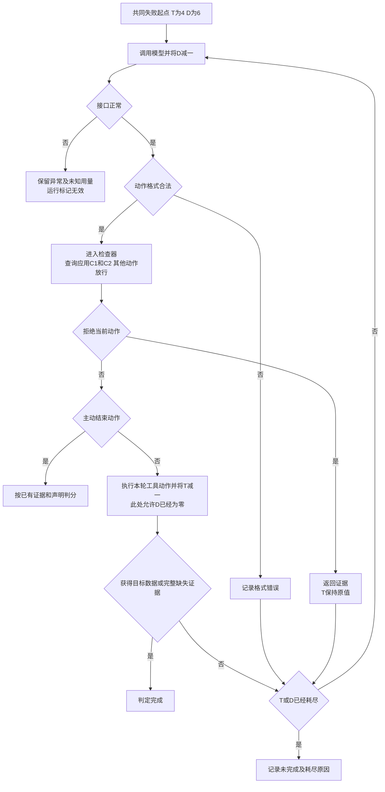

# 明确工具语义下的失败恢复：历史约束检查器的设计与零触发试跑

**公开 GitHub 仓库链接待补充，提交前须确认可公开访问**

## 摘要

本作业从 Workflow 与 Agent 的边界出发，将问题收窄到工具调用失败后的动作选择，设计并实现了一个依赖历史证据的执行前检查器。检查器根据错误语义，拒绝再次使用已确认无效编号的查询，以及重复查询已确认缺失记录的动作，并返回证据供模型重新选择。实验设置固定规则、原始模型和模型加检查器三组，使用相同模拟工具和有限恢复预算。八个固定案例的真实试跑中，两模型组各产生十七个提案，其中十四个为适用约束的温度查询，可拦截查询均为零。检查组检查入口正常执行十七次，拒绝次数为零。人工测试验证了具体机制和边界，真实试跑尚未提供退回重选收益的观测样本。报告进一步审计输入冗余、网关用量及检查耗时，并限定结论范围。

**关键词**　失败恢复；历史约束；工具调用；运行时检查；零触发结果

## 1　研究问题与设计演变

最初的问题是 Workflow 与 Agent 的边界，具体关注“工具调用失败之后，下一步由谁决定”。初步方案让两套程序完成相同任务，一套按规则恢复，另一套由模型选择动作，再比较完成情况和成本。

讨论首先暴露出规则基线问题。Workflow 可以包含复杂分支，若只编写简单规则，结果容易受到规则覆盖程度影响。编号错误、记录缺失和临时超时又具有明确语义，合理的规则循环可以处理连续故障。因此，本作业保留充分实现的规则基线及三类故障。

第二个问题是信息对等。曾考虑“模型诊断、规则决策”的中间组，但诊断字段与原始报错、完整历史仍可能存在信息差异。作者提出统一结构化错误，使两模型组获得相同任务、工具约定、历史和动作权限。

随后，作者提出执行前检查思路，利用确定的历史证据减少无效调用，同时保留模型的选择权。运行前确定了两条约束、双重预算、八个案例和判分顺序。观察到零触发并完成审计后，研究重点进一步明确为，在明确工具语义和正常提示下，历史检查器是否具有实际干预机会。

## 2　相关方法与贡献定位

执行阶段约束动作已有研究基础。Alshiekh 等提出 shielding，用外部模块依据规范监测和修正学习器动作，为本作业提供了方法参照。[1](https://arxiv.org/abs/1708.08611)

Ji 等的 Sentry 包含动作检查与重新生成。其第 3.1 节说明，系统发现动作不符合环境要求的格式时，会提供当前动作、上下文和格式要求，让任务模型生成修正动作。该文为 2026 年提交的预印本。[2](https://arxiv.org/html/2610.02994v1)

本作业的贡献定位为已有约束执行思路的一次具体设计与实验验证。具体工作包括按错误语义限定证据范围、规定检查器与模型的权限、分开核算工具执行与模型重选，以及区分人工机制测试和真实干预机会。各项证据及未验证部分在下一节分别说明。

## 3　四项具体设计

### 3.1　根据错误语义限定历史证据范围

**问题**　相同参数重复出现，可能是无效查询，也可能是仍有机会成功的超时重试。仅按“重复调用”拦截容易误伤。

**设计选择**　定义两条约束。C1 根据 `INVALID_ID` 排除同一编号命名空间中已确认无效的编号。C2 根据 `NO_RECORD` 排除数据源、标准站点、日期、变量和快照全部相同的查询。这是对运行时约束思路的任务化设计。

例如，h1 记录 P 使用 `OLD7` 返回编号无效，则再次用 `OLD7` 查询 P 或 B 均命中 C1。解析得到 `S17` 后，首次使用新编号查询可以通过 C1。若 h3 又记录 P、`S17`、日期 D 的温度不存在，则相同请求命中 C2。

切换到 B 后，P 的缺失证据不适用；改变日期为 D2 后，针对 D 的证据也不适用，但 D2 的结果无法完成查询 D 的任务。切源后的旧编号仍受 C1 约束。超时没有证明缺失，同参数重试应通过这两项检查。

**成立条件**　两源共享编号体系，编号验证先于记录查询，任务使用固定只读快照。编号解析始终成功。条件改变后，需要重新检查约束的有效范围。

**验证证据**　检查器测试覆盖旧编号、修正编号、切源、改变日期和超时重试，代码判定依据可在 `inspect_action` 中核对。证据 E6、E8。

**尚未验证**　动态数据、编号体系变化及不准确错误返回下的约束有效性尚未覆盖。现有测试为具体边界提供证据，完整实现的普遍正确性仍有范围限制。

### 3.2　拒绝当前动作并返回证据

**问题**　若检查模块直接选择备用源或修改参数，任务完成可能来自检查模块代替模型决策，难以解释模型的贡献。

**设计选择**　检查器只返回允许或拒绝。拒绝内容包含约束编号、历史记录编号、匹配字段和固定原因文本，替代动作由模型重新提出。这借鉴了外部检查后反馈恢复的结构，历史语义约束及反馈范围由本作业具体规定。

在人工构造的 h3 缺失情形中，再次查询 P 的相同记录会收到 C2 拒绝及 h3 证据。反馈保留该请求为何被排除的信息，模型继续自行选择动作。

**成立条件**　检查器只读取公开约定与已有历史，无法读取隐藏故障序列。拒绝动作不进入工具，也不改变模拟器状态。

**验证证据**　人工动作序列验证了拒绝、反馈和重新提案流程；`test_rejection_preserves_state_and_tools` 检查拒绝前后的状态摘要及额度。证据 E6、E8。

**尚未验证**　真实试跑没有发生拒绝，模型收到反馈后的替代选择质量、恢复进展和任务收益尚无实测样本。

### 3.3　分别核算工具执行与模型重选

**问题**　退回动作可以保留工具机会，但重新调用模型仍有成本。无限重选会使比较失去统一资源边界。

**设计选择**　恢复阶段最多执行四次工具、调用模型六次。每次提案先扣一次模型额度，格式错误和退回均计入。只有实际执行工具才扣工具额度。例如提案前剩两次工具、四次模型机会，被拒绝后变为两次工具、三次模型机会；重新选择再扣一次模型额度。

**成立条件**　每次模型调用只提出一个动作，客户端自动重试关闭，接口异常与模型格式错误分开记录。提交状态或用量无法确认时标为未知。

**验证证据**　程序测试覆盖六次拒绝、格式错误耗尽，以及第六次模型调用提出的合法动作仍可执行。真实运行日志保留逐步前后额度。证据 E4、E6。

**尚未验证**　真实试跑每个任务最多使用四次模型调用，第六次调用边界由程序测试覆盖。重选的实际成本收益交换尚未观测。

### 3.4　分开验证机制与自然干预机会

**问题**　人工安排错误动作可以检验拦截功能，但无法说明正常提示下模型是否会产生这些动作。

**设计选择**　人工测试允许预写动作，验证判定、反馈和预算。真实试跑只预置共同工具失败起点，由模型自然选择恢复动作。两模型组都提前获知两条约束。此处的贡献是建立两种证据各自的解释边界。

**成立条件**　人工测试与真实运行分别标记、分开保存。可拦截动作的离线标注只使用提案前历史，标注结果不反馈给原始模型组。

**验证证据**　四十六项离线程序测试通过；真实试跑完成十六次任务，原始提案、解析动作和检查结果均可追溯。证据 E1、E4、E6。

**尚未验证**　八个固定案例只提供当前条件下的描述性观察，尚不足以估计一般任务中的干预频率。

## 4　实现流程与运行前设置

模拟任务查询指定站点、日期的温度。工具包括编号解析及主源 P、备用源 B 查询，模型输出 JSON 提案，由本地程序执行。

模拟器按数据源、标准站点、日期、变量和快照维护独立响应序列。无关请求不会消耗另一个请求的超时。共同失败前缀已推进相应序列，但不扣恢复额度。各组从相同检查点的独立副本开始。

图 1 与 `experiment.py` 中的顺序一致。当前调用即使消耗了最后一次模型额度，其合法提案仍先完成检查、执行或主动结束处理，随后才决定能否进入下一轮。

图 1　检查组恢复循环。第四次工具返回补齐证据时，先判完成。相关边界测试见证据 E6。

R 按确定规则选择动作。首次超时允许重试，再次超时且另一源尚未确认缺失时切换。切到 B 后，B 首次超时会重试 B，P 优先仅用于初始化。

案例、规则和检查器在真实调用前冻结为 v0.1。两模型组使用相同提示词、公开信息和生成设置。原 GPT 标识被网关拒绝后，作者授权改用已有 Claude 型号，AI 从成功列表选择 `claude-sonnet-4-6`。配置及全部响应标识一致，底层身份无法独立核实。

两组均采用温度 0、输出上限 512、超时六十秒。独立连通性检查通过后，奇数案例按 M、MC，偶数案例按 MC、M 顺序运行。证据 E3、E7、E8。

## 5　逐案结果与零触发分母

表中调用数为“工具／模型”。三组在各案例中的结果类别相同。

| 案例 | 故障安排 | 结果 | R | M | MC |
|---|---|---|---:|---:|---:|
| 01 | 编号修复 | 取得温度 | 2／0 | 2／2 | 2／2 |
| 02 | 主源无记录 | 取得温度 | 1／0 | 1／1 | 1／1 |
| 03 | 主源单次超时 | 取得温度 | 1／0 | 1／1 | 1／1 |
| 04 | 编号错误、主源缺失、备用源超时 | 取得温度 | 4／0 | 4／4 | 4／4 |
| 05 | 主源连续两次超时 | 取得温度 | 2／0 | 2／2 | 2／2 |
| 06 | 主源缺失、备用源超时 | 取得温度 | 2／0 | 2／2 | 2／2 |
| 07 | 两源均缺失 | 完整证据确认无记录 | 1／0 | 1／1 | 1／1 |
| 08 | 主源持续超时、备用源缺失 | 未完成 | 4／0 | 3／4 | 3／4 |

六个温度获取案例取得结果，缺失确认案例完成，持续不可用案例未完成。各目标状态分别报告。证据 E1、E2、E5。

| 提案类别及检查口径 | M | MC |
|---|---:|---:|
| 全部提案 | 17 | 17 |
| `query_temperature` | 14 | 14 |
| `resolve_station` | 2 | 2 |
| `finish` | 1 | 1 |
| 可拦截查询／适用查询提案 | 0／14 | 0／14 |
| 检查器入口执行次数 | — | 17 |
| 实际拒绝次数 | — | 0 |

C1、C2 只针对温度查询。MC 的另外三个动作进入检查函数后直接放行。因此，“零触发”指拒绝次数为零，检查器仍正常执行十七次，其中十四次适用查询约束。M 的可拦截性由事后离线判定。证据 E2。

正式实验共三十四次模型请求，另有一次独立连通性请求。正式任务接口异常和格式错误均为零。证据 E1、E3。

案例 04 的原始模型依次解析编号、查询 P、切换 B、超时重试，第四次工具调用取得温度。案例 06 的检查组放行备用源同参数重试并取得结果。两组均未收到拒绝反馈。

案例 08 中，两模型组均在三次工具调用后提交 `finish(incomplete)`。结束前剩一次工具和三次模型机会，结束后剩一次工具和两次模型机会。这支持结果表述符合证据，任务仍未完成。终止时机是否合理尚未验证。规则组继续使用最后一次工具机会，因此总工具调用多一次，此差异来自主动终止，与检查器无关。证据 E4、E5。

## 6　资源审计与结果解释

| 指标 | R | M | MC |
|---|---:|---:|---:|
| 工具调用 | 17 | 16 | 16 |
| 模型调用 | 0 | 17 | 17 |
| 网关报告输入合计 | 0 | 85,866 | 85,877 |
| 网关报告输出 | 0 | 898 | 898 |
| 恢复耗时合计 | 0.685 毫秒 | 47,106.113 毫秒 | 44,802.457 毫秒 |
| 检查器耗时合计 | — | — | 0.201 毫秒 |
| 金额 |  |  |  |

规则时间来自此前独立本地运行，规则决策的单独耗时未记录。MC 的检查耗时覆盖检查函数包围区间，其他处理未单独计时。两模型组总耗时相差约 2.304 秒，其中包含网络等待的调用区间相差约 2.292 秒，现有单次记录缺少因果归因依据。证据 E2。

输入审计发现，每次请求重发完整历史，已执行动作同时进入 `history` 和 `decisions`，系统提示词与 `contract` 也有语义重叠。每组累计十五次已执行动作在同一请求中重复呈现。单个历史内部没有重复编号，未发现隐藏配置进入请求。

官方定义将普通输入、缓存写入和缓存读取相加，缓存写入内部细分属于父字段的组成。[3](https://platform.claude.com/docs/en/build-with-claude/prompt-caching)

| 原始字段 | M | MC |
|---|---:|---:|
| 普通输入 | 102 | 102 |
| 缓存写入 | 21,897 | 21,858 |
| 缓存读取 | 63,867 | 63,917 |
| 合计 | 85,866 | 85,877 |

原始响应、账本、任务日志和汇总一致，未发现重复累加缓存细分。然而，客户端未发送缓存控制字段，三十四次请求均报告非零缓存读写，普通输入每次恒为六。每组可见文本累计 66,094 字符，仍无法独立解释全部网关输入计数。字符数不能直接换算 token，网关上游提示、分词器及字段转换尚待核实。证据 E2、E3。

零触发意味着退回重选收益缺少真实样本，检查成本则已经发生。关于检查器一般效用的判断仍需更多证据。八个案例为固定构造，部分前缀相同，轨迹内提案相互依赖，现有数据采用描述性统计。

## 7　仓库证据索引

以下路径均以拟上传仓库根目录为基准，已核对文件存在。E 编号用于定位本报告主要数字及机制。

| 编号 | 相对路径与支持字段 |
|---|---|
| E1 | `results/claude-pilot-20261109/experiment/summary.json`，`rows` 支持逐案结果，`groups` 支持调用数、用量及异常数 |
| E2 | `results/claude-pilot-20261109/result-audit.json`，`groups.*.proposal_action_counts` 支持动作分类，`query_proposals` 与 `interceptable_query_proposals` 支持分母，`checker_dispatch_calls` 支持入口次数，`checker_elapsed_ms` 支持检查耗时 |
| E3 | `results/claude-pilot-20261109/audit.json`，`checks` 支持一致性核对，`raw_usage_totals` 支持分项用量，`connectivity_usage` 与 `total_requests_this_model_round_including_probe` 支持连通性及总请求数 |
| E4 | `results/claude-pilot-20261109/experiment/runs/04-M.json`、`06-MC.json`、`08-M.json`、`08-MC.json`，后面三个文件位于同一 `runs` 目录；`events` 中的 `action`、`tool_result`、`check`、`budgets_before`、`budgets_after` 支持轨迹与额度判定 |
| E5 | `results/api-preparation-program-check/rule_baseline/01-R.json` 至 `08-R.json`，`totals` 支持规则资源消耗，`events` 支持规则终止过程 |
| E6 | `test_experiment.py` 中的 `CheckerTests`、`test_rejection_preserves_state_and_tools`、`test_sixth_model_action_still_executes` 及第四次工具完成证据测试；`test_model_connection.py`、`test_run_real.py` 补充接口与运行检查。`results/claude-pilot-20261109/offline-program-tests.txt` 记录四十六项通过 |
| E7 | `results/claude-pilot-20261109/experiment/manifest.json` 的 `plan`、`config` 支持顺序和设置；同一结果根目录下的 `model-change.json`、`connectivity/attempt-01/result.json` 支持模型变更与独立检查 |
| E8 | `experiment.py` 的 `inspect_action`、`run`、`Rules`，以及 `model_prompt.txt`、`frozen/v0.1/manifest.json`、`CHANGES.md`，支持机制、冻结及修改记录 |
| E9 | `results/claude-pilot-20261109/reference-check.json` 记录一手资料的题名、作者、年份、支持论点和核验状态 |

E2 为依据已有日志重新生成的离线审计。原始运行记录保留，修订阶段没有增加模型实验。

## 8　协作分工与结论

问题讨论、代码实现、运行分析和报告撰写均使用了 AI。作者明确选择失败恢复切口，指出规则基线和信息差问题，提出历史检查器，并确认保留三类故障、四次工具与六次模型预算、零触发结果及暂停扩大调用。作者还提出先判完成再判预算、补充 token 审计和区分终止决策等修订要求。

AI 提出了模拟载体、具体案例和实现方案，完成 Python 编码、本地执行、接口兼容处理、日志统计、资料核查及报告整理。在作者授权范围内，AI 从网关列表选择了 Sonnet 型号。完整对话将另行上传，用于核对方案演变和具体分工。

本作业完成了两条历史约束及其范围、反馈和预算机制的设计与具体测试。真实试跑中，原始模型十四个适用查询均未命中约束，检查组正常检查十七次、拒绝零次。退回重选收益尚未实测，普遍可靠性和总体干预频率仍超出现有证据范围。

后续可预先固定重复次数，在原八例上检查零触发能否复现；也可另立版本压缩等价输入，结合网关计量核查比较资源消耗。当前保留已有结果。

## 参考文献

[1] Alshiekh, M., Bloem, R., Ehlers, R., Könighofer, B., Niekum, S., & Topcu, U. (2017). *Safe Reinforcement Learning via Shielding*. arXiv:1708.08611，预印本。[原文及元数据](https://arxiv.org/abs/1708.08611)

[2] Ji, C., Lu, A., Zhang, Q., & Olukotun, K. (2026). *Sentry: Learning to Recover from LLM Agent Failures at Test Time*. arXiv:2610.02994v1，预印本。[摘要及元数据](https://arxiv.org/abs/2610.02994)、[全文](https://arxiv.org/html/2610.02994v1)

[3] Anthropic.（无日期）. *Prompt caching*. Claude Platform Docs。[官方文档](https://platform.claude.com/docs/en/build-with-claude/prompt-caching)

**核验说明**　2026 年 11 月 9 日实际访问了以上一手页面。文献［1］按 2017 年预印本引用。Sentry 的题名、四位作者、2026 年提交时间及全文第 3.1 节均已核对，正文仅引用其格式检查后要求修正动作的机制。文献［3］核对了输入求和公式与缓存细分定义。预印本身份及无日期文档均按实际状态标注。

**本轮修改**

- 单独展开四项设计的五个维度，明确借鉴内容、实现证据和未验证部分。
- 改为“零触发”，补充每组十四个查询、两个解析和一个结束动作。
- 修正流程图，明确最后一次模型额度消耗后的合法动作仍可执行。
- 补充仓库相对证据路径、真实协作分工及引用核验状态。

**提交前仍需完成**

- 补入公开 GitHub 链接，并确认可公开访问。
- 上传完整对话及索引列出的证据文件，保留相对目录结构，排除本地凭据和密钥。