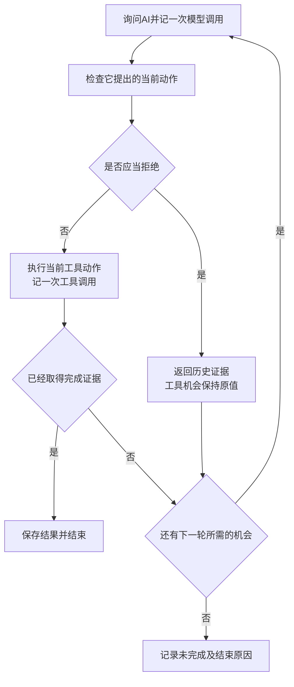

# 工具调用失败后，有必要让 AI 决定下一步吗？——一次固定规则与模型决策的对照实验

**公开 GitHub 仓库链接待补充，提交前须确认可公开访问**

## 1　工具出错以后，把下一步交给模型能多带来什么

工具调用失败以后，有些处理办法可以提前写好。例如，编号错误时先修正编号，一个数据源没有记录时换另一个数据源，临时超时时再试一次。那么，让 AI 根据当前情况决定下一步，能否增加任务完成机会，或者减少无效调用？

这是本作业最初想回答的问题。它来自对 Workflow 与 Agent 边界的讨论。本文把比较限定在失败恢复过程中，观察下一步由固定规则选择，或由模型根据反馈选择，会产生什么差异。

最初曾预期模型能够更灵活地处理连续故障。但讨论发现，固定规则也能反复读取错误、更新状态和选择动作。仅把两个故障接在一起，未必会形成模型优势。因此，我们保留了充分实现的规则程序，并选择一个范围很小、结果容易核对的温度查询任务。

运行前准备观察的差异包括任务结果、工具调用次数、模型调用次数，以及是否出现可以根据历史确定无效的动作。研究过程中又提出一个小改进，在模型动作执行前加一道检查，拒绝已经可以确定无效的查询，再让模型重新选择。这个改进后来成为第三种程序。

## 2　哪些内容是模拟的，哪些地方真的调用了 AI

任务要求查询指定站点、指定日期的温度。实验中的站点、温度、主数据源、备用数据源和故障都由本地 Python 程序设置。“工具”是本地函数，包括查询站点编号和查询温度。

真实的网络调用发生在询问第三方 AI 时。程序把任务、工具说明、已经发生的调用和剩余机会发送出去，AI 返回下一步动作，本地程序再执行这个动作。AI 在这里负责选择恢复步骤。

例如，本例中的 `Station-A`、标准编号 `S17`、日期 `2026-01-15` 和温度 `18.4℃` 都是测试设置。备用数据源“第一次超时”也由本地函数直接返回错误标记，无需真的等待某个网站超时。

提前安排工具结果，是为了让不同程序面对一致、可重复的环境。每个请求分别维护自己的返回顺序，查询其他日期或另一个数据源不会消耗当前请求的超时。模型只能看到已经返回的结果，看不到后面的安排。被检查步骤拒绝的动作也不会进入模拟工具。

这种安排适合比较当前模拟任务中的恢复行为，其解释范围受预设环境限制。如果把未来安排透露给模型、给某种程序更多信息或机会，或者让所有动作都必然成功，比较就会失去辨别力。

## 3　一个实际案例怎样走完

### 3.1　任务和共同失败起点

以已经运行的“主数据源没有记录，备用数据源第一次查询超时”为例。任务是查询 `Station-A` 在 `2026-01-15` 的温度。

三种程序开始恢复前，本地初始化已经完成两步。第一步确认站点编号是 `S17`；第二步用该编号查询主数据源，得到 `NO_RECORD`，即参数有效，但该数据源没有目标记录。

这两条历史一起交给三种程序。报告中的恢复次数从这里开始计算，初始化步骤不扣恢复机会。模型此时知道主数据源没有记录，尚不知道备用数据源会超时，也不知道随后会返回什么温度。

### 3.2　由模型自己决定的程序

程序第一次真实询问 AI，提供任务、两条历史、工具约定，以及剩余四次工具机会和六次模型机会。AI 实际选择查询备用数据源，编号仍为 `S17`，日期仍为 `2026-01-15`。这个决定消耗一次模型调用。

本地程序随后执行查询。模拟器按预设返回 `TIMEOUT`，表示本次未取得结果。这消耗一次工具调用。剩余机会变为三次工具、五次模型。

程序把这次超时加入历史，再次询问 AI。模型实际选择以相同参数重试备用数据源，又消耗一次模型调用。本地工具第二次返回成功，温度为 `18.4℃`，再消耗一次工具调用。

共同执行程序确认返回的站点、日期和变量符合任务，就保存结果并结束。因此，这条恢复轨迹使用了两次模型调用和两次工具调用。模型两次返回的都是查询动作，温度来自模拟工具。

### 3.3　另外两种程序怎样处理

| 环节 | 固定规则程序 | 由模型自己决定的程序 | 加了检查步骤的模型程序 |
|---|---|---|---|
| 主数据源没有记录后 | 按规则查询备用源 | AI 选择查询备用源 | AI 选择后，先检查再执行 |
| 备用源第一次超时后 | 按规则重试一次 | AI 选择重试 | AI 选择后，再检查一次 |
| 返回 `18.4℃` 后 | 共同程序收集结果 | 共同程序收集结果 | 共同程序收集结果 |
| 恢复阶段工具调用 | 2 次 | 2 次 | 2 次 |
| 恢复阶段模型调用 | 0 次 | 2 次 | 2 次 |
| 额外检查 | — | — | 2 次，均放行 |

三种程序在这里走出了相同的查询顺序。区别在于，固定规则程序提前写好了“主源缺失后切换、首次超时后重试”；另外两种程序分别真实询问了 AI。

加了检查步骤的程序，两次都允许执行。第一次提出的是备用源查询，而已确认缺失的是主源记录。第二次虽然重复了参数，但备用源此前只返回超时，仍可能成功。实际记录随后也返回了成功。

## 4　历史检查器想改进什么

这个小改进的想法很直接。如果历史已经明确证明某次查询无效，模型又提出相同查询，就退回这一步，让它重新选择。超时后的重试仍然允许。

具体实现包含两条规则。

**第一条，拒绝再次使用已经确认无效的编号。** 如果旧编号 `OLD7` 已返回 `INVALID_ID`，即编号无效，那么在共享编号体系下，再次用它查询任一数据源都可以拒绝。解析得到新编号 `S17` 后，旧编号的错误证据不再适用于新请求。

**第二条，拒绝重复查询已经确认缺失的同一记录。** 只有数据源、标准站点、日期、变量和固定数据版本都一致，历史中的“没有记录”才能排除当前查询。切换数据源、改变日期或改变实际站点后，需要各自的证据。改变日期虽然可以通过这一检查，新日期的结果仍无法完成原日期的任务。

这些规则依赖实验约定。两源共享编号体系，编号验证先于记录查询，数据在任务期间保持不变。如果记录会更新，过去缺失就未必代表现在仍然缺失。

拒绝反馈只包含命中的规则、历史记录编号、匹配字段和原因。检查步骤保留模型选择替代动作的权利。例如，当模型再次查询主源已确认缺失的记录时，反馈指出相关证据，下一步仍由模型提出。

重选也要付出代价。因此，工具执行和询问模型分别计数。每次恢复最多执行四次工具、询问模型六次。被退回的提案消耗一次模型机会，工具机会保持原值。格式错误同样消耗模型机会。接口异常单独记录，无法确认的用量保留为未知。

图中展示工具动作的处理顺序。剩余次数的检查位于当前动作处理之后，所以最后一次模型调用提出的合法动作仍可执行。工具返回后也先判断完成证据，再判断次数耗尽。主动结束动作按已有证据和声明判分。

## 5　实验怎样扩展到八个案例

在真实模型调用前，案例、固定规则、检查步骤和次数限制已经确定，案例、规则和检查器冻结为 v0.1。两种模型程序使用同一提示词，都提前知道工具语义和两条检查规则，请求中没有案例编号、所属程序或隐藏故障安排。

原配置中的 GPT 型号被网关拒绝后，经作者授权，改用成功模型列表中的 `claude-sonnet-4-6`。本地没有默认 Claude 型号，协作 AI 选择 Sonnet 通用型号用于结构化动作输出。配置与全部响应返回的型号字符串一致，底层身份仍无法独立核实。

两种模型程序均采用温度 0、输出上限 512、超时六十秒，客户端自动重试关闭。一次独立连通性检查通过后，按预定交替顺序完成八个案例、每种模型程序各一次的十六次运行。

下表中的次数均只计算恢复阶段。

| 案例 | 设置的情况 | 三种程序的结果 | 固定规则的工具次数 | 两种模型程序各自的工具／模型次数 |
|---|---|---|---:|---:|
| 01 | 编号错误后修复 | 取得温度 | 2 | 2／2 |
| 02 | 主源没有记录 | 取得温度 | 1 | 1／1 |
| 03 | 主源单次超时 | 取得温度 | 1 | 1／1 |
| 04 | 编号错误、主源缺失、备用源超时 | 取得温度 | 4 | 4／4 |
| 05 | 主源连续两次超时 | 取得温度 | 2 | 2／2 |
| 06 | 主源缺失、备用源超时 | 取得温度 | 2 | 2／2 |
| 07 | 两源都没有记录 | 完整证据确认无记录 | 1 | 1／1 |
| 08 | 主源持续超时、备用源没有记录 | 未完成 | 4 | 3／4 |

固定规则已经处理了本轮预设的可恢复情况。模型取得了相同的任务结果。六个温度获取案例、一个缺失确认案例和一个持续不可用案例分别呈现，避免将不同目标状态混成整体能力评分。

## 6　实际看到了什么

### 6.1　额外检查没有遇到需要拒绝的动作

| 动作或检查项目 | 由模型自己决定的程序 | 加了检查步骤的模型程序 |
|---|---:|---:|
| 全部提案 | 17 | 17 |
| 温度查询 | 14 | 14 |
| 编号解析 | 2 | 2 |
| 结束动作 | 1 | 1 |
| 可拦截查询／适用的查询提案 | 0／14 | 0／14 |
| 检查入口执行次数 | — | 17 |
| 拒绝次数 | — | 0 |

“检查十七次、拒绝零次”表示检查步骤正常运行。两条规则适用于其中十四个温度查询，另外三个动作进入检查函数后直接放行。

这轮主要观察的是，在明确告知工具约定和检查规则后，模型能否自然遵守，以及额外检查是否获得干预机会。十四个查询全部通过约束，因此没有退回重选的真实样本。两种模型程序逐案选择的动作序列也相同。

### 6.2　模型提前停止来自哪里

案例 08 中，两种模型程序都在三次工具调用后提交“未完成”。它们没有虚构温度，也没有把主源超时声称为主源无记录。

结束前仍剩一次工具和三次模型机会。结束动作消耗一次模型机会，之后剩两次。这说明结果表述符合证据，任务状态仍为未完成。终止时机是否合理尚未得到验证。

固定规则程序继续执行了最后一次查询，随后次数耗尽。所以规则程序总共多用一次工具。这个差异来自模型主动结束，与额外检查无关。隐藏安排规定主源持续超时，但模型无法看到这个事实，现有实验也未提供成功概率和任务收益的决策标准。

### 6.3　调用次数与耗时

| 指标 | 固定规则程序 | 由模型自己决定的程序 | 加了检查步骤的模型程序 |
|---|---:|---:|---:|
| 工具调用 | 17 | 16 | 16 |
| 模型调用 | 0 | 17 | 17 |
| 恢复阶段耗时合计 | 0.685 毫秒 | 47,106.113 毫秒 | 44,802.457 毫秒 |
| 额外检查耗时合计 | — | — | 0.201 毫秒 |
| 金额 |  |  |  |

模型没有增加本轮的任务完成收益，却增加了实际模型调用。规则组的本地时间取自此前独立运行，亚毫秒读数只作为已有记录保留。

检查步骤虽然没有拒绝动作，仍花费了本地时间。其计时覆盖检查函数包围区间，其他处理没有全部单独计时。两模型程序总耗时相差约 2.304 秒，其中包含网络等待的模型调用区间相差约 2.292 秒。现有单次记录无法把几秒差异归因于检查步骤。

### 6.4　网关用量为什么仍有疑问

接口用 token 计量输入和输出，可以将其理解为模型处理文本时使用的小片段。本报告保留第三方网关返回的计数。

| 网关报告项目 | 由模型自己决定的程序 | 加了检查步骤的模型程序 |
|---|---:|---:|
| 普通输入 | 102 | 102 |
| 缓存写入 | 21,897 | 21,858 |
| 缓存读取 | 63,867 | 63,917 |
| 输入合计 | 85,866 | 85,877 |
| 输出 | 898 | 898 |

官方定义将普通输入、缓存写入和缓存读取相加；缓存写入内部的时长细分已经包含在父字段中。[3](https://platform.claude.com/docs/en/build-with-claude/prompt-caching)

这张表采用该定义。逐次核对原始响应、账本、任务日志和汇总，没有发现客户端重复累加缓存细分。正式任务共发起三十四次模型请求，独立连通性检查另用一次，共三十五次。

请求内容确实存在冗余。每次都重新发送完整历史，已执行动作同时出现在历史和先前决定中，系统提示词与工具约定也重复描述了部分语义。每组累计十五次已执行动作在同一请求中重复呈现。

但全部输入计数仍无法独立解释。客户端未发送缓存控制字段，三十四次请求却都报告非零缓存读写，普通输入还每次恒为六。每组可见文本累计 66,094 字符，字符数又不能直接换算为 token。网关上游提示、分词器和字段转换缺乏独立证据，因此继续使用“网关报告量”口径，金额留空。

## 7　具体设计贡献与实验意义

### 7.1　四项设计解决了什么问题

**按错误语义限定证据范围。** 这解决了把所有重复调用都当作浪费的问题。固定快照、共享编号以及先验证参数的约定，使旧编号错误和记录缺失能够形成有范围的排除证据。人工测试覆盖修正编号、切源、改日期和超时重试。动态数据及错误信息不可靠的环境尚未覆盖。

**只拒绝当前动作并返回证据。** 这使模型保留替代选择权，也使实验能够定位拒绝发生的原因。人工动作序列验证了拒绝、反馈和后续提案可以运转，拒绝前后模拟器状态保持一致。真实模型收到拒绝后的表现尚未得到观察。

**分开核算工具执行和模型重选。** 这解决了保留工具机会却忽略额外 AI 成本的问题。程序测试覆盖反复拒绝、格式错误耗尽和最后一次模型调用仍可执行当前合法动作。真实试跑没有触及第六次模型调用，相关边界证据来自程序测试。

**分开验证机制和自然机会。** 人工测试允许预写错误动作，真实试跑则使用正常提示，观察模型自行选择。四十六项离线程序测试通过，为具体实现边界提供证据；自然查询没有触发拒绝，实际收益仍缺少样本。

依据规范在执行阶段限制动作已有研究基础。Alshiekh 等的 shielding 使用外部模块监测并修正违反规范的学习器动作。[1](https://arxiv.org/abs/1708.08611)

Sentry 的第 3.1 节也说明，对不符合环境格式要求的动作，系统会提供上下文和要求，让任务模型重新生成。本文借鉴这类外部检查与反馈恢复思路，具体限定历史证据的范围及预算。[2](https://arxiv.org/html/2610.02994v1)

因此，原创性定位为已有思路的一次具体设计、实现和实验验证。真实零触发结果决定了本轮能够证明到哪一步。

### 7.2　为什么这次实验仍然值得做

这次工作改变了对问题的理解，并留下了能够核查的依据。

首先，讨论排除了信息不对等的中间组方案，使比较集中在相同信息下的动作选择。其次，连续故障被实际运行后，可以看到规则循环已经覆盖恢复路径，模型的选择自由没有自动转化为额外完成收益。再次，三种程序都取得相同结果时，检查记录表明成功路径无需拒绝步骤改变，因而不能把成功归功于检查器。

最后，少用一次工具的差异被定位到案例 08 的主动结束，输入数字也被拆回原始字段。由此，停止时机、检查收益、网络耗时和网关计量得以分别讨论。

这些发现支持一个有条件的结论。在当前明确、有限的任务中，固定规则已经足以取得本轮观察到的结果。模型决策增加了模型调用，额外检查没有遇到干预机会。对更广泛任务的必要性和可靠性判断，仍需新的证据。

八个案例为人工固定构造，部分起点完全相同，同一任务中的连续动作也相互依赖。本文采用描述性统计，关于一般任务中干预频率的推断尚无随机抽样依据。

## 8　协作分工及后续工作

本作业有两个 AI 角色。

**协作 AI** 参与问题讨论、方案设计、Python 实现、接口兼容处理、运行分析、引用核查和报告写作。它在作者授权范围内选择了当前 Claude 型号，并执行本地实验与审计。

**被测 AI** 是通过第三方接口调用的模型。它在每次请求中读取公开信息，返回下一步动作。正式实验中的三十四次请求属于这一角色。

作者选择了最初的研究切口，指出规则基线和信息差问题，提出历史检查器，并明确确认保留三类故障、统一预算和零触发结果。作者还推动了判分顺序、用量审计、终止解释及报告主线的修正。完整对话将另行上传，供核对方案演变与实际分工。

后续可以预先固定重复次数，在原八例上检查零触发能否复现；也可以另立版本，在信息保持完整的条件下压缩重复输入，并结合网关计量核查比较资源消耗。本轮保留已有结果，未增加模型实验。

**个人反思由作者另行补充。**

## 附录　如何根据记录核查

以下路径均以拟上传仓库根目录为基准，已核对文件存在。

| 想核查的内容 | 相对路径及查看位置 |
|---|---|
| 各案例结果、调用次数和异常 | `results/claude-pilot-20261109/experiment/summary.json`，查看 `rows` 和 `groups` |
| 本文详细讲解的模型程序轨迹 | `results/claude-pilot-20261109/experiment/runs/06-M.json`，查看 `prefix` 和 `events` |
| 同例加检查步骤的轨迹 | `results/claude-pilot-20261109/experiment/runs/06-MC.json`，查看动作、工具返回和检查结果 |
| 同例固定规则轨迹 | `results/api-preparation-program-check/rule_baseline/06-R.json` |
| 主动结束及剩余机会 | 正式轨迹目录中的 `08-M.json`、`08-MC.json`，以及规则目录中的 `08-R.json` |
| 十七个提案怎样分类、十四个查询及检查耗时 | `results/claude-pilot-20261109/result-audit.json`，查看 `groups` 下的动作分类、查询数量和计时字段 |
| 请求一致性与原始用量分项 | `results/claude-pilot-20261109/audit.json`；逐次原始响应在 `experiment/request_ledgers/` 中 |
| 实际顺序、型号和生成设置 | `results/claude-pilot-20261109/experiment/manifest.json` |
| 模型变更和独立连通性检查 | 同一结果根目录的 `model-change.json`、`connectivity/attempt-01/result.json` |
| 机制和预算测试 | `test_experiment.py`、`test_model_connection.py`、`test_run_real.py` |
| 四十六项测试通过记录 | `results/claude-pilot-20261109/offline-program-tests.txt` |
| 实现、提示词和冻结记录 | `experiment.py`、`model_prompt.txt`、`frozen/v0.1/manifest.json`、`CHANGES.md` |
| 本轮引用核验状态 | `results/claude-pilot-20261109/reference-check.json` |

这些文件将任务结果、动作选择、检查行为与资源记录分开保存。由原始轨迹可以核对每一步，由汇总和审计可以核对统计口径；人工动作测试继续单独呈现。

## 参考文献

[1] Alshiekh, M., Bloem, R., Ehlers, R., Könighofer, B., Niekum, S., & Topcu, U. (2017). *Safe Reinforcement Learning via Shielding*. arXiv:1708.08611，预印本。[原文及元数据](https://arxiv.org/abs/1708.08611)

[2] Ji, C., Lu, A., Zhang, Q., & Olukotun, K. (2026). *Sentry: Learning to Recover from LLM Agent Failures at Test Time*. arXiv:2610.02994v1，预印本。[摘要及元数据](https://arxiv.org/abs/2610.02994)、[全文](https://arxiv.org/html/2610.02994v1)

[3] Anthropic.（无日期）. *Prompt caching*. Claude Platform Docs。[官方文档](https://platform.claude.com/docs/en/build-with-claude/prompt-caching)

**核验说明**　已实际访问上述一手页面。文献［1］按 2017 年预印本引用。Sentry 的题名、四位作者、2026 年提交时间及全文第 3.1 节已核对，正文引用范围限于动作格式检查和要求重新生成的机制。文献［3］核对了输入求和公式与缓存细分定义。核验记录日期为 2026 年 11 月 9 日。

本次重写先解释模拟与真实调用，再用一个完整案例串起三种程序；设计贡献、方法归属和证据索引放在结果之后。

提交前仍需补入公开仓库链接、上传完整对话及所列证据，并由你补写个人反思。