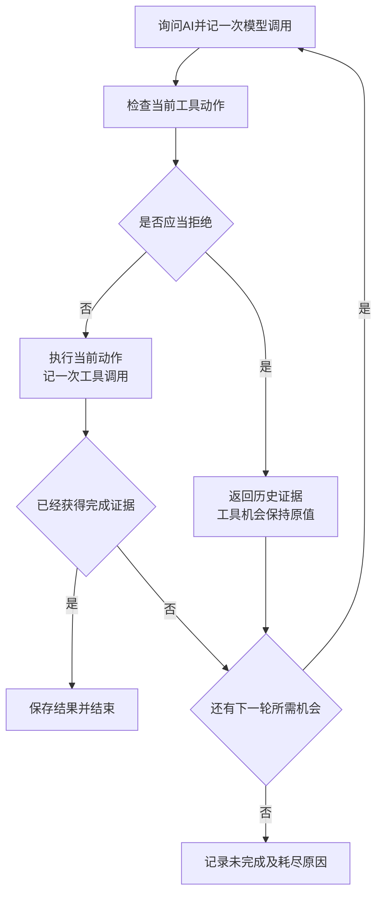

# 工具调用失败后，有必要让 AI 决定下一步吗？——一次固定规则与模型决策的对照实验

**公开 GitHub 仓库链接待补充，提交前须确认可公开访问**

## 1　我们想回答什么问题

工具调用失败以后，有些处理办法可以提前写好。例如，编号错误时修正编号，一个数据源没有记录时换另一个，临时超时时再试一次。那么，把下一步交给 AI 决定，能否增加任务完成机会，或者减少无效调用？

本作业最初从 Workflow 与 Agent 的边界出发，关注失败后的决定权。为了让问题可以实际检验，我们把范围缩小到一个温度查询任务，比较三种程序如何利用已经发生的情况选择恢复步骤。

原先准备观察的差异包括任务结果、工具调用次数、模型调用次数，以及是否出现可以确定无效的动作。研究过程中又提出一个小改进，在模型动作执行前增加检查，拒绝已经被历史证据排除的查询，再让模型重新选择。

选择小场景，是因为其结果容易核对，故障也可以重复安排。但这个选择同时限定了结论。这里错误种类少、含义清楚、历史短，并且模型得到充分说明。实验检验的是这些条件下的恢复行为。

## 2　哪些是本地模拟，哪些是真实调用

任务要求取得指定站点、指定日期的温度。实验中的站点、温度、主数据源、备用数据源和故障，都由本地 Python 程序设置。

所谓“工具”是本地函数，包括查询标准站点编号，以及从主数据源或备用数据源查询温度。标准编号可以理解为程序查询站点时使用的统一编号。

真实网络调用发生在询问第三方 AI 时。程序把任务、工具说明、已有调用历史和剩余机会发送出去，AI 返回下一步动作，本地程序再执行它。AI 在实验中负责选择恢复步骤。

例如，测试站点 `Station-A` 的标准编号是 `S17`，查询日期为 `2026-01-15`，备用数据源能够返回的温度预设为 `18.4℃`。“查询超时”也可以由本地函数直接返回错误标记，无需真的等待网站超时。

提前设置工具结果，是为了让三种程序面对一致、可重复的环境。模拟器对每个数据源、站点、日期和变量分别记录查询次数，按事先安排返回结果。查询其他日期或另一个数据源，不会消耗当前请求的超时。模型看不到这些未来安排。

因此，我们比较的是遇到相同反馈后如何恢复。温度数值和工具故障由本地环境提供，真实 AI 调用用于决定下一步。

## 3　三种程序分别怎样决定下一步

### 3.1　固定规则程序

固定规则程序会记住标准编号、已经确认缺失的数据源，以及每个具体查询累计超时的次数。

每次工具返回后，共同执行程序先判断是否已经取得符合任务的温度，或者已经获得两个数据源都缺失的完整证据。满足其中一种，就收集结果并结束。尚未完成而工具机会已经耗尽，则记录未完成。

需要继续时，固定规则程序按以下顺序选择动作。

1. **先解决编号问题。** 历史中还没有成功解析出的标准编号，就查询编号；已有解析结果，就使用最近一次成功得到的编号。旧编号失败后，用标准编号继续查询最近使用的数据源。
2. **明确没有记录时切换。** 某个数据源已经确认缺少目标记录，就查询另一个尚未确认缺失的数据源。
3. **第一次超时后重试。** 同一个查询在当前数据源上只超时过一次，就重试一次。
4. **累计至少两次超时后考虑切换。** 如果另一个数据源尚未确认缺失，就切换过去。
5. **只剩一个可能有记录的数据源时继续尝试。** 另一个数据源已经确认缺失，就继续查询当前数据源，直到成功或机会用完。
6. **尚无查询历史时才默认主源优先。** 切换后按照当前反馈继续处理，不会每次重新从主源开始。

超时次数包含共同起点中已经发生的超时，切换数据源也不会清空计数。例如，切到备用源后，备用源首次超时会先重试；它也累计至少两次超时后，才可能切回尚未确认缺失的主源。

这些规则使相同历史始终得到相同动作。它们没有使用未来故障安排。

### 3.2　由模型自己决定的程序

这一程序每次把当前任务、工具约定、完整历史及剩余机会交给 AI，由 AI 提出一个动作。程序执行后，再把结果加入历史，供下一次选择使用。

模型提前知道工具语义和两条避免无效查询的约定，但固定规则程序的完整选择顺序由代码规定。例如，模型自行决定是否在重复超时后切换。

### 3.3　加了检查步骤的模型程序

这一程序使用相同模型、提示词和生成设置。AI 提出动作后，本地检查步骤判断它是否已经被已有证据排除。允许的动作继续执行，被拒绝的动作连同证据反馈给模型，重新选择也要消耗一次模型调用。

三种程序使用相同模拟工具和共同失败起点。它们的差别集中在选择动作的方式，以及是否额外检查模型当前的提案。

## 4　用一个实际案例走完全过程

### 4.1　任务从哪里开始

本例要求查询 `Station-A` 在 `2026-01-15` 的温度。

开始恢复前，本地初始化程序已经执行两步。首先确认标准编号为 `S17`，随后查询主数据源，得到 `NO_RECORD`，表示参数有效，但该数据源没有目标记录。

这两条历史一起交给三种程序。恢复次数从这里开始计算，初始化步骤单独保存。模型此时知道主源没有记录，尚不知道备用源会发生什么。

模拟器的隐藏安排是，主源始终没有目标记录，备用源第一次有效查询返回超时，第二次返回 `18.4℃`。

### 4.2　模型实际选择了什么

由模型自己决定的程序第一次询问 AI 时，提供任务、两条历史、工具约定，以及剩余四次工具机会和六次模型机会。

AI 实际选择查询备用数据源，编号为 `S17`，日期为 `2026-01-15`。这消耗一次模型调用。本地程序执行查询，模拟器返回 `TIMEOUT`，表示本次未取得结果。这消耗一次工具调用。

程序把动作及超时结果加入历史，再次询问 AI。此时剩三次工具机会、五次模型机会。模型实际返回了相同查询，选择重试备用源，又消耗一次模型调用。

本地工具第二次返回成功，温度为 `18.4℃`，再消耗一次工具调用。共同执行程序确认站点、日期和变量符合任务，就保存结果并结束。

因此，这条恢复轨迹用了两次模型调用和两次工具调用。AI 两次选择查询动作，温度来自模拟工具。

### 4.3　三种程序在本例中的区别

| 环节 | 固定规则程序 | 由模型自己决定的程序 | 加了检查步骤的模型程序 |
|---|---|---|---|
| 主源没有记录后 | 按规则查询备用源 | AI 选择查询备用源 | AI 选择后先检查 |
| 备用源首次超时后 | 按规则重试一次 | AI 选择重试 | AI 选择后再次检查 |
| 返回 `18.4℃` 后 | 共同程序收集结果 | 共同程序收集结果 | 共同程序收集结果 |
| 恢复阶段工具调用 | 2 次 | 2 次 | 2 次 |
| 恢复阶段模型调用 | 0 次 | 2 次 | 2 次 |
| 额外检查 | — | — | 2 次，均放行 |

三种程序在这里选择了相同的两步。固定规则提前规定了处理顺序，另外两种程序则分别真实询问了 AI。

检查步骤第一次允许执行，是因为缺失证据来自主源，而模型提出查询备用源。第二次也允许执行，是因为备用源此前只是超时，尚未被证明没有记录。虽然两次参数相同，重试仍可能成功。

## 5　历史检查器的规则和次数限制

### 5.1　为什么不能简单拦截重复调用

同样的查询重复出现，有时确实浪费机会，有时则是合理重试。检查步骤要解决的是，根据错误的含义判断当前动作是否已经确定无效。

**第一条规则是，拒绝再次使用已经确认无效的编号。** 如果旧编号 `OLD7` 返回 `INVALID_ID`，即编号无效，那么在共享编号体系下，再用它查询任一数据源都可以拒绝。修正为 `S17` 后，旧编号证据不再适用于新编号。

**第二条规则是，拒绝重复查询已经确认缺失的同一记录。** 数据源、标准站点、日期、变量和固定数据版本必须全部匹配。换到备用源，或者改变日期，就需要各自的证据。新日期的返回即使成功，也不能完成查询原日期的任务。

超时只表示本次没有取得结果，因此同参数重试应当允许。切换数据源也不能使已确认无效的旧编号变得有效。

这些判断依赖三个运行前确认的条件。两源共享编号体系，编号验证先于记录查询，任务使用固定只读数据。编号解析也始终成功。如果数据可能更新，过去缺失的证据就需要重新限定有效范围。

### 5.2　拒绝之后谁来选，以及怎样计数

检查步骤只返回拒绝原因、命中的约定、相关历史记录和匹配字段，替代动作继续由模型选择。

为了计算代价，工具执行与模型调用分别限制。恢复阶段最多执行四次工具、询问模型六次。被拒绝的提案已经消耗一次模型机会，工具机会保持原值。重新提案再扣一次模型机会，格式错误也按此计数。

最后一次模型调用得到的合法动作仍可处理。程序先执行本轮动作，再判断是否还有下一轮机会。工具返回后，也先检查完成证据，再判断次数耗尽。

图中展示格式合法的工具动作。主动结束按已有证据和声明判分，接口异常则单独记录为无效运行，无法确认的用量标为未知。

### 5.3　为什么要分开做两种验证

人工预写错误动作，可以检查程序是否会拒绝它、反馈是否正确，以及拒绝是否改变了模拟器。但这种测试无法说明正常提示下的模型会不会产生同样错误。

因此，人工动作测试和真实试跑分开保存。四十六项离线程序测试通过，其中包含修正编号、切源、改日期、超时重试、拒绝不推进环境，以及最后一次调用仍可执行等检查。真实试跑观察自然提案，并未要求模型先犯错。

## 6　为什么选择这八个案例

八例是人工选择的流程检查案例。选择顺序是先覆盖单一问题，再观察连续故障，最后检查不同的结束状态。

编号修复案例检查程序能否恢复有效参数，另一个案例把编号修复、主源缺失和备用源超时连接起来。主源缺失与备用源超时分别出现及连续出现，用于观察切源和重试是否被正确区分。一次超时与连续两次超时，则观察程序是否会改变选择。最后两例分别提供完整缺失证据和持续不确定性。

这些安排确实适合认真编写的固定规则。错误类型少、含义清楚，数据保持不变，只有两个数据源，历史也很短。这一特点在运行前就存在，结果只能在这个范围内解释。

八例没有覆盖所有组合，例如两源均持续超时，也未覆盖错误含义不清、工具说明不完整、长历史、数据更新和更多工具之间的选择。当前规则可以对部分遗漏情况作确定推演，但推演不能列为已取得的真实模型结果。

## 7　任务结果、资源消耗和零触发

### 7.1　各类任务完成了什么

| 案例 | 设置的情况 | 三种程序的结果 |
|---|---|---|
| 01 | 编号错误后修复 | 取得温度 |
| 02 | 主源没有记录 | 取得温度 |
| 03 | 主源单次超时 | 取得温度 |
| 04 | 编号错误、主源缺失、备用源超时 | 取得温度 |
| 05 | 主源连续两次超时 | 取得温度 |
| 06 | 主源缺失、备用源首次超时 | 取得温度 |
| 07 | 两源都没有记录 | 完整证据确认无记录 |
| 08 | 主源持续超时、备用源缺失 | 未完成 |

六个温度获取案例取得结果，缺失确认案例取得完整证据，持续不可用案例保持未完成。各类目标状态分别呈现。固定规则已经取得本轮观察到的相同任务结果。

### 7.2　用了多少工具和模型调用

| 指标 | 固定规则程序 | 由模型自己决定的程序 | 加了检查步骤的模型程序 |
|---|---:|---:|---:|
| 工具调用 | 17 | 16 | 16 |
| 模型调用 | 0 | 17 | 17 |
| 网关报告输入合计 | 0 | 85,866 | 85,877 |
| 网关报告输出 | 0 | 898 | 898 |
| 恢复阶段耗时合计 | 0.685 毫秒 | 47,106.113 毫秒 | 44,802.457 毫秒 |
| 额外检查耗时合计 | — | — | 0.201 毫秒 |
| 金额 |  |  |  |

模型增加了真实模型调用，但没有增加本轮任务完成收益。两种模型程序共发起三十四次正式请求，独立连通性检查另用一次，共三十五次。正式任务没有接口异常或格式错误。

规则组时间来自此前独立本地运行，亚毫秒读数仅作为已有记录。额外检查虽然没有拒绝动作，仍执行了检查并消耗时间。两模型组总耗时相差约 2.304 秒，其中包含网络等待的调用区间相差约 2.292 秒，现有单次计时缺少因果归因依据。

### 7.3　案例 08 为什么少用了一次工具

案例 08 开始时已经知道主源超时一次。固定规则程序先重试主源，再查备用源；备用源确认缺失后，继续用剩下两次机会查询主源，最终因四次工具机会耗尽而结束。

两种模型程序均在三次工具调用后提交“未完成”。结束前还剩一次工具和三次模型机会，结束动作本身再消耗一次模型机会。

模型没有虚构答案，任务仍然未完成。少用一次工具来自主动终止，与检查器无关。隐藏环境规定主源持续超时，但模型无法看到这一安排。缺少成功概率和任务收益标准，现有记录尚未证明停止时机更合理。

### 7.4　为什么检查没有触发

| 提案类别及检查项目 | 由模型自己决定的程序 | 加了检查步骤的模型程序 |
|---|---:|---:|
| 全部提案 | 17 | 17 |
| 温度查询 | 14 | 14 |
| 编号解析 | 2 | 2 |
| 结束动作 | 1 | 1 |
| 可拦截查询／适用查询提案 | 0／14 | 0／14 |
| 检查入口执行次数 | — | 17 |
| 实际拒绝次数 | — | 0 |

两条约束只适用于温度查询。检查入口执行十七次，其中十四次应用查询约束，另外三个动作直接放行。“零触发”具体指拒绝次数为零。

两种模型程序都提前知道检查规则。我们希望它们在充分说明下正常完成任务，再看额外检查是否有帮助。结果表明，本轮十四个查询都遵守了约定。提示不清、历史很长或模型忘记规则时的情况尚未检验，提示充分的独立影响也未单独比较。

### 7.5　网关用量的疑问

token 是接口计量文本处理量的单位。本报告保留的是第三方网关返回的计数。官方定义将普通输入、缓存写入和缓存读取相加，缓存写入内部细分已包含在父字段中。[3](https://platform.claude.com/docs/en/build-with-claude/prompt-caching)

按此定义核对原始响应、账本、任务日志和汇总，没有发现客户端重复累加缓存细分。不过，请求本身有冗余，包括反复发送完整历史、在两个位置记录已执行动作，以及重复说明部分工具语义。

仍需保留的疑问是，客户端未发送缓存控制字段，三十四次请求却都报告非零缓存读写，普通输入每次恒为六。每组可见文本累计 66,094 字符，字符数又无法直接换算 token。网关上游提示、分词器和字段转换缺乏独立证据。因此，计数继续标为“网关报告量”，金额留空。

## 8　这次具体设计和实验带来了什么认识

**结论适用范围是显著受限的。我们设置的是错误少、含义清楚、历史短的任务，并给模型完整说明。在这些条件下，固定规则取得相同结果，模型没有显示额外的任务完成收益。更复杂情况下会怎样，本轮没有回答。**

本作业在研究中作出了四项具体设计。

首先，按错误语义限定历史证据范围，解决“重复动作是否都应拒绝”的问题。共享编号和固定数据使两条约束在当前环境成立，人工测试覆盖了修正编号、切源、改日期和超时重试。动态数据及不准确错误信息下的有效性仍待验证。

其次，检查步骤只拒绝当前动作并返回证据，保留模型的替代选择权。人工测试验证了拒绝不改变环境，真实试跑没有出现反馈后的重新选择，因此恢复收益尚无样本。

再次，工具和模型分别计数，使重选成本进入比较。程序测试覆盖最后一次模型额度仍可执行当前合法动作，真实试跑则没有触及第六次调用。

最后，机制测试与自然干预机会分开验证，避免把人工安排错误后成功拒绝，直接解释为正常使用时有效。

这些设计借鉴已有方法。Alshiekh 等的 shielding 用外部模块依据规范监测和修正学习器动作。[1](https://arxiv.org/abs/1708.08611) Sentry 第 3.1 节也包含检查动作格式、提供上下文并要求模型重新生成的机制。[2](https://arxiv.org/html/2610.02994v1) 本作业的原创性定位为结合具体错误语义、作用范围和预算的一次设计与实验验证。

实验仍然值得做，是因为它实际修正了比较方式，并排除了几种容易产生的解释。讨论中曾提出“模型诊断、规则决策”的中间组，随后因信息可能不对等而放弃，改为统一结构化错误。运行又表明，连续故障可以被规则循环覆盖，动作选择自由并未自动转化为收益。检查记录进一步说明，本轮成功路径没有被拒绝步骤改变。案例 08 的调用差异也被定位到主动结束，避免把它归功于检查器。

八个案例是固定构造，部分起点相同，轨迹内提案相互依赖。现有结果采用描述性统计，普遍可靠性、总体干预频率和检查器一般效用仍需其他证据。

## 9　协作过程与后续工作

作者通过另一个 AI 生成追问，再将问题转发给本对话 AI，推进问题讨论和方案修订。技术方案是在这个交互过程中逐步形成的。作者负责转发需求、确认取舍并审阅阶段性结果。

本对话 AI 参与具体方案展开、Python 编码、本地执行、接口兼容处理、日志分析、引用核查和报告写作。第三方被测 AI 则是实验对象，在正式请求中读取公开信息并返回下一步动作。问题生成、技术实现、运行解释和报告撰写均有 AI 参与，完整对话将另行上传。

后续可预先确定重复次数，在原八例上检查零触发能否复现；也可另立版本压缩等价输入，并结合网关计量核查资源消耗。本轮只整理已有记录，保留尚未得到实测的收益问题。

**个人反思由作者另行补充。**

## 附录　实现与证据位置

以下路径均以拟上传仓库根目录为基准，已核对文件存在。正文采用完整名称，文件名保留程序内部标记。

| 核查内容 | 相对路径及查看位置 |
|---|---|
| 实验实现与固定规则顺序 | `experiment.py` 中的 `Rules.choose`、`run` |
| 提示词及冻结记录 | `model_prompt.txt`、`frozen/v0.1/manifest.json`、`CHANGES.md` |
| 各案例结果和调用统计 | `results/claude-pilot-20261109/experiment/summary.json` 中的 `rows`、`groups` |
| 本文详细案例的三种轨迹 | `results/api-preparation-program-check/rule_baseline/06-R.json`；`results/claude-pilot-20261109/experiment/runs/06-M.json`、`06-MC.json` |
| 案例 08 的实际终止过程 | 上述规则目录的 `08-R.json`，模型轨迹目录的 `08-M.json`、`08-MC.json` |
| 动作分类、适用分母及检查耗时 | `results/claude-pilot-20261109/result-audit.json` |
| 一致性检查与原始用量合计 | `results/claude-pilot-20261109/audit.json` |
| 每次实际请求与原始响应 | `results/claude-pilot-20261109/experiment/request_ledgers/` |
| 实际运行顺序和生成设置 | `results/claude-pilot-20261109/experiment/manifest.json` |
| 型号变更及独立连通性检查 | `results/claude-pilot-20261109/model-change.json`、`connectivity/attempt-01/result.json` |
| 人工机制、预算和接口测试 | `test_experiment.py`、`test_model_connection.py`、`test_run_real.py` |
| 四十六项测试通过记录 | `results/claude-pilot-20261109/offline-program-tests.txt` |
| 引用核验记录 | `results/claude-pilot-20261109/reference-check.json` |

轨迹中的任务、动作、工具返回、检查结果和前后剩余次数，可以逐步对应正文解释。原始响应与离线审计分别保存，人工动作测试与真实模型结果分开呈现。

## 参考文献

[1] Alshiekh, M., Bloem, R., Ehlers, R., Könighofer, B., Niekum, S., & Topcu, U. (2017). *Safe Reinforcement Learning via Shielding*. arXiv:1708.08611，预印本。[原文及元数据](https://arxiv.org/abs/1708.08611)

[2] Ji, C., Lu, A., Zhang, Q., & Olukotun, K. (2026). *Sentry: Learning to Recover from LLM Agent Failures at Test Time*. arXiv:2610.02994v1，预印本。[摘要及元数据](https://arxiv.org/abs/2610.02994)、[全文](https://arxiv.org/html/2610.02994v1)

[3] Anthropic.（无日期）. *Prompt caching*. Claude Platform Docs。[官方文档](https://platform.claude.com/docs/en/build-with-claude/prompt-caching)

**核验说明**　已实际访问上述一手页面。文献［1］按 2017 年预印本引用。Sentry 的题名、四位作者、2026 年提交时间及全文第 3.1 节已核对，正文引用范围限于动作格式检查和要求重新生成的机制。文献［3］核对了输入求和公式及缓存细分定义。核验记录日期为 2026 年 11 月 9 日。

### 修改说明

- 按指定顺序重组全文，提前写清固定规则，再用实际案例解释三种程序。
- 将任务结果、调用消耗和零触发分开，突出结论范围。
- 按最新说明修正 AI 协作分工，技术路径集中到附录。

### 提交前待办

- 补入公开 GitHub 链接，确认可公开访问。
- 上传完整对话和证据文件，保持目录结构，排除本地凭据与密钥。
- 补写个人反思。