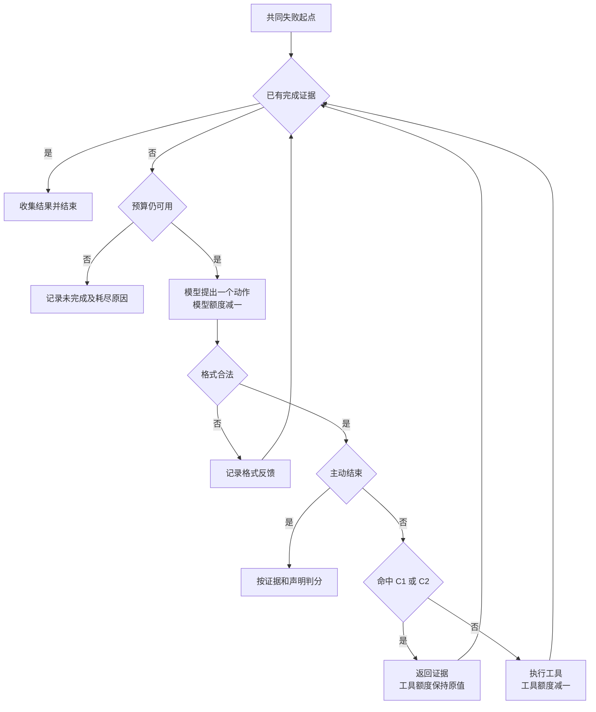
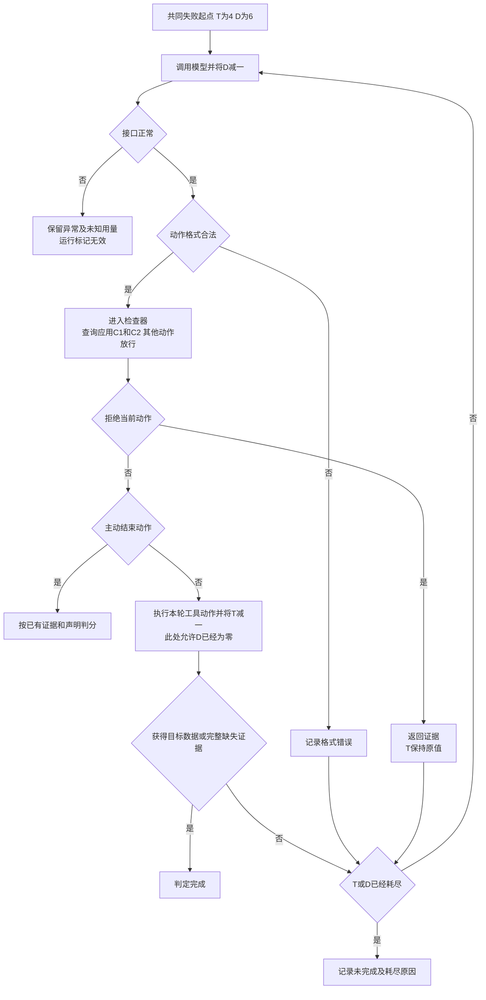
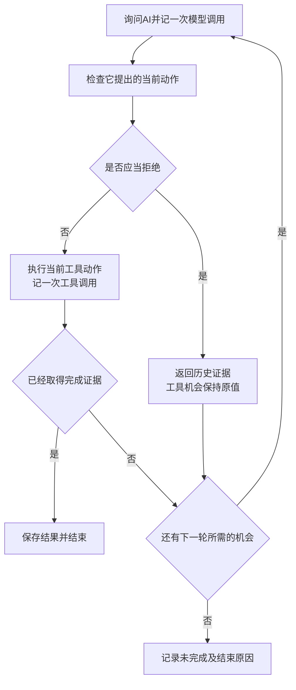
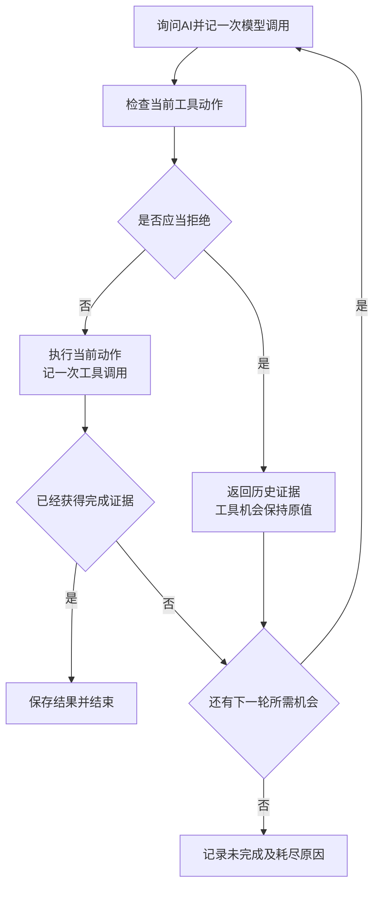

# 本窗口聊天记录

从本机实际会话记录导出，按发生顺序保留用户消息、AI 回复及进度消息。消息中实际引用的粘贴附件全文紧随对应消息。

本机绝对路径已替换为明确占位。导出范围截至本次导出时点，系统上下文、内部推理、工具载荷及自动注入的编辑器状态不纳入聊天正文。

导出日期　2026年11月11日（Asia/Shanghai）

共 79 条可见消息。


## 001　用户　2026-11-08T11:32:45.296Z

我有一份课程作业，需要从课上讲过的知识点里选一个很小的切口，做一点自己的探索，最后通过实验形成报告。我想选 Workflow 和 Agent 的边界，但直接讨论两者的区别太宽了，所以准备只看“工具调用失败之后，下一步由谁决定”这件事。

我的初步想法是，让两套程序用相同的工具完成相同的任务。遇到失败时，一套按提前写好的规则处理，另一套让模型根据当前信息决定怎么处理，再比较任务完成情况和成本。

不过我有个疑问。Workflow 也能写复杂的条件分支，甚至在某个节点调用模型。如果只是拿几条简单规则跟模型比，最后得出模型更灵活，这个实验好像没什么说服力。

你觉得这个切入点值得做吗？先帮我找出这个想法里最关键的问题，再建议一个学生能实际做出来的小实验。先把比较对象和要验证的问题想清楚，报告后面再写。


## 002　AI 进度消息　2026-11-08T11:32:48.296Z

我会先梳理比较对象，重点看怎样避免把“规则写得简单”误当成 Workflow 的局限，再据此设计一个能控制变量的小实验。


## 003　AI　2026-11-08T12:53:01.403Z

值得做。你已经抓到了一个能落实到程序里的切口。**最关键的问题是，怎样把“模型理解了错误信息”与“模型拥有恢复决策权”区分开。** 如果这两件事混在一起，实验即使出现差异，也很难解释原因。

## 一、先把比较对象说清楚

Workflow 可以包含复杂分支，也可以调用模型。Anthropic 的一种常用划分关注的是控制方式，预先编排执行路径，或让模型根据反馈动态决定后续行动。这个划分可以作为你实验的操作性定义。具体到你的题目，应当把观察范围限定在失败恢复环节。[Building effective agents](https://www.anthropic.com/research/building-effective-agents)

建议把研究问题收窄为一句话。

> 在相同工具、可见信息、可选恢复动作和执行预算下，把工具失败后的恢复动作选择交给模型，会怎样影响任务成功率与恢复成本？这种影响在单一故障和组合故障中是否不同？

这里有三个需要提前处理的问题。

### 1. 规则基线的质量会影响结论

规则写得多完整，本身就是实验条件。你可以在开发样例上认真完善规则，包括有限次重试、参数修复、备用工具、重复失败检测和终止条件。

随后冻结规则和模型提示词，再进入测试。这样能让“开发时覆盖过的情况”和“需要重新组合处理步骤的情况”分开。

### 2. 模型可能只是在读懂报错上占了优势

假设规则只识别 `TIMEOUT`，模型却能理解“服务器繁忙，请稍后再试”，成功率差异就同时包含错误理解能力与动作选择能力。

因此，我建议增加一个小的中间对照组。

| 组别 | 错误信息如何理解 | 恢复动作由谁选择 |
|---|---|---|
| A，规则恢复 | 固定解析规则 | 预先写好的策略 |
| B，模型诊断＋规则恢复 | 模型输出规定格式的错误诊断 | 与 A 相同的策略 |
| C，模型决策 | 模型读取错误与执行历史 | 模型逐步选择动作和参数 |

B 的诊断字段必须受约束，例如错误类别、涉及的参数、建议等待时间，避免让它直接输出下一步动作。

**B 与 C 的比较最贴近你的核心问题。** A 与 B 则能帮助解释，收益有多少来自理解报错。三组仍然可以共用一套工具和执行程序，只替换恢复模块。

### 3. 要允许不同方向的结果

预先保留几种可能解释。

- 单一故障上规则表现更好，说明明确故障可以通过固定策略高效处理。
- 组合故障上 C 更好，说明逐步选择恢复动作可能具有价值。
- B 与 C 接近，说明本实验中模型诊断已经提供了大部分收益。
- C 更贵且成功率相近，说明在这个任务范围内，额外决策成本没有换来明显收益。

这样，实验的价值来自辨别条件与原因。

## 二、一个学生能做出来的小实验

### 任务选用一个能自动判分的查询

结合海洋数据课程，可以使用这样一个任务。

> 查询指定站点、指定日期的海表温度，并返回摄氏度数值与数据来源。

准备一个很小的本地模拟数据服务，提供三个工具。

- 查询站点信息，获得标准站点编号。
- 从主数据源获取温度。
- 从备用数据源获取温度。

正常查询、结果整理和单位换算都由共同程序完成。只在工具失败之后，进入不同的恢复模块。恢复模块能够选择重试、查询标准编号、修改参数、切换数据源或终止，并填写对应参数。

使用本地模拟服务，可以准确控制故障、重复实验，也方便自动核对答案。

### 故障只设计三类

| 故障 | 返回的信息 | 合理的恢复方式 |
|---|---|---|
| 临时不可用 | 本次查询超时，下次可以成功 | 有限次重试 |
| 站点标识错误 | 当前名称无法识别，需要标准编号 | 查询编号，再调用 |
| 主源缺少记录 | 主源没有该日期数据，备用源可能有 | 切换备用源 |

另外放入少量两个数据源都无记录的案例，观察系统能否适时终止。

测试分成两部分。

**单一故障组**沿用开发时见过的故障类别，替换站点、日期和数据。

**组合故障组**组合相同的故障类别，例如主源缺少记录，切换备用源后又遇到临时超时。两组程序都可以看到完整历史，规则策略也应支持连续处理错误。

组合故障比较适合检验恢复步骤的重新组合能力。它在这里的含义应明确为“开发样例没有覆盖的故障组合”。

## 三、怎样让比较公平

建议固定以下条件。

1. **从同一个失败现场开始。**  
   三组接收相同任务、失败调用、错误返回和此前历史。这样能集中观察恢复阶段。

2. **三组拥有相同的信息与行动权限。**  
   工具文档、参数要求、历史反馈都一致。模拟器内部的故障安排只用于判分。

3. **限制相同的工具调用预算。**  
   例如失败后最多再调用六次工具。模型调用次数另外设上限，并计入成本。B、C 使用同一个模型版本与相同设置。

4. **故障安排可以重复播放。**  
   例如规定某个数据源的第一次有效请求超时。每组运行前重置环境，避免前一组的调用影响后一组。

5. **测试期间冻结实现。**  
   规则和提示词都只用开发样例调整。发现测试失败后，先记入结果，再考虑后续改进。

## 四、规模和指标可以很小

第一版建议准备约 12 个开发案例、40 个测试案例，测试中单一故障与组合故障各占一半。模型组每例重复三次，用来观察输出波动。确定性规则组每例运行一次即可。这个规模适合课程作业中的探索性比较。

主要记录四项指标。

| 指标 | 判定方式 |
|---|---|
| 任务成功率 | 温度、单位、站点、日期与来源全部正确 |
| 恢复工具调用数 | 从共同失败现场开始计数，成功和失败案例都计入 |
| 模型成本 | 输入与输出 token 数，以及对应费用 |
| 无效重复次数 | 状态没有变化时，重复执行相同的失败调用 |

两个数据源都无记录的案例，单独统计“正确终止率”。把它们混入答案成功率，会让结果难以理解。

分析时，分别展示单一故障与组合故障的结果，再检查“B 成功而 C 失败”和“C 成功而 B 失败”的调用记录。即使样本不大，这些配对案例也能说明决策差异具体发生在哪里。

## 五、这个作业最终能回答到什么程度

你可以把暂定题目写成 **《工具调用失败后的恢复决策权——固定策略与模型逐步决策的对照实验》**。

它能够支持的结论范围是，在这套任务、故障分布、模型和预算下，恢复决策权的配置怎样影响结果。规则覆盖程度和模型版本都需要随结果一起说明。

上面的海温查询、本地故障模拟和三组设计，是我为控制工作量与区分原因提出的方案。目前还没有实验结果。先把 **B 与 C 到底共享哪些信息、模型能够决定哪些动作** 写清楚，就能判断这个切口是否已经足够小、足够可验证。


## 004　用户　2026-11-08T12:56:52.939Z

我觉得“错误理解”和“恢复决策”要分开，这个提醒很重要。不过你加上 B 组以后，我反而觉得还有个问题。B 只能用模型提取出的诊断字段，C 却能直接读原始报错和完整历史，那它们拿到的信息还是不一样，最后可能仍然分不清差异来自哪里。

我想先把实验简化成两组。模拟工具直接返回统一格式的错误信息，两组都能看到相同的错误字段、任务信息和完整调用历史，也拥有相同的恢复动作。一组按固定规则选动作，另一组由模型选。这样先集中研究“谁来决定下一步”，自然语言报错的理解能力以后再考虑。这个取舍是否合理？会损失什么值得研究的东西？

另外，你提到海洋数据课程，但我没有提供过这个背景。我们先用本地模拟的站点温度查询作为实验载体就好。

我现在最担心的是规则组怎么设计。如果它已经能根据当前错误反复选择重试、修正编号、切换数据源，那么你举的组合故障，它似乎也能自然处理。仅仅把两个故障接在一起，真的能检验出模型决策的价值吗？

请你先围绕这个问题推演。给出一个规则组和模型组都合理、信息对等的具体案例，逐步列出它们在每一步能看到什么、有哪些选择，以及什么条件下选择才会影响最终结果。不要预设模型一定更好。如果这三类故障本来就适合规则解决，也请直接指出来，我们再决定是否调整研究问题。

这一轮先把比较逻辑想扎实，实验规模和报告结构暂时放一放。


## 005　AI　2026-11-08T12:58:16.451Z

你的两组方案合理，而且更贴合“失败后由谁决定下一步”这个问题。我之前的 B、C 两组确实保留了信息差异，需要修正。另外，我把工作区名称当成了课程背景，这个推断没有依据。下面只使用本地模拟的站点温度查询。

**你的另一个判断也成立。仅仅把几类故障串起来，通常不足以检验模型决策的价值。** 如果每一种错误都有明确、局部有效的处理方式，规则循环就能自然处理组合故障。

## 一、统一错误信息，这个取舍会损失什么

两组都接收相同的结构化观察，例如任务、错误字段、工具说明、完整调用历史和剩余预算，并拥有相同动作。区别只放在动作选择模块。

这个设计排除了自然语言报错理解上的差异，比较对象更清楚了。

它会暂时放下两个值得研究的方向。

- **从含糊反馈中诊断故障。** 例如根据一段不完整的报错，判断应该重试还是修改参数。
- **面对接口变化时解释新信息。** 例如工具新增了错误提示，但规则解析器还没有更新。

还有一项设计细节。统一格式可以包含 `error_code`、`retryable`、`station_id` 等事实字段。如果直接包含 `recommended_action` 或“下一步切换备用源”，就已经替控制器完成了一部分决策。字段表达得越充分，剩余决策问题可能越简单。

这仍然是有意义的实验条件，只需要明确你让控制器解决的究竟是什么。

## 二、先推演一个两组都能合理解决的案例

### 共同任务与工具约定

任务是查询站点 S 在日期 D 的温度，主源、备用源都能提供符合要求的数据。

两组都提前知道以下工具约定。

- 查询温度必须使用标准站点编号。
- `INVALID_ID` 表示需要查询标准编号。
- `NO_RECORD` 表示该数据源没有这条记录，在本次任务中重复查询不会改变结果。
- `TIMEOUT` 表示本次调用没有取得结果，可以重试，但成功没有保证。
- 查询站点编号也计入工具调用次数。

共同起点是第一次查询已经失败。之后还允许调用工具四次。

### 一个合理的规则控制器

规则组应当使用完整历史维护状态，包括已确认的编号、哪些数据源已经缺少记录、各次查询的超时次数。

它可以按以下策略循环选择动作。

1. 编号无效时，查询标准编号。
2. 某数据源已确认没有记录时，排除该数据源。
3. 查询超时时，允许原参数重试一次。
4. 从尚未排除的数据源中选择一个查询，默认主源优先。
5. 没有可用动作或预算耗尽时终止。

模型组看到同样的约定、状态和历史，自行选择动作。下面列出一条双方都合理的执行路径，模型的实际输出仍需运行后观察。

### 逐步执行

每一步，两组都能看到共同任务、工具约定和此前全部历史。表中列出新增观察与当前关键状态。

| 步骤 | 两组看到的信息 | 可选动作 | 一条合理选择及结果 |
|---|---|---|---|
| 共同起点 | 主源返回 `INVALID_ID`，标准编号未知，剩余 4 次调用 | 查询编号、向任一源查询、终止 | 查询编号，得到标准编号 S17，剩余 3 次 |
| 第二步 | S17 已知，两个数据源的数据可用性都未知 | 用 S17 查询主源或备用源、重新查编号、终止 | 查询主源，返回 `NO_RECORD`，剩余 2 次 |
| 第三步 | 主源已确认无记录，备用源尚未查询 | 查询备用源、重复查询主源、查询编号、终止 | 查询备用源，返回 `TIMEOUT`，剩余 1 次 |
| 第四步 | 主源无记录，备用源首次超时，S17 有效 | 重试备用源、查询主源、查询编号、终止 | 重试备用源，成功取得温度 |

这里假定模拟器为备用源安排了一次超时，下一次查询成功。**这个后续安排只有评测程序知道，两组在第四步都只能看到“首次超时”。**

规则组能够完整走通这条路径。模型组如果选择相同动作，也会成功。

### 什么选择会影响最终结果

在这个具体案例中，四次预算恰好够用，所以额外调用会影响结果。

- 编号无效后，继续用旧编号查询，会浪费一次调用。
- 主源返回 `NO_RECORD` 后再次查询主源，会浪费一次调用。
- 最后一次机会选择终止，会放弃仍可能成功的重试。

这些差异主要检验控制器能否遵守已知工具约定、利用历史、避免无效动作。合理的规则已经可以处理它们。

主源和备用源的先后顺序，也未必产生差异。如果修正编号后先查备用源，再重试，也可能更早成功。因此，不能把预想的那条执行路径当成唯一正确答案。

**这个案例可以作为实现检查，确认两组能够处理连续失败。它对“模型逐步决策是否带来额外收益”的辨别力很有限。**

## 三、怎样才会出现真正需要权衡的决策

考虑另一个失败现场。

两组都知道标准编号。主源刚刚超时，备用源尚未尝试，只剩一次调用。主源重试和切换备用源都可能成功。

这时，两种选择会在以下条件下影响结果。

| 模拟器中的实际情况 | 重试主源 | 切换备用源 |
|---|---|---|
| 主源下一次恢复，备用源无记录 | 成功 | 失败 |
| 主源持续不可用，备用源有记录 | 失败 | 成功 |

但这里还有一道关键检查。

### 情况一，两组没有任何线索区分这两种情况

如果可见信息完全相同，那么单次成功可能只说明选择碰巧符合隐藏环境。模型无法仅凭“动态决策”得知隐藏状态。

此时应该比较给定故障分布下的平均表现。规则可以根据开发数据设置“超时后重试优先”或“切换优先”，模型也只能依据它获得的信息选择。测试环境偏向哪种隐藏情况，会直接影响谁更容易获胜。

### 情况二，共同历史提供了相关线索

例如两组都能看到，主源已经连续超时三次，备用源刚刚成功返回过该站点相邻日期的数据。这些信息可能影响选择。

然而，规则也可以利用它们。你可以写出“主源连续超时达到阈值时切换”的策略，还可以根据开发数据调整阈值。

因此，**“动作选择会影响结果”只是必要条件。你还需要解释，这种选择为什么值得交给模型，以及合理规则在什么约束下存在困难。**

如果状态少、工具语义清楚、有效动作有限，规则策略很可能既容易写，也容易验证。把这些条件交给模型，并不会自动产生优势。

## 四、对当前三类故障的判断

你目前的三类故障确实很适合规则解决。

- 编号错误提供了明确的参数修复路径。
- 确定缺少记录提供了明确的数据源排除依据。
- 临时超时可以通过有限重试和切换策略处理。

把它们串联起来，规则只需要持续更新状态，再应用同一套策略。序列变长本身并没有增加多少决策难度。

现阶段可以保留两条研究方向。

**如果保留当前故障设计**，研究问题可以调整为，在错误语义明确、动作空间有限的恢复任务中，模型决策能否达到固定规则的可靠性，需要付出多少额外成本。规则表现更好、两组接近、模型出现多余调用，都是有解释价值的结果。

**如果仍想研究动态决策的收益**，则需要增加一个具体的权衡来源，例如有限预算下的重试与切换，且成功概率能够从共同历史中得到部分判断。随后要给规则组一个认真设计的、使用这些信息的策略，再比较两者。这个扩展会把问题带向“不完全信息下的恢复策略”。

我的判断是，先保留统一信息的两组设计。当前三类故障足以构成一个清楚、可验证的小实验，但它们尚不足以支撑“组合故障能够体现模型决策价值”这一预期。先承认规则可能已经足够，比较逻辑反而会更扎实。


## 006　用户　2026-11-08T13:28:04.165Z

我想保留当前这三类故障。为了让模型显得有用，再不断增加任务难度，容易把实验带偏。我接受规则已经足够，也接受最后发现模型更贵、表现还更差。

不过，单纯比较谁的成功率高，还没有回应作业里“提出自己的改进思路”这个要求。我想顺着你提到的多余调用，试一个更具体的改进。

模型仍然负责选下一步，但执行前加一道检查。检查只根据工具约定和已有历史，拦住已经可以确认无效的动作。比如某个数据源已经明确返回该日期没有记录，模型又用相同参数去查询，就把这个动作退回，并告诉它为什么，让它重新选择。对于超时后的重试，因为仍然可能成功，就不能简单地按“重复调用”拦截。

我觉得这里值得研究的地方是，怎样利用少量确定的约束，减少模型浪费有限的恢复机会，同时给它保留选择空间。但我还不确定，这是不是只是常见的动作校验，能算多大程度的改进。

你先帮我审查这个想法，重点看三个问题。

第一，在当前任务里，哪些动作能根据已知信息确定无效，哪些只是看起来不划算？请给出明确的判定条件和容易误拦的反例，尤其考虑参数已经修正、数据源已经切换的情况。

第二，动作被退回后，模型重新选择也要花成本。如果允许它无限重选，实验就不公平了。怎样设置统一的工具预算和模型决策预算，才能把这部分代价算清楚，同时避免检查模块暗中替模型选择下一步？

第三，这种方法和已有的动作校验、约束执行有什么关系？请核查相关的一手资料。如果它属于已有思路的应用，就明确说明，并帮我判断，我们能否围绕一个具体的机制或可验证的假设形成课程作业层面的贡献。

先别写代码。我想先知道这个改进是否站得住，以及出现什么实验结果时，我应该承认它没有价值。


## 007　AI 进度消息　2026-11-08T13:28:12.404Z

我会先逐项检查哪些动作能被确定排除，再核查已有的动作校验与约束执行方法，重点看退回重选的成本和检查模块的权限边界。


## 008　AI　2026-11-08T13:30:28.343Z

这个改进站得住。**它属于已有约束执行思路在具体任务中的应用，课程作业的贡献可以落在约束的精确定义、预算核算，以及收益是否抵得过重选成本上。**

最需要守住的条件是，“确定无效”必须由工具约定和可见历史推出。检查器能够保证拦截某些无效调用，但任务成功率与总成本仍需实验判断。

## 一、哪些能够确定拦截

先为当前模拟任务明确两条约定。

- 一次任务使用固定的数据快照，查询不会改变数据或接口状态。
- `NO_RECORD` 只在参数已通过验证后返回，表示指定数据源中，指定站点、日期和变量确实没有记录。

这两条约定让历史中的否定信息能够持续生效。

可以采用下面的判定标准。

> 在所有符合工具约定、且与当前历史一致的环境状态中，该动作都无法取得所请求的有效数据，也无法提供新的相关信息，才允许按“确定无效”拦截。

### 建议先只实现两条历史约束

| 历史证据 | 拦截条件 | 容易误拦的反例 |
|---|---|---|
| `INVALID_ID` 明确指出编号无效 | 相同编号被再次用于同一个编号命名空间，且接口约定与状态未变化 | 参数已改成有效编号，应放行。备用源使用另一套编号体系，也应重新判断 |
| 参数有效的查询返回 `NO_RECORD` | 数据源、标准站点身份、日期、变量、数据快照均与已确认无记录的查询一致 | 切换数据源、改变日期或纠正站点身份后，历史证据可能已经不适用 |

这里有两个细节。

**第一，按照错误涉及的范围匹配。**  
如果编号在某个数据源中全局无效，改日期也无法修复它。如果“编号无效”的含义只涉及某个接口，换接口后便需要重新判断。

**第二，按工具定义的语义判断请求是否相同。**  
例如 `S17` 与某个站点别名是否表示同一站点，需要已验证的映射。检查器不能凭字符串相似度合并它们。

### 一组具体反例

假设历史已有两条记录。

1. 主源使用旧编号 `OLD7`，返回 `INVALID_ID`。
2. 查询编号后得到 `S17`，用它查询主源指定日期，返回 `NO_RECORD`。

接下来应当如此处理。

| 模型提出的动作 | 处理 | 依据 |
|---|---|---|
| 再用 `OLD7` 查询主源 | 拦截 | 旧编号在主源仍然无效 |
| 用 `S17` 查询主源相同日期、变量 | 拦截 | 该请求已确认无记录 |
| 用 `S17` 查询备用源 | 放行 | 主源的缺失记录不能推出备用源也缺失 |
| 用 `S17` 查询主源另一日期 | 放行此项检查 | 缺失证据只涉及原日期 |
| 备用源超时后，以相同参数重试 | 放行 | 超时没有证明数据缺失或参数无效 |
| 再查询一次已获得的标准编号 | 暂不纳入拦截 | 可能冗余，但需要另外证明返回完全确定、没有新信息 |

最后一项可以以后研究，第一版保持两条约束就足够。

### 以下情况只能判断“可能不划算”

- 连续超时后继续重试。
- 尚未尝试备用源，却继续查询主源。
- 已经知道标准编号，又查询一次编号。
- 剩余预算很少时，选择一个成功机会看起来较小的动作。

尤其是连续超时。即使连续五次失败，第六次仍可能成功。重试次数上限可以作为所有组共享的执行限制，但它表达的是预算政策。

还有一个很容易忽略的反例。如果一次查询可以触发后台更新、推进恢复状态或等待真实时间过去，即使返回相同错误，重复执行也可能有作用。因此，你的“确定无效”判定依赖前面约定的固定快照与只读查询。

## 二、统一预算，同时把退回成本完整计入

研究改进效果时，主要对照应当是**原始模型控制器与加入检查器的同一模型控制器**。固定规则组仍可保留为原研究问题的参照。

### 两本独立账目

| 项目 | 如何扣减 |
|---|---|
| 工具预算 \(T\) | 每次真正提交给模拟工具的调用扣一次，成功、超时、编号错误和无记录都计入 |
| 模型决策预算 \(D\) | 每次调用模型生成动作扣一次，包括首次选择和被退回后的重新选择 |

被拦截的动作消耗一次模型决策，工具调用数保持原值。这样恰好体现你要研究的交换关系——付出重选成本，保留工具调用机会。

还应统一以下设置。

- 每次模型调用只提出一个动作。
- 两个模型组使用相同的 \(T\)、\(D\)、模型设置和单次输出上限。
- 两组都有相同的累计 token 上限，所有重选输入、拒绝反馈和输出都计入。
- 工具或决策预算耗尽后，执行器按统一规则终止，已取得的有效数据直接交给共同判分程序处理。

有了全局 \(D\)，无限重选就受到限制。第一版可以只使用这个全局限制，避免再引入每一步的局部重选额度。

**预算上限相同，并不意味着实际成本相同。** 最终仍需分别记录工具调用、模型调用、输入输出 token、检查耗时及总耗时。失败任务消耗的资源也要计入。

### 一个能看清交换关系的例子

假设两组都剩余两次工具调用、三次模型决策。主源已确认无记录，备用源仍可尝试。

两组第一次都提出“重复查询主源”。

| 后续过程 | 原始模型组 | 加检查器组 |
|---|---|---|
| 第一次选择 | 执行无效查询，剩 1 次工具、2 次决策 | 退回，剩 2 次工具、2 次决策 |
| 第二次选择 | 查询备用源，超时，工具预算耗尽 | 查询备用源，超时，剩 1 次工具、1 次决策 |
| 第三次选择 | 已终止 | 若模型选择重试且成功，则完成任务 |

这说明检查器可能怎样产生收益。另一种结果也完全可能发生——模型被退回后继续提出相同动作，耗尽决策预算，任务仍然失败。

因此，“拦下了几次调用”和“因此多完成了几个任务”需要分别统计。

### 检查器的权限要固定

建议检查器只返回三项信息。

- 命中的约束编号。
- 支持判定的历史记录编号。
- 简短的拒绝原因。

例如，“记录 5 已确认主源对 S17、日期 D 的温度记录缺失，当前请求处于相同数据快照。”

模型负责提出替代动作与参数。检查器只判定当前提案，并保留完整审计记录。

两组的初始工具说明和提示词都应包含相同约定与约束。加入检查器组获得的额外反馈，是对共同历史的即时引用。这也是干预的一部分，所以能够检验的是**拦截加证据反馈的整体机制**。若将来要区分两部分的贡献，才需要额外对照。

另外，退回动作不应推进模拟器的工具调用序列或故障状态。对于只读查询，模拟器也应避免让一次无关的无效调用改变另一个数据源的恢复进程。

## 三、与已有方法的关系

核查的一手资料表明，你的总体思路已有明确先例。

| 已有方向 | 与你的方案的关系 |
|---|---|
| 执行前校验与中间件 | LangChain 官方文档提供工具执行前的拦截位置，并允许直接结束当前工具调用。你的两条历史约束可以在这一位置执行。[官方文档](https://docs.langchain.com/oss/python/langchain/middleware/custom) |
| Shielding，运行时约束执行 | Alshiekh 等人的工作使用独立模块，根据规范限制或修正学习器动作。你的方案与这种分工有联系，具体目标是避免已知无效查询，其保证范围取决于所写约定与约束。[原始论文](https://arxiv.org/abs/1708.08611) |
| 无效动作屏蔽 | Huang 与 Ontañón 研究从可选集合中屏蔽无效动作。你的机制放在动作提出之后，通过退回触发重选，重选开销因此成为直接问题。[原始论文](https://arxiv.org/abs/2006.14171) |
| LLM 动作检查与重新生成 | Sentry 的执行流程包含对不可执行动作进行检查，再要求任务模型输出修正动作。它还包含更广泛的诊断与恢复知识机制。该资料是预印本。[原始论文，第 3.1 节](https://arxiv.org/html/2610.02994v1) |

据此，“模型提出动作，外部检查后退回重选”应当明确归为已有思路的应用。这轮核查足以确认其先例，尚未覆盖全部相关研究。

## 四、课程作业可以贡献什么

可以把贡献集中到一个具体问题。

> 在结构化错误、固定数据快照和双重预算下，按错误语义及作用范围拦截已知无效动作，能否提高模型恢复的资源利用效率？

其中有三个可验证的主张。

1. **判定正确性。** 两条约束能否准确区分已知无效查询、参数修正后的新查询、切换数据源后的新查询，以及超时重试。
2. **恢复收益。** 节省下来的工具机会，是否被模型用于取得有效结果。
3. **成本交换。** 收益能否覆盖额外模型决策、token 和延迟。

“参数已修正”“数据源已切换”“超时后重试”应当专门用来检查误拦。由于模拟环境很小，可以根据完整工具约定检查这些动作的有效性。评测程序可以使用环境真值，检查器的输入则始终限定为公开约定和历史。

这足以形成课程作业层面的独立探索，算法原创程度应据实表述。

## 五、什么结果应当让你承认它没有价值

需要提前区分几种否定结果。

| 实验结果 | 应当承认的结论 |
|---|---|
| 原始模型几乎从不提出这两类无效动作 | 当前任务里缺少需要干预的实际问题 |
| 无效调用减少，但成功率相近，总成本和耗时上升 | 当前条件下缺乏净收益 |
| 退回后模型频繁继续犯错，决策预算更早耗尽 | 保留工具机会未能转化为恢复能力 |
| 拦住修正参数后的请求、备用源查询或有效超时重试 | 约束实现或适用范围有误，需要修正后重新评估 |
| 成功率提高，同时模型成本明显上升 | 得到了可量化的成本交换，价值取决于事先明确的成本标准 |
| 只有忽略重选成本、或给检查组更多决策额度才出现优势 | 原比较中的优势无法归因于公平预算下的改进 |

对这个作业而言，最值得检验的是**少量语义明确的约束，能否以可接受的重选代价，把有限工具机会留给仍可能有效的动作**。这个假设可能成立，也可能在当前简单任务中没有实际收益。两种结果都能回应你的研究问题。


## 009　用户　2026-11-08T13:56:25.971Z

我决定沿着这个方案做，但把贡献说得克制一点。执行前检查和退回重选已有先例，我这次主要验证，两条依赖历史的约束，在工具预算有限时到底能不能带来净收益。

这里还有一个容易影响结果的问题。你举的例子里，模型第一次重复查询主源，被拦截以后才有机会成功。但实际模型未必会犯这个错误。如果我在提示词里诱导它重复，或者人为安排它先犯错，就无法说明正常使用时有没有价值。所以我想把“检查器能否正确拦截”和“真实模型运行时是否受益”分开验证。

我们先做一个小规模试跑，暂定三组，固定规则、原始模型、同一个模型加检查器。两个模型组使用相同的初始提示词，都提前知道工具约定和这两条约束。检查组只额外获得被拦截时的证据反馈。每次模型调用只选一个动作，恢复阶段最多执行四次工具调用、调用模型六次，重选也计入六次之内。

请先帮我把试跑落实成一份可以照着实现的实验规格，重点解决下面几件事。

1. 用八个案例检查实验流程，覆盖编号修复、主源无记录、超时重试和必要的连续故障，也包含应当正确终止的情况。不要专门挑检查器容易赢的案例。每例明确共同失败起点、可见历史、隐藏环境，以及成功或正确终止的判定标准。
2. 把模拟器的故障触发方式定义清楚。相同请求在不同组里应当面对一致的环境，但被拦截的动作不应推进环境状态，无关查询也不能把另一个数据源的超时“消耗掉”。同时说明这种模拟方式对结论有什么限制。
3. 单独列一小组检查器测试，验证它不会误拦参数修正、切换数据源和超时重试。这部分可以人工构造动作，但统计时必须和真实模型的任务成功率分开。
4. 给出三组共用的记录格式，让我能从每一步记录中核对模型提案、拦截依据、实际执行、剩余预算及成本。先分别记录工具次数、模型调用次数、token 和耗时，费用等选定实际模型后再算。

另外，先写下试跑后的判断标准。如果原始模型很少提出可拦截动作，我们就如实记录，先排查原因，再决定是否值得扩大实验，不为了做出正面结果临时修改测试案例。

这一轮先把规格定下来。如果其中还有必须由我选择的实现条件，请集中指出。实际模型还没有选定，暂时不要用模拟回复冒充模型实验结果。


## 010　AI 进度消息　2026-11-08T13:56:31.279Z

我会把八个任务案例、故障触发规则、检查器测试和逐步日志整理成可实现的规格，并将人工构造的检查测试与真实模型运行结果分开记录。


## 011　AI　2026-11-08T13:59:13.458Z

下面可以直接作为试跑的实现规格。八个任务案例用于检查完整流程，人工动作测试单独验证检查器。实际模型尚未选定，本轮只有设计规格。

:::writing{variant="document" id="61482"}
# 工具失败恢复试跑规格 v0.1

## 1. 目标与比较对象

验证两条依赖历史的执行前约束，在有限工具预算下，能否为模型恢复带来净收益。

三组使用相同任务、工具约定、共同失败起点和可见历史。

| 组别 | 下一步动作的选择方式 | 执行前历史检查 |
|---|---|---|
| 固定规则组 R | 冻结的确定性规则 | 在规则自身选择动作时使用历史 |
| 原始模型组 M | 模型每次提出一个动作 | 直接提交符合接口格式的动作 |
| 模型加检查器组 MC | 与 M 相同的模型和初始提示词 | 对提案执行两条历史约束，命中则退回重选 |

M 与 MC 的初始提示词完全相同，均提前包含工具约定、两条约束、预算和输出格式。MC 仅在动作被拦截时额外接收证据反馈。

主要改进比较是 MC 与 M。R 提供当前任务中固定策略的表现参照。

## 2. 共同任务与工具约定

### 2.1 任务

查询指定站点、日期的温度，返回摄氏度数值和数据源。

主源 P 与备用源 B 均被任务接受。每例只设置一个目标站点、日期和变量。

### 2.2 工具与动作

工具包括以下两种。

- `resolve_station(alias)`，返回站点的标准编号。
- `query_temperature(source, station_id, date, variable)`，返回温度或结构化错误。

另有本地结束动作 `finish`，可以提交答案、声明已确认无记录，或报告尚未完成。

`finish` 不消耗工具预算。模型选择 `finish` 时消耗一次模型调用。成功返回有效目标数据后，共同执行器可直接收集结果并结束，避免额外的答案生成调用。

### 2.3 固定约定

- 一次任务使用固定快照，查询为只读操作。
- P、B 在本试跑中共享同一个标准编号命名空间。
- 标准编号查询为确定性操作，本试跑中始终正常返回。
- 编号验证先于记录查询。
- `INVALID_ID` 明确表示该编号在共享命名空间中无效。
- `NO_RECORD` 只在编号及其他参数有效后返回，表示该数据源对指定站点、日期、变量确实无记录。
- `TIMEOUT` 表示本次查询未取得结果，无法据此确认记录存在或缺失。
- 模型及检查器均无法读取隐藏故障安排。
- 返回内容使用统一结构。任务数据中不包含诱导动作的文字。

## 3. 两条历史约束

### C1，重复使用已确认无效的编号

若历史中已有 `INVALID_ID`，当前动作又在同一命名空间使用该无效编号查询，则拦截。

适用范围由编号命名空间决定。由于本试跑两源共享命名空间，切换数据源不能使旧编号有效。

使用修正后的有效编号，应通过此项检查。

### C2，重复查询已确认缺失的记录

若历史中存在有效参数查询返回的 `NO_RECORD`，当前请求与其具有相同的数据源、标准站点身份、日期、变量及快照，则拦截。

切换数据源、改变日期或改变实际站点身份后，该历史证据不再足以支持拦截。

请求等价关系只使用工具约定和已验证的编号映射。无法确认等价时放行。

### 检查器输出

每次检查返回 `allow` 或 `reject`。拒绝反馈包含以下字段。

- 约束编号。
- 命中的历史记录编号。
- 当前请求与历史证据匹配的字段。
- 固定模板生成的简短原因。

检查器仅评估当前提案。替代动作及参数由模型重新提出。

接口格式校验作为三组共用的基础设施单独记录，其效果不归入 C1、C2。

## 4. 八个任务案例

### 4.1 表格约定

- 每例都有目标站点、日期、变量和固定快照。
- S 表示该例的有效标准编号，OLD 表示已确认无效的旧编号。
- 除案例 1、4 外，共同历史已包含标准编号查询成功，故两组均知道 S。
- “成功”表示返回正确的目标温度、单位和来源。
- 所有共同起点之前的调用均写入历史。恢复预算从共同起点之后重新计数。
- 表内隐藏安排仅供模拟器和评测程序读取。
- 所列后续故障是条件安排，控制器可以选择其他合法路径。

| 案例 | 共同失败起点与可见历史 | 隐藏环境 | 判定标准 |
|---|---|---|---|
| 1，编号修复 | 使用 OLD 查询 P，返回 `INVALID_ID`。标准编号未知 | 解析别名得到 S。P、B 使用 S 查询均直接成功 | 获得任一源正确温度为成功。声明无记录为错误 |
| 2，主源缺失 | 已知 S。P 返回 `NO_RECORD` | P 固定无记录，B 直接成功 | 从 B 获得正确温度为成功 |
| 3，单次超时 | 已知 S。P 首次有效查询返回 `TIMEOUT` | P 后续查询直接成功，B 也可直接成功 | 任一源返回正确温度为成功。允许重试或切换 |
| 4，编号修复后连续故障 | 使用 OLD 查询 P，返回 `INVALID_ID`。标准编号未知 | 解析得到 S。P 无记录。B 第一次有效查询超时，之后成功 | 获得 B 正确温度为成功。解析、查 P、查 B、重试 B 的路径恰好需要四次恢复工具调用，也允许其他路径 |
| 5，重复超时与切换 | 已知 S。P 首次有效查询超时 | P 第二次有效查询仍超时，第三次起成功。B 直接成功 | 任一源返回正确温度为成功。继续重试与切换都有可行路径 |
| 6，主源缺失后备用源超时 | 已知 S。P 返回 `NO_RECORD` | P 固定无记录。B 第一次有效查询超时，之后成功 | 从 B 获得正确温度为成功 |
| 7，两源均缺失 | 已知 S。P 返回 `NO_RECORD` | B 也返回 `NO_RECORD` | 取得两源缺失证据后，结束并声明无记录，记为正确终止。证据不足便声明无记录，记为无依据终止 |
| 8，持续不可用 | 已知 S。P 首次有效查询超时 | P 在本次运行中持续超时，B 无记录 | 本例无法取得温度。预算耗尽后报告未完成，或主动报告尚未完成，均保留为未完成结果。声明两源都无记录为错误 |

### 4.2 案例 8 的特殊说明

案例 8 用来检查持续失败、预算终止和结果表述。

控制器只能知道 P 查询失败，无法确认 P 没有记录。它可以报告未完成，执行器也可以在预算耗尽时终止。

此例单独报告未完成及终止原因。它与案例 7 的“有证据确认无记录”分开统计。

八例均使用正常任务提示。提示词不要求重复查询，也不预先注入某个模型错误动作。

## 5. 模拟器的故障触发规则

### 5.1 按请求分别维护状态

每个有效查询使用以下请求键。

`工具名、数据源、标准站点身份、日期、变量、快照`

每个请求键独立维护调用计数及响应序列。例如案例 5 中 P 的目标查询序列为“超时、超时、成功、成功……”。

这样，无关查询和另一个数据源的查询无法消耗该请求的超时。

### 5.2 计数与推进

- 只有实际进入模拟工具的调用才可能改变模拟器计数。
- 被检查器退回的提案不进入工具，也不推进响应序列。
- 无效编号调用返回 `INVALID_ID`，消耗工具预算，但不推进任何有效数据查询的序列。
- `resolve_station` 不推进温度查询序列。
- 每个有效查询只推进自身请求键的序列。
- 固定缺失记录始终返回 `NO_RECORD`。
- 持续超时记录始终返回 `TIMEOUT`。
- 成功查询重复执行时返回同一条数据。

### 5.3 初始化与重置

每组运行前加载独立环境副本。

共同前缀通过同一初始化程序生成，生成后保存公开历史与环境检查点。三组从该检查点的独立副本开始。

因此，若共同起点已包含 P 的第一次超时，该超时已经消耗 P 序列的第一项。

检查器只能读取公开历史，无法读取检查点中的隐藏序列与计数安排。

### 5.4 一致性的含义

相同请求在相同的自身调用序号上，获得相同响应。

三组选择的动作路径可能不同，所以各组的全局第几步无需返回相同错误。

### 5.5 对结论的限制

这种方式排除了真实时间、网络负载、并发和后台更新的影响。

超时恢复由该请求的有效调用次数驱动。因此，试跑结论仅适用于这个可重复的模拟环境。它不能直接说明真实网络服务中的等待与重试效果。

## 6. 预算与固定规则组

### 6.1 恢复阶段预算

- 实际工具调用最多四次。
- M、MC 的模型调用最多六次。
- 每次模型调用只提出一个动作。
- 退回重选消耗模型调用额度，工具额度保持原值。
- 达到工具上限后，共同执行器停止后续恢复。
- 第六次模型调用提出的动作仍可检查、执行。完成该动作后，如果任务仍未结束，则终止。
- 提交答案、主动终止、工具预算耗尽、模型预算耗尽分别记录。
- 接口格式错误消耗模型调用，反馈后继续时仍受六次上限约束。未进入工具的格式错误不消耗工具额度。

实际模型确定后，固定相同的单次输出限制和累计 token 上限。任何 token 上限触发均单独记录。

R 无模型调用，记录为零。它同样最多执行四次工具调用。

### 6.2 固定规则策略

实现前将以下规则冻结。

1. 已取得有效目标数据则结束。
2. 两源均有目标记录缺失证据，则声明无记录并结束。
3. 编号未知或已确认无效时，解析站点编号，随后使用标准编号。
4. 从尚未确认缺失的数据源中选择查询，默认 P 优先。
5. 某源首次超时后，允许立即重试一次。
6. 再次超时后，若另一个源尚未确认缺失，则切换。
7. 若只剩一个尚未确认缺失的源，则继续尝试该源，直至成功或预算耗尽。

超时次数按有效请求键记录，所有可见前缀中的超时也计入。切换数据源不清空已有计数。

## 7. 独立检查器测试

以下测试使用人工构造的历史和动作，只验证检查器判定。

| 测试 | 历史与待检查动作 | 预期 |
|---|---|---|
| V1 | OLD 已返回 `INVALID_ID`，再次用 OLD 查询 P | C1 拦截 |
| V2 | 同一历史，改用已解析的 S 查询 P | 放行 |
| V3 | OLD 在共享命名空间已无效，改用 OLD 查询 B | C1 拦截 |
| V4 | P、S、日期 D 已返回 `NO_RECORD`，相同查询再次提出 | C2 拦截 |
| V5 | 同一缺失历史，使用 S 查询 B 的日期 D | 放行 |
| V6 | 同一缺失历史，查询 P 的另一日期 D2 | 放行 |
| V7 | P、S、D 返回 `TIMEOUT`，原参数重试 | 放行 |
| V8 | P 已无记录，B 刚刚超时，模型重试 B | 放行 |

额外检查每次拒绝前后的模拟器状态摘要，确认拒绝没有推进环境。

这部分报告预期与实际判定、错误拦截和遗漏拦截。人工构造动作不进入真实模型提案数量、任务成功率或成本收益统计。

## 8. 共用记录格式

### 8.1 运行级记录

每次运行保存以下字段。

| 类别 | 字段 |
|---|---|
| 身份 | 实验版本、案例编号、运行编号、组别 |
| 配置 | 工具及规则版本、检查器版本、提示词全文或文件及摘要 |
| 模型 | 模型标识、可用的版本信息、生成设置、输出与 token 上限 |
| 环境 | 案例配置版本、快照编号、共同前缀编号、初始检查点摘要 |
| 预算 | 工具上限 4、模型上限 6 |
| 结果 | 最终状态、答案及来源、是否正确、终止原因 |
| 汇总 | 工具次数、模型调用次数、各类 token、总耗时 |

原始模型响应应保留，动作解析结果另存。模型提供商返回的 usage 原样保存，再生成统一统计字段。

### 8.2 每一步记录

三组共用同一事件结构。无对应内容的字段使用空值，并保留原因。

| 类别 | 字段 |
|---|---|
| 步骤身份 | 步骤编号、运行编号、开始及结束时间 |
| 输入 | 当步可见任务、公开历史记录编号、预算状态 |
| 提案 | 提案来源、模型原始响应、解析后的动作与参数 |
| 决策计数 | 本步模型调用序号、调用前后剩余额度 |
| 检查 | 是否启用、允许或拒绝、约束编号、证据记录编号、匹配字段、反馈全文 |
| 执行 | 是否执行、未执行原因、实际工具名及参数、工具返回 |
| 工具计数 | 执行前后工具剩余额度 |
| 成本 | 输入 token、输出 token、其他可用 token 明细、模型耗时、检查耗时、工具耗时、整步耗时 |
| 环境审计 | 执行前后状态摘要、请求键及其自身调用序号 |
| 结果 | 是否结束、结束原因、当前是否已有有效答案或完整缺失证据 |

环境审计字段供离线核对，禁止混入模型输入或检查器输入。

M 的动作是否“本可被 C1/C2 拦截”，由离线程序根据动作提出之前的历史标注。该标注在运行结束后进行。

费用字段暂留空，选定实际模型后再按记录的用量计算。

## 9. 试跑后的判断标准

### 9.1 先检查流程有效性

出现以下任一情况，先修正流程，再重新运行。

- 三组共同前缀或环境初始化不一致。
- 拒绝动作推进了环境。
- 无关请求推进了其他请求的超时序列。
- 检查器误拦编号修正、切换数据源后的有效请求或超时重试。
- 模型组的提示词、预算或工具说明不一致。
- 检查器读取了隐藏环境信息。

有流程缺陷的运行保留记录并标注作废。

### 9.2 再检查自然发生的干预机会

原始模型组单独统计以下项目。

- 提出过至少一次可拦截动作的任务数。
- 可拦截提案数及全部提案数。
- C1、C2 各自命中数。
- 这些调用是否实际挤占了后续恢复机会。

若八例中仅零例或一例出现可拦截动作，作为“干预机会稀少”的排查信号。该阈值只用于试跑决策。

优先检查任务与提示是否正确、历史是否充分、预算是否形成约束、模型是否自然遵守约定，以及离线标注是否遗漏。

随后决定是否值得扩大实验。案例调整如确有理由，建立新版本，保留本轮结果。

### 9.3 判断收益与代价

分别报告以下结果。

- 正确数据获取、正确无记录终止、未完成、错误答案或无依据终止。
- 全部任务的实际工具调用数。
- 全部任务的模型调用数、token 和耗时。
- MC 的拒绝次数，以及拒绝后取得有效进展或耗尽预算的情况。

预先采用以下解释。

- 无效调用减少、完成情况接近、模型成本和耗时上升，说明当前条件下缺少净收益。
- 完成情况改善、模型成本也上升，说明存在成本交换，待实际费用和使用目标明确后判断。
- 模型调用反复消耗在退回重选上，说明检查机制未能把保留的工具机会转化为恢复收益。
- 原始模型很少提出可拦截动作，说明当前任务中干预机会有限。
- 各项表现接近，说明此次试跑尚未观察到实质收益。

本轮规模仅用于核对流程和观察机制，结果保留为描述性记录。
:::

实现前还有一项必须选择的条件——**实际模型及其调用接口**。确定后需要固定生成设置、单次输出限制和累计 token 上限。

规格中暂采用了“两源共享编号体系、固定只读快照、编号解析始终成功”的实现条件。它们让两条约束的适用范围明确，也会限制结论的推广范围。


## 012　用户　2026-11-08T16:20:10.988Z

这份规格已经可以往实现推进了。我接受共享编号、固定只读快照和编号解析始终成功这三个简化条件，先把实验做完整。

不过，实现前我想修正两个细节。

第一，规则策略里“默认 P 优先”和“再次超时后切换”可能发生冲突。比如 P 连续超时两次，切到 B 后，B 第一次也超时，下一步到底是重试 B，还是重新按 P 优先选择？请把规则写成确定的状态转移，让相同历史始终得到相同动作，避免实现时临时解释。

第二，如果第四次工具调用恰好返回 B 的 `NO_RECORD`，历史已经足以确认两源都无记录，但工具预算也刚好耗尽，此时应该怎么判？我倾向于让三组共用的执行器在每次工具返回后，先检查是否取得正确数据或完整缺失证据，再检查预算。这样不会因为少了一次表达“结束”的机会，把已经完成的任务判成失败。请统一主动结束和预算耗尽时的判分逻辑，同时保留模型无依据声明无记录的错误记录。

修正以后，请用 Python 实现最小可运行版本。先完成模拟器、共同前缀初始化、固定规则控制器、两条历史检查、预算管理、日志和八个案例，以及独立的检查器测试。依赖尽量少，让我能按你给的步骤在本地运行。

实际模型和接口暂时还没确定，请把模型调用留成一个清楚的接口。可以用预先写好的动作序列测试退回重选、格式错误和预算耗尽，但运行结果要明确标为程序测试，和真实模型实验分开保存。没有配置真实模型时，应明确提示该部分尚未运行。

请实际检查这几个关键性质，拒绝不改变模拟器状态，无关请求不消耗别的请求的超时，三组从相同检查点开始，最后一次工具调用的结果会先判定再终止。如果你有执行环境，就运行后给出实际结果。如果无法执行，就说明，并给我本地运行方法。

这轮先把程序跑通，真实模型的选择和接入下一轮再处理。


## 013　AI 进度消息　2026-11-08T16:20:15.035Z

我会先把规则写成确定的状态转移，并统一工具返回后的判分顺序，再实现最小程序。动作序列测试会与真实模型实验分开保存，最后实际运行检查你列出的关键性质。


## 014　AI 进度消息　2026-11-08T16:22:49.181Z

核心程序已写好。规则会根据最近一次查询结果和各请求的超时计数转移，不会在切换后重新套用“P 优先”。执行器也已按“先检查数据或完整缺失证据，再检查预算”的顺序处理返回。接下来用独立测试核对这些边界，包括第四次调用刚好补齐缺失证据的情况。


## 015　AI　2026-11-08T16:25:28.393Z

已实现并实际运行，仅依赖 Python 标准库。

- [运行说明与确定性状态转移表]([项目目录]/README.md)
- [主程序及模型接口]([项目目录]/experiment.py)
- [独立测试]([项目目录]/test_experiment.py)

**28 项程序测试全部通过**，包括拒绝不改变环境、请求计数相互独立、三组检查点一致，以及第四次调用补齐成功或缺失证据时优先判定完成。

规则组八例得到六例成功、一例正确确认无记录、一例持续超时后未完成，均符合预期。P 切换至 B 后，B 首次超时会重试 B。

[运行摘要与分组结果]([项目目录]/results/implementation-check/summary.json)已保存。动作序列结果单独存放在 `program_tests`，真实模型状态明确标为 `NOT_RUN`，token 与费用尚未实测。

在当前目录运行即可复查。

```sh
python3 -m unittest -v
python3 experiment.py
```


## 016　用户　2026-11-09T05:21:09.132Z

程序测试和规则组结果已经有了，接下来接入真实模型，看看它在正常提示下到底会不会提出那些可拦截的动作。

先把现有案例、规则和检查器冻结为 v0.1。之后发现程序错误可以修复，但要记录修改原因，涉及实验行为的修改需要重新运行对应结果。

请先检查当前模型接口，以及当前环境已经配置好的模型调用方式。只检查配置是否可用，密钥保留在本地，输出中不要出现密钥值。如果有可用接口，说明它对应的提供商、准确模型标识，以及能否取得实际 token 用量。如果还缺配置，就集中告诉我需要补充哪些信息，并给出最短的配置步骤。

接入时，我希望先解决几个会影响实验可信度的问题。

两个模型组使用同一个调用函数和同一份初始提示词。提示词要让模型知道工具语义和预算，但不要透露案例编号、隐藏故障安排、参考路径或所属实验组。请把最终提示词展示出来，让我检查有没有无意中的暗示。

每次请求只产生一个动作，保留原始响应和解析结果。接口异常与模型产生的格式错误要分开记录。接口异常可能导致整次运行无效，模型格式错误则按我们已经确定的规则消耗决策次数。尤其要考虑请求已经提交、客户端却超时的情况，避免自动重试后漏记调用或费用。无法确认的用量标为未知。

第一轮先按八个案例、M 和 MC 各运行一次设计，共十六次任务运行，每次最多六次模型决策。这个规模先用来观察自然发生的干预机会，暂时不据此判断普遍效果。两组运行顺序交替安排，记录实际顺序和生成设置。

请先完成接口接入准备、提示词和调用前检查，并说明这轮最多可能发起多少次模型请求。等模型配置和费用条件明确后，再开始正式调用。程序测试结果继续单独保存。


## 017　AI 进度消息　2026-11-09T05:21:13.366Z

我会先冻结现有案例、规则和检查器，再检查本地接口配置并准备统一调用入口与提示词。本轮只做调用前检查，正式模型请求留到配置和费用条件明确后。


## 018　AI 进度消息　2026-11-09T05:22:39.221Z

本地未发现实验可用的 API 密钥、端点和模型配置。Codex 当前配置标识为 `gpt-6.1-sol`，使用 ChatGPT 登录，但这还不足以确认独立实验接口及逐次 token 用量。检查中还发现一个需要修复的问题：旧接口会把调用函数抛出的某些异常误记为模型格式错误。我会分开记录这两类错误，并将修复原因写入变更记录。


## 019　AI 进度消息　2026-11-09T05:27:01.371Z

补查本地应用配置后，发现一处已保存凭据的第三方网关配置，域名为 `api.alsai.xyz`，使用 Anthropic 风格的配置项。该配置没有指定模型标识，接口是否连通、是否返回 token 用量仍未验证。我会让适配器直接引用本地凭据，并把它列为待补全的接入选项。


## 020　AI 进度消息　2026-11-09T05:29:05.754Z

接入准备和回归检查已完成，43 项离线程序测试全部通过，冻结的 17 个实验行为组件校验一致。调用前检查显示仍缺准确模型标识和费用条件。十六次任务的交替顺序已保存，当前真实模型请求数为 0。


## 021　AI　2026-11-09T05:29:59.994Z

已完成接入准备。**真实模型请求数为 0，本轮最多发起 96 次客户端模型请求**，即十六次任务运行，每次最多六次决策。

## 配置检查结果

| 本地配置 | 检查结果 |
|---|---|
| Codex | 配置模型标识为 `gpt-6.1-sol`，使用 ChatGPT 登录 |
| 第三方网关 | `api.alsai.xyz`，已有本地凭据，使用 Anthropic 风格配置 |
| 网关模型标识 | 未配置，底层提供商及模型身份待核实 |
| 实际 token 用量 | 已准备解析接口，网关是否实际返回仍待验证 |

密钥保留在原有本地配置中。新配置通过引用读取，工作区内未发现密钥值。

继续前需要集中补充以下信息。

- 使用哪个接口，以及它接受的**准确模型标识**。
- 输入、输出及缓存等项目的实际计费方式、币种和本轮费用条件。
- 确认生成设置。当前样例暂填温度 `0`、输出上限 `512`、超时 `60` 秒，尚未用于正式实验。

若使用已有网关，最短步骤是补全 [本地配置]([项目目录]/model_config.local.json)，再执行本地检查。

```sh
python3 model_connection.py --config model_config.local.json
```

该命令只检查本地配置。鉴权、模型可用性和用量返回尚需远端验证。

## 已完成的实现与检查

- 案例、规则和检查器已冻结为 **v0.1**，快照及十七个行为组件校验一致。
- 两组使用同一个调用函数、同一份提示词。请求仅包含公开观察。
- 原始响应、解析动作、请求编号和生成设置分别保留。
- 接口异常使任务运行无效。模型格式错误消耗决策次数后允许重选。
- 请求前先持久化账本，客户端自动重试数为零。超时后的提交状态及无法确认的用量标为未知。
- 已规划奇数案例 `M → MC`、偶数案例 `MC → M`。实际执行时间字段留待正式运行填写。

修复了旧接口将适配器部分异常误记为模型格式错误的问题。原因和复跑要求已写入[修改记录]([项目目录]/CHANGES.md)。**43 项离线程序测试全部通过**，八例规则结果符合原预期，结果另存。[调用前检查结果]([项目目录]/results/api-preparation-preflight/preflight.json)

用量解析保留提供商原始字段，缺失时记为未知。字段依据官方接口资料实现，第三方网关的实际兼容性仍待核实。[OpenAI 接口资料](https://developers.openai.com/api/reference/resources/chat/subresources/completions/methods/create)、[Anthropic 接口资料](https://platform.claude.com/docs/en/api/messages/create)

96 次是客户端请求上限。网关内部是否存在重试，以及相应计费方式，也需要确认。

## 最终初始提示词

以下与 [model_prompt.txt]([项目目录]/model_prompt.txt) 内容一致。两个模型组都会收到它。

:::writing{variant="standard" id="73214"}
Query the temperature for the station, date, and variable in the supplied task.
Return exactly one JSON action per response, without Markdown or additional text.

Available actions and exact argument fields
{"tool":"resolve_station","args":{"alias":"<task station>"}}
{"tool":"query_temperature","args":{"source":"<source>","station_id":"<standard identifier>","date":"YYYY-MM-DD","variable":"temperature"}}
{"tool":"finish","args":{"status":"<status>","answer":{}}}

query_temperature accepts source P or B. Both sources are acceptable answers.
finish accepts status answer, no_record, or incomplete. An answer must contain
station, date, variable, source, temperature_c, and snapshot.

The observation contains the task, tool contract, complete executed history,
previous proposals and feedback, and remaining budgets.
Both sources share standard station identifiers. resolve_station deterministically
returns the standard identifier for the task alias and always succeeds.
Identifier validation occurs before record lookup. INVALID_ID proves that the
identifier is invalid throughout the shared namespace.
NO_RECORD is returned only after parameter validation and proves absence for
that source, station, date, variable, and snapshot. The snapshot is fixed and
read-only. TIMEOUT proves neither presence nor absence; retry may succeed.

Apply these two constraints when choosing an action.
C1. Do not query an identifier already proven invalid in the shared namespace.
C2. Do not repeat a query already proven absent for the same source, standard
station, date, variable, and snapshot. Changed parameters or sources require
their own evidence. A timeout alone does not justify excluding a retry.

The recovery phase allows at most four executed tool calls and six model calls.
The remaining budgets in the observation are measured before this response.
This response consumes one model call. A rejected proposal or format error also
consumes a model call; choosing again requires another call. Only executed tools
consume tool budget. Each tool return is checked for valid target data or complete
two-source absence evidence before budget exhaustion is checked. Completion is
collected automatically when that evidence is present. Without sufficient
evidence, report incomplete if you choose to stop. A no_record claim requires
absence evidence from both sources. Select your next action using the observation.
:::


## 022　用户　2026-11-09T05:41:09.388Z

就使用我已经配置好的第三方 API，模型按我设置的 gpt6.1sol 来调用。请求中的模型标识沿用本地配置里的准确字符串。

报告里如实写明使用第三方 API，以及配置和响应返回的模型标识。底层模型身份无法独立核实，就作为实验限制记录下来。费用如果缺少可靠单价，先保留实际 token 用量和请求次数，金额暂记未知。

请继续完成接入并开始小规模验证。先执行一次真实请求，检查鉴权、响应解析、动作格式和用量记录。这次单独标为连通性检查，不计入实验结果。如果接口报错，保留原始错误并修复明确的兼容问题，避免反复盲试。

连通后，按已经冻结的八个案例运行 M 和 MC 两组，各一次，共十六次任务运行。沿用四次工具调用、六次模型决策的上限，以及此前确定的交替顺序。两组保持相同提示词和生成设置，客户端自动重试保持关闭。温度、输出上限等参数如果接口不支持，记录实际采用的设置，并确保两组一致。

这轮重点看模型正常运行时是否自然提出可拦截动作，以及拦截后有没有取得有效进展。即使一次都没触发检查器，也保留这个结果。

完成后给我实际运行汇总，包括各案例结果、可拦截动作数、实际拦截数、工具与模型调用数、token 用量，以及接口异常。挑两三段真实轨迹解释发生了什么，先据此判断是否值得扩大实验。


## 023　AI 进度消息　2026-11-09T05:41:13.342Z

我会先读取本地配置中的准确模型字符串，单独做一次真实连通性检查。确认鉴权、响应解析和用量记录后，再按交替顺序运行十六次任务。单价缺失时金额记为未知，接口错误和兼容性调整都会保留记录。


## 024　AI 进度消息　2026-11-09T05:43:01.848Z

第一次连通性检查在传输层失败。随后用独立 TLS 检查定位到本机 Python 缺少默认 CA 证书文件；使用系统证书文件可通过验证。我会保持证书校验开启，指定系统证书后再做一次连通性检查，原失败记录保留。


## 025　AI 进度消息　2026-11-09T05:44:11.007Z

请求已能到达网关，但 Messages 接口返回 `model_not_found`，提示当前分组没有账户支持 `gpt-6.1-sol`。我正在只读核对网关公布的模型列表和本地协议配置，模型名称保持原样；若确认当前账户无法调用，就保留错误并停止正式实验。


## 026　AI　2026-11-09T05:46:07.777Z

**连通性验证被模型权限阻断，正式十六次任务尚未开始。**

请求沿用本地准确字符串 `gpt-6.1-sol`。第三方网关最终返回 HTTP 404，原文为：

> Model "gpt-6.1-sol" is not supported by any configured account in this group

随后一次只读模型列表请求通过鉴权，返回的列表仅包含 Claude 标识。响应未返回所请求模型的标识。

| 实际操作 | 结果 |
|---|---|
| 连通性尝试 1 | 传输失败，独立诊断发现 Python 默认 CA 文件缺失 |
| 连通性尝试 2 | 指定系统证书后返回 HTTP 403 / 1010 |
| 连通性尝试 3 | 增加应用客户端标识后返回上述模型权限错误 |
| 模型列表读取 | HTTP 200，未列出 `gpt-6.1-sol` |

三次尝试均单独保存，客户端自动重试为零。用量及金额记为未知。首次传输日志只保留了异常类型，后续已补充完整脱敏异常记录。

因此，目前没有任务成功率、可拦截动作数或真实轨迹可供分析。**此时无法判断是否值得扩大实验。**

冻结校验通过，46 项离线程序测试通过。[实际状态及运行计划]([项目目录]/results/real-pilot-20261109/status.json)和[修改记录]([项目目录]/CHANGES.md)已保存。

继续需要 `gpt-6.1-sol` 对应的端点和凭据，或为当前凭据开通相应模型分组。密钥继续保留在本地即可。


## 027　用户　2026-11-09T05:49:42.879Z

那就使用当前第三方 API 已经支持的 Claude 模型，继续实验。

从刚才成功返回的模型列表中，选一个适合这个小规模实验的通用文本模型。优先沿用该服务已有的默认配置，如果没有默认值，就选一个并记录选择理由。请求使用列表中的准确模型标识，报告同时保留配置值和响应返回值。

这次模型变更单独记录。实验案例、规则、检查器、提示词和预算继续保持冻结，M 与 MC 使用同一个模型及相同生成设置。接口不支持的参数据实处理并记录，费用缺少单价时先记实际用量，金额留空。

先做一次独立的连通性检查，成功后直接完成八个案例、两个模型组的十六次任务试跑，按此前确定的顺序运行。接口异常保留记录，客户端自动重试保持关闭。

完成后给我真实结果，重点看原始模型自然提出了多少可拦截动作、检查组实际拦截了多少次，以及重选有没有换来任务进展。同时汇总完成情况、工具调用、模型调用和 token 用量，再用几段实际轨迹解释结果。若没有触发拦截，就如实报告，先据此判断是否值得扩大实验。


## 028　AI 进度消息　2026-11-09T05:49:47.541Z

我会从已返回的列表中选择 Claude 模型，并单独记录变更理由。先做独立连通性检查，通过后直接运行十六次任务；案例、规则、检查器、提示词和预算继续沿用冻结版本。


## 029　AI 进度消息　2026-11-09T05:50:54.024Z

已选用列表中的 `claude-sonnet-4-6`。本地未设置 Claude 默认型号，我选择 Sonnet 通用系列作为此次试跑模型，理由已记录。连通性检查通过，配置标识与响应标识一致，接口也返回了 token 用量。正式任务已按交替顺序开始运行。


## 030　AI 进度消息　2026-11-09T05:52:32.520Z

十六次任务已完成，正式实验共发起 34 次模型请求，未出现接口异常或格式错误。原始模型的 17 个提案中，可拦截动作数为 0，检查组也未触发拦截。我正在核对逐案轨迹、请求账本和缓存 token 分项，汇总时会保留这个结果。


## 031　AI　2026-11-09T05:54:00.810Z

**十六次真实任务已完成。原始模型自然提出的可拦截动作数为 0，检查组实际拦截数也为 0。**

本地没有默认 Claude 型号，我选择了列表中的 `claude-sonnet-4-6`，用于此次结构化文本动作选择。配置值和全部响应返回值均为该字符串。模型变更已[单独记录]([项目目录]/results/claude-pilot-20261109/model-change.json)。

两组均使用温度 `0`、输出上限 `512`、超时 `60` 秒，客户端自动重试为零。接口接受这些参数。冻结校验通过，提示词与此前版本逐字一致。

## 实际汇总

| 指标 | 原始模型 M | 加检查器 MC |
|---|---:|---:|
| 取得正确温度 | 6 | 6 |
| 完整证据确认无记录 | 1 | 1 |
| 主动报告未完成 | 1 | 1 |
| 可拦截提案 | **0 / 17** | **0 / 17** |
| 实际拦截 | 0 | **0** |
| 工具调用 | 16 | 16 |
| 模型调用 | 17 | 17 |
| 输入 token，含缓存 | 85,866 | 85,877 |
| 输出 token | 898 | 898 |
| 格式错误／接口异常 | 0／0 | 0／0 |
| 运行耗时 | 47.11 秒 | 44.80 秒 |

正式实验共 **34 次模型请求**。另有一次成功连通性检查，单独记录输入 4,379、输出 58 token。本轮合计 **35 次请求**，金额留空。

输入合计包含普通输入、缓存写入和缓存读取，分项保存在[审计记录]([项目目录]/results/claude-pilot-20261109/audit.json)。

### 逐案结果

两组在每个案例中的动作序列和结果均相同。

| 案例 | 两组结果 | 每组工具／模型调用 |
|---|---|---:|
| 01 编号修复 | 成功 | 2／2 |
| 02 主源缺失 | 成功 | 1／1 |
| 03 单次超时 | 成功 | 1／1 |
| 04 修复、缺失、备用源超时 | 成功 | 4／4 |
| 05 主源重复超时 | 成功 | 2／2 |
| 06 主源缺失、备用源超时 | 成功 | 2／2 |
| 07 两源均缺失 | 正确确认无记录 | 1／1 |
| 08 持续不可用 | 主动报告未完成 | 3／4 |

完整结果和实际执行顺序保存在[运行汇总]([项目目录]/results/claude-pilot-20261109/experiment/summary.json)。

## 三段真实轨迹

- **案例 04，原始模型。** 旧编号失败后，模型解析出 `S17`，查询 P 得到 `NO_RECORD`，切换 B 遇到 `TIMEOUT`，随后重试 B 成功。第四次工具调用取得结果，执行器正确判定完成。[原始轨迹]([项目目录]/results/claude-pilot-20261109/experiment/runs/04-M.json)

- **案例 06，检查组。** 起点已知 P 无记录，模型查询 B 超时，随后使用相同参数重试并成功。检查器两次均放行，超时重试没有被误拦。[原始轨迹]([项目目录]/results/claude-pilot-20261109/experiment/runs/06-MC.json)

- **案例 08，原始模型。** 模型重试 P，继续超时；查询 B 得到无记录；再试 P，仍超时；随后提交 `finish(incomplete)`。结束时仍剩一次工具机会，模型没有无依据声明“两源均无记录”。[原始轨迹]([项目目录]/results/claude-pilot-20261109/experiment/runs/08-M.json)

## 是否扩大实验

**目前先保留这轮零触发结果，暂不扩大效果比较。** 在当前明确工具语义和正常提示下，模型已经自然遵守两条约束，检查器没有获得干预机会，因此没有观察到调用节省，也没有退回重选收益可供评估。

这轮只有八个固定案例、每组各一次。第三方返回的模型标识已保留，底层身份仍无法独立核实；token 用量也以网关报告为准。46 项离线程序测试继续单独保存。


## 032　用户　2026-11-09T06:02:09.204Z

这轮结果我接受，先保留零触发，也暂停扩大调用。现在看来，原问题可以更准确地落在“明确工具语义下，历史约束检查器是否有实际干预机会”。我们提出了一个具体改进，实现并验证了它，但当前试跑没有观察到它发挥作用。

不过，我想把结论分清楚。检查器没有触发，说明这轮没有检验到退回重选的收益，不能因此证明检查器普遍没用。它即使没有触发，也运行了检查，所以检查耗时仍然需要统计。两组总耗时相差几秒，也不能直接归因于检查器。

请先利用现有记录完成一次结果审计，暂时不发起新的模型请求。

我最想核对的是输入 token。每组只有十七次调用，却累计约八万六千输入 token，平均每次约五千。请检查实际请求里是否包含重复历史、重复工具说明或无意带入的内容，同时核对普通输入、缓存写入和缓存读取的定义，确认汇总没有重复计数。以实际请求和网关原始 usage 为依据，无法确认的地方明确保留疑问。

然后把规则组也放进结果表，比较三组的任务结果和实际资源消耗。规则组没有模型调用，但本地运行时间仍要据实记录。已有记录不足的字段留空。

另外，请检查案例 08 的判定。模型在仍有一次工具机会时主动结束，可以确认它没有虚构答案，但这不等于已经证明它选择了最佳终止时机。请把“结果表述诚实”“任务未完成”和“终止决策是否合理”分开解释。

审计完成后，帮我整理一份报告提纲，重点展开我们的改进机制、两条约束为什么成立、误拦反例、双重预算、真实零触发结果，以及这个结果能支持到什么程度。人工动作测试与真实模型试跑分开呈现，八个固定案例也不能当作独立随机抽样来推导普遍可靠性。

原创性部分请据实定位为已有约束执行思路的一次具体设计与实验验证，把我们讨论中作出的取舍写清楚。先给审计结果和提纲，确认之后再写完整报告。


## 033　AI 进度消息　2026-11-09T06:02:13.278Z

我会只用现有日志审计请求内容、token 分项和耗时，补入规则组结果，并复核案例 08 的判定。之后整理报告提纲，区分已经验证的机制、这轮没有观测到的收益，以及仍无法确认的结论。


## 034　AI 进度消息　2026-11-09T06:04:58.513Z

已确认两处输入冗余：每次请求都会重发完整历史，已执行动作还会同时出现在 `history` 和 `decisions` 中；系统提示词与 `contract` 也重复描述了部分工具语义。usage 按官方三项定义相加后与原汇总一致，未发现缓存分项被重复累加。但网关在客户端未设置缓存控制时，仍为每次请求报告缓存读写量，这部分计数的来源尚无法确认。


## 035　AI　2026-11-09T06:08:39.632Z

审计已完成，**新增模型请求为 0**。上轮汇总漏列了检查耗时，本次已补入。输入量也应统一标为“网关报告输入合计”，其底层计量尚未独立验证。[完整审计记录]([项目目录]/results/claude-pilot-20261109/result-audit.json)

## 一、输入 token 审计

### 1. 请求中确实存在冗余

核对了全部 34 次正式请求。

| 项目 | 审计结果 |
|---|---|
| 每次请求的系统提示词 | 同一份，共 2,414 字符 |
| 消息数量 | 每次一条用户消息，包含当前完整观察 |
| 完整历史 | 每次重新发送；单个 `history` 内没有重复记录编号 |
| 已执行动作 | 同时出现在 `history` 和 `decisions`，每组累计出现 15 次这种重复 |
| 工具语义 | 系统提示词与 `contract` 部分重叠；`contract` 每次约 467 字符 |
| 意外内容 | 未发现案例编号、实验组、隐藏故障、参考结果、审计状态或配置文件内容 |
| 原生工具定义 | 未发送额外的 `tools` 数组 |

因此，存在可以压缩的输入冗余。完整历史跨请求重发，也使相同前缀随多次请求累计计数。本轮保持冻结版本，审计没有修改输入。

但**这些冗余尚不足以解释网关报告的全部输入量**。

### 2. 三项相加没有发现重复计数

Anthropic 官方定义将输入分为普通未缓存输入、缓存写入、缓存读取，输入总量为三项之和。`cache_creation` 内的五分钟和一小时字段是缓存写入的细分，不能再次加入总量。[官方字段说明](https://platform.claude.com/docs/en/build-with-claude/prompt-caching)

| 网关原始字段 | M | MC |
|---|---:|---:|
| `input_tokens` | 102 | 102 |
| `cache_creation_input_tokens` | 21,897 | 21,858 |
| `cache_read_input_tokens` | 63,867 | 63,917 |
| **三项合计** | **85,866** | **85,877** |
| 平均每次请求 | 5,050.94 | 5,051.59 |

逐次核对后，原始 HTTP 响应、请求账本、任务日志和最终汇总一致。缓存写入细分也都等于其父字段，程序没有再次累加细分项。同一响应在账本中的接收与解析记录，也没有被重复统计。

### 3. 仍有明确疑问

- 客户端没有发送 `cache_control`，但 **34 次请求均报告了非零缓存读取和写入**。
- 每次普通 `input_tokens` 都恰好为 **6**。
- 两组各累计发送 **66,094 个可见文本字符**，网关各报告约 86,000 输入 token。例如案例 08 最后一次请求有 5,092 个可见字符，报告输入 7,910 token。

字符数不能直接换算为 token 数，上述对照只能作为核查线索。目前缺少网关实际分词器、上游提示内容和缓存实现的信息，也无法确认其字段转换完全遵循官方语义。

**可以确认客户端汇总算术一致；网关报告值与实际底层处理量之间的对应关系仍待解释。** 报告应保留原始字段和这一限制，金额继续留空。

## 二、三组结果与资源消耗

规则组采用已有 `api-preparation-program-check` 那次运行记录，没有重新执行或计时。三组各案例的初始检查点核对一致。

| 指标 | 固定规则 R | 原始模型 M | 检查组 MC |
|---|---:|---:|---:|
| 取得正确温度 | 6 | 6 | 6 |
| 完整证据确认无记录 | 1 | 1 | 1 |
| 任务未完成 | 1 | 1 | 1 |
| 工具调用 | 17 | 16 | 16 |
| 模型调用 | 0 | 17 | 17 |
| 网关报告输入合计 | 0 | 85,866 | 85,877 |
| 网关报告输出 | 0 | 898 | 898 |
| 恢复阶段耗时合计 | 0.685 毫秒 | 47,106.113 毫秒 | 44,802.457 毫秒 |
| 检查器检查次数 | — | — | 17 |
| 检查器实测耗时合计 | — | — | **0.201 毫秒** |

规则组的亚毫秒读数来自此前独立运行，不能视为稳定的性能基准。规则决策的单独耗时没有记录。

MC 的 `check_ms` 测量范围是检查函数外包围区间，未涵盖更广泛的日志和反馈处理。17 次检查平均约 **0.0118 毫秒**，虽然没有拒绝动作，仍有实际检查开销。

两模型组总耗时相差约 **2.304 秒**。其中，包含网络等待、响应解析和账本写入的模型调用区间相差约 **2.292 秒**。这些单次运行读数不能支持检查器带来加速的因果结论。

## 三、案例 08 的三个独立判断

| 判断维度 | 现有证据支持的结论 |
|---|---|
| 结果表述诚实 | 两模型组均提交 `finish(incomplete)`，答案为空，没有把超时声称为无记录 |
| 任务完成情况 | 未取得温度，也未获得两源完整缺失证据，判为未完成 |
| 终止时机是否合理 | 尚未验证 |

模型选择结束前还剩一次工具机会、三次模型机会，结束后剩两次模型机会。规则组则继续使用最后一次工具机会，随后预算耗尽。

隐藏环境规定 P 持续超时，可以说明该案例中的额外查询无法取得温度。但模型看不到这个安排。已有记录没有提供成功概率、调用成本与任务收益的决策标准，因此无法证明其停止时机最优。

两模型组少用的一次工具调用来自此处的主动结束，与检查器干预无关。

## 四、报告提纲

:::writing{variant="document" id="68031"}
# 明确工具语义下，历史约束检查器的实际干预机会

## 1. 问题形成与研究范围

- 从“失败后由谁决定下一步”收窄到明确工具语义下的恢复动作选择。
- 研究历史约束检查器是否获得实际干预机会，以及干预后是否可能产生资源收益。
- 交代采用结构化错误、相同信息和动作权限、保留三类故障与充分规则基线的取舍。

## 2. 相关思路与贡献定位

- 简述动作校验、运行时约束执行及 shielding 的已有思路。
- 将本作业定位为一次具体机制设计、实现与实验验证。
- 贡献落在约束作用范围、误拦边界、双重预算及自然干预机会的测量。

## 3. 任务环境与约束成立条件

- 说明站点温度查询、共享编号、固定只读快照和确定性编号解析。
- C1 根据同一编号命名空间中的无效证据排除旧编号。
- C2 根据数据源、标准站点、日期、变量和快照一致的缺失证据排除查询。
- 给出条件性成立论证，明确依赖接口约定。
- 展开编号修正、切换数据源、改变日期和超时重试等误拦反例。

## 4. 改进机制与预算管理

- 描述模型提案、历史检查、执行或证据退回、模型重选的流程。
- 明确检查器权限和拒绝反馈字段。
- 工具预算四次、模型预算六次，退回与格式错误计入模型额度。
- 区分接口异常、模型格式错误和有效任务失败。
- 工具返回后先判断证据完成，再判断预算耗尽。

## 5. 两层验证与实验过程

- 人工动作测试验证具体约束及误拦边界。
- 程序测试验证状态不变、请求隔离、共同检查点和最后一次调用判分。
- 真实试跑采用八个固定案例，M 与 MC 各运行一次，交替安排顺序。
- 单独说明规则组、模型变更、连通性检查及冻结记录。
- 人工构造测试与真实模型结果分别呈现。

## 6. 结果与资源审计

- 展示三组任务结果、调用次数及已有耗时。
- 展示输入冗余、网关原始 usage 分项、汇总核对和未解决的计量疑问。
- 报告原始模型可拦截提案零次、检查组拒绝零次。
- 单列检查器实际执行次数和检查耗时。
- 用案例 04、06、08 展示连续恢复、允许的超时重试与主动终止。
- 将案例 08 的表述诚实、任务未完成和终止决策合理性分别分析。

## 7. 讨论与结论边界

- 当前条件下未观测到干预机会，退回重选的收益缺少实测样本。
- 人工测试为实现正确性提供具体证据，真实零触发结果限定本轮机制收益的解释。
- 两组总耗时差异缺少因果归因依据。
- 两模型组提前获知约束，这属于研究条件。
- 八个固定案例及同一任务内的连续提案具有依赖关系，采用描述性统计。
- 保留第三方模型身份、用量计量、模拟故障方式及单次运行的限制。

## 附录

- 冻结提示词、案例配置、规则状态转移与检查器判定条件。
- 人工动作测试、程序测试、原始任务轨迹及请求账本索引。
- 模型配置与响应标识、生成设置、版本修改和资源统计口径。
:::

目前可支持的结论是，**在这组固定案例、明确工具语义和既定提示条件下，原始模型没有自然提出命中两条约束的动作，检查器执行了检查但未发生干预。** 退回重选的收益仍缺少观测样本，检查器普遍有效或无效的主张都超出了现有证据。


## 036　用户　2026-11-09T06:20:41.063Z

这个提纲可以，请据此写完整实验报告初稿，正文大约四千字，关键机制和结果分析可以适当展开。

题目我想定为《明确工具语义下的失败恢复：历史约束检查器的设计与零干预试跑》。原来的研究问题继续保留，并按实际过程交代它是怎样逐步收窄的。要让读者看清楚，哪些设计是在运行前确定的，哪些认识来自结果和审计。

报告里最需要写透的是改进机制。请用具体历史和动作解释 C1、C2 的判断依据、匹配范围、退回反馈和预算扣减，再用修正编号、切换数据源、改变日期、超时重试说明误拦边界。可以配一张简单流程图，让别人能够照着复现。检查器测试和真实试跑分别说明各自验证了什么。

原创性部分据实写。动作校验和退回重选有已有研究基础，我们这次做的是结合错误语义定义两条历史约束，处理作用范围与预算问题，并检验正常提示下有没有自然干预机会。这些具体设计和讨论中的取舍需要展开，已有方法的归属也要说清楚。

结果采用审计后的口径。特别说明规则组多出的一次工具调用来自案例 08，模型组提前停止与检查器无关。八个案例分别呈现，不把六例取得温度简单换算成整体能力评分，因为另外两例的目标状态不同。网关报告的 token 数、缓存字段疑问和检查耗时都如实保留，金额留空。没有发生退回重选，就明确说明这部分收益尚未得到实测。

请核查最终引用的一手资料，确认标题、作者、年份和正文所支持的论点相符。查不到或无法确认的引用删去，尤其重新检查此前提到的 Sentry。参考文献以实际核实结果为准。

作业要求的公开 GitHub 链接由我之后补充。请在报告开头显著位置写“公开 GitHub 仓库链接待补充，提交前须确认可公开访问”，不要编造地址。协作过程可以概述真实发生的追问、方案修改和结果审计，但不要添加我的课程背景、个人经历或没有发生过的操作。

先完成这份初稿。结尾提出一两项由当前结果直接引出的后续实验即可，这轮不再增加模型调用。


## 037　AI 进度消息　2026-11-09T06:20:46.556Z

我会按审计后的口径写完整初稿，标清运行前的设计与结果后的认识，并重新核查一手引用，重点检查 Sentry。正文会分别呈现机制、人工测试、真实零干预结果和未解决的用量疑问；本轮不增加模型调用。


## 038　AI 进度消息　2026-11-09T06:23:42.715Z

Sentry 的 arXiv 摘要页与全文已核对，标题、四位作者和 2026 年提交时间一致。正文只用它支持“检查不可执行动作后要求模型重新生成”这一机制，并标明它是预印本。报告会明确区分运行前确定的设计、试跑结果，以及审计后补充的计量限制。


## 039　AI　2026-11-09T06:26:19.051Z

:::writing{variant="document" id="90537"}
# 明确工具语义下的失败恢复：历史约束检查器的设计与零干预试跑

**公开 GitHub 仓库链接待补充，提交前须确认可公开访问**

## 摘要

本作业从 Workflow 与 Agent 的边界出发，将问题收窄到工具调用失败后的动作选择，并设计了一个依赖调用历史的执行前检查器。检查器根据工具约定，拦截再次使用已确认无效编号的查询，以及重复查询已确认缺失记录的动作，再将证据反馈给模型重新选择。实验采用固定规则、原始模型和模型加检查器三组，在相同工具与恢复预算下完成八个固定案例。真实试跑中，两模型组各提出十七个动作，可拦截提案和实际拦截均为零。检查器累计执行十七次，实测检查耗时约零点二零一毫秒。结果显示，本轮尚未观察到检查器的自然干预机会，退回重选收益仍缺少实测样本。报告同时审计了输入冗余、网关用量及终止判定，并限定结论的适用范围。

**关键词**　失败恢复；历史约束；工具调用；运行时检查；零干预结果

## 1　研究问题及其收窄过程

最初的问题是 Workflow 与 Agent 的边界，具体关注“工具调用失败之后，下一步由谁决定”。初步方案让两套程序使用相同工具完成相同任务，一套按预先规则恢复，另一套由模型选择动作，再比较完成情况和成本。

这一比较很快遇到基线问题。Workflow 可以写复杂分支，也可以在节点调用模型。若规则只包含几条简单处理方式，结果容易受到规则覆盖程度影响。进一步讨论表明，编号错误、记录缺失和临时超时都具有明确语义，合理的规则循环能够自然处理连续故障，故障串联本身未必体现模型决策的优势。

另一个问题是信息对等。曾考虑增加“模型诊断、规则决策”的中间组，但诊断字段与原始报错、完整历史仍可能包含不同信息。最终在真实运行前确定使用结构化错误，两模型组获得相同任务、工具约定和完整历史，拥有相同动作权限。

在此基础上，改进思路转向减少确定无效的调用。模型继续提出下一步动作，执行前由少量历史约束检查其有效性。运行前的问题是检查器能否节省有限工具机会，以及收益能否覆盖重选成本。零触发结果出现后，研究重点进一步明确为，在明确工具语义和正常提示下，检查器是否存在实际干预机会。这个认识来自试跑及审计。

## 2　已有方法与本作业的定位

根据规范在执行阶段约束动作已有研究基础。Alshiekh 等提出 shielding，用外部模块监测学习器动作，并在违反规范时实施干预，为本作业的执行前检查提供了方法参照。[1](https://arxiv.org/abs/1708.08611)

Ji 等的 Sentry 也包含动作检查与重新生成。其第 3.1 节说明，系统发现动作不符合环境所需格式时，会向任务模型提供动作、上下文和格式要求，要求生成修正动作。该文是 2026 年提交的预印本，本报告仅据此说明机制先例。[2](https://arxiv.org/html/2610.02994v1)

本作业的具体设计在于，结合三类错误的语义定义两条历史约束，明确证据的匹配范围，处理退回后的预算扣减，并检验模型正常运行时是否自然提出可拦截动作。原创性定位为已有约束执行思路的一次具体设计与实验验证。

## 3　实验环境与改进机制

### 3.1　任务与共同约定

任务是查询指定站点、日期的温度，返回摄氏度数值及数据来源。本地模拟器提供站点编号解析、主源 P 查询和备用源 B 查询。模型通过 JSON 每次提出一个动作，由本地程序执行。

环境采用运行前确定的三个简化条件。两源共享标准编号体系，任务使用固定只读快照，站点编号解析始终成功。编号验证先于记录查询，因此 `NO_RECORD` 只会在参数有效后返回。`TIMEOUT` 表示本次未取得结果，无法确认数据是否存在。

### 3.2　两条历史约束

**C1 拦截已确认无效编号。** 假设历史记录 h1 表明，P 使用 `OLD7` 查询时返回 `INVALID_ID`。根据共享编号体系约定，当前任务中再次用 `OLD7` 查询 P 或 B，都命中 C1。改变日期无法修复编号错误。随后若解析得到 `S17`，首次使用它查询时，旧编号证据不再适用。

**C2 拦截已确认缺失的等价查询。** 假设 h3 表明，P 使用有效编号 `S17` 查询日期 D 的温度，返回 `NO_RECORD`。只有当前请求的数据源、标准站点、日期、变量和快照均匹配，才命中 C2。固定快照和只读约定保证该缺失证据持续有效。

两条约束的作用范围不同。P 的缺失证据无法排除 B 的同日期查询；针对日期 D 的证据也无法排除 D2。不过，D2 的返回结果仍不能完成查询 D 的任务。切换数据源后，编号有效性仍受 C1 约束。发生超时时，即使参数完全相同，重试也应通过这两项检查，因为历史尚未证明其无效。

这些判断依赖既定接口语义。若查询能够触发更新，或者记录会在运行中变化，缺失证据的持续有效性就需要重新设计。

### 3.3　退回反馈与双重预算

以下是人工构造的说明情形。历史已有 h3 的主源缺失证据，模型再次提出相同请求。检查器返回拒绝判定、约束编号 C2、证据编号 h3、匹配字段及固定原因文本。模型自行提出替代动作，检查器仅评估当前提案。

每次恢复最多执行四次工具调用、调用模型六次。若提案前剩两次工具机会、四次模型机会，该提案即消耗一次模型调用。被退回后，工具机会仍为两次，模型机会变为三次；再次选择继续扣模型额度。通过检查并执行工具后，再扣一次工具额度。拒绝动作不进入模拟器，也不推进故障序列。

模型格式错误同样消耗决策额度。接口异常另行记录，并使该任务运行无效。每次工具返回后，共同执行器先检查是否取得有效目标数据或两源完整缺失证据，再检查预算，保证最后一次调用补齐证据时仍判完成。



图 1 展示检查组的恢复循环。原始模型组直接执行格式合法的工具提案，规则组按确定状态转移选择动作。

## 4　运行前确定的实验设计

三组分别为固定规则 R、原始模型 M、模型加检查器 MC。规则维护有效编号、缺失数据源和请求超时计数。首次超时允许重试，再次超时且另一源尚未确认缺失时切换。切到 B 后，B 首次超时会重试 B，P 优先仅用于初始化。

模拟器按数据源、标准站点、日期、变量和快照分别维护请求序列。无关查询不会消耗另一个请求的超时。共同失败前缀已推进相应序列，但不计入恢复预算。各组从相同检查点的独立副本开始。

案例、规则和检查器在真实调用前冻结为 v0.1。M 与 MC 使用相同初始提示词，均提前知道错误语义、两条约束和预算，请求中没有案例编号、实验组或隐藏安排。

原配置中的 GPT 标识被网关拒绝后，经用户授权改用成功模型列表中的 `claude-sonnet-4-6`。本地未设置默认 Claude 型号，选择 Sonnet 通用型号用于结构化文本动作输出。配置及全部响应标识一致，底层身份无法独立核实。两组均使用温度 0、输出上限 512、超时六十秒，客户端自动重试关闭。

一次成功连通性检查独立保存。随后奇数案例按 M、MC 顺序，偶数案例按 MC、M 顺序运行，共十六次正式任务。

## 5　验证层次与真实结果

### 5.1　人工测试与程序检查

独立检查器测试覆盖旧编号重复、编号修正、切换数据源、改变日期及超时重试，另有不同编号的补充测试。预写动作序列用于检查退回重选、格式错误和预算耗尽。

共四十六项离线程序测试通过，包括拒绝不改变环境、请求计数隔离、共同检查点一致和最后一次调用优先判分。这些测试为具体实现边界提供证据，人工动作也验证了退回流程可以运转。自然干预机会与收益由真实模型运行另行观察。

### 5.2　八个固定案例

表中调用数按“工具／模型”表示。三组在各案例的结果类别相同。

| 案例 | 故障安排 | 结果 | R | M | MC |
|---|---|---|---:|---:|---:|
| 01 | 编号修复 | 取得温度 | 2／0 | 2／2 | 2／2 |
| 02 | 主源无记录 | 取得温度 | 1／0 | 1／1 | 1／1 |
| 03 | 主源单次超时 | 取得温度 | 1／0 | 1／1 | 1／1 |
| 04 | 编号错误、主源缺失、备用源超时 | 取得温度 | 4／0 | 4／4 | 4／4 |
| 05 | 主源连续两次超时 | 取得温度 | 2／0 | 2／2 | 2／2 |
| 06 | 主源缺失、备用源超时 | 取得温度 | 2／0 | 2／2 | 2／2 |
| 07 | 两源均缺失 | 完整证据确认无记录 | 1／0 | 1／1 | 1／1 |
| 08 | 主源持续超时、备用源缺失 | 未完成 | 4／0 | 3／4 | 3／4 |

六个温度获取案例均取得结果，案例 07 完成缺失确认，案例 08 保持未完成。三类目标状态分别呈现。

M 的十七个提案中，可拦截动作数为零；MC 实际拦截数也为零，两模型组逐案动作序列相同。正式实验没有接口异常或格式错误。

案例 04 中，模型先解析编号，再查 P，得到无记录后切至 B，超时后重试成功，恰好使用四次工具调用。案例 06 中，检查器放行了备用源的同参数超时重试。两段轨迹均未产生退回重选。

### 5.3　案例 08 的终止判定

两模型组均在重试 P、查询 B、再次重试 P 后提交 `finish(incomplete)`，答案为空。结束后仍剩一次工具机会和两次模型机会。

这一记录支持其结果表述符合已有证据，任务状态仍为未完成。终止时机是否合理尚未验证。虽然隐藏安排规定 P 持续超时，模型看不到这个事实，现有实验也未给出成功概率、调用成本和任务收益的决策标准。

规则组继续执行最后一次查询，因此总工具调用多一次。这个差异来自模型主动停止，与检查器干预无关。

## 6　资源消耗及审计后的解释

| 指标 | R | M | MC |
|---|---:|---:|---:|
| 工具调用 | 17 | 16 | 16 |
| 模型调用 | 0 | 17 | 17 |
| 网关报告输入合计 | 0 | 85,866 | 85,877 |
| 网关报告输出 | 0 | 898 | 898 |
| 恢复阶段耗时合计 | 0.685 毫秒 | 47,106.113 毫秒 | 44,802.457 毫秒 |
| 检查器检查次数 | — | — | 17 |
| 检查器耗时合计 | — | — | 0.201 毫秒 |
| 金额 |  |  |  |

规则组时间取自此前独立本地运行，单次亚毫秒读数不能作为稳定性能基准。检查器耗时覆盖检查函数包围区间，其他日志与反馈处理未单独计时。两模型组总耗时相差约 2.304 秒，其中包含网络等待的调用区间相差约 2.292 秒，缺少重复计时和因果识别依据。

输入量审计发现，每次请求重发完整历史，已执行动作同时进入 `history` 与 `decisions`，系统提示词与 `contract` 也有语义重叠。每组累计有十五次已执行动作在同一请求中重复呈现。单个历史内部没有重复编号，也未发现隐藏配置或参考路径进入请求。

官方缓存定义将普通输入、缓存写入和缓存读取相加，缓存写入内部的五分钟、一小时字段属于父字段细分。[3](https://platform.claude.com/docs/en/build-with-claude/prompt-caching)

| 原始输入字段 | M | MC |
|---|---:|---:|
| 普通输入 | 102 | 102 |
| 缓存写入 | 21,897 | 21,858 |
| 缓存读取 | 63,867 | 63,917 |
| 合计 | 85,866 | 85,877 |

原始响应、账本、任务日志和汇总逐次一致，程序没有重复累加缓存细分。然而，客户端未发送缓存控制字段，三十四次请求却均报告非零缓存读写，普通输入还恒为六。每组可见文本累计为 66,094 字符。字符数不能直接换算 token，这些现象仍需网关解释。网关的上游提示、分词器及字段转换缺乏独立验证，故保留“网关报告量”口径，金额留空。

## 7　讨论、贡献与限制

本轮结果使改进机制的适用前提更加清楚。模型已提前知道两条约束，并在固定案例中自然遵守它们，检查器获得的干预机会为零。退回重选的收益仍缺少真实样本，检查耗时则已经发生。关于检查器普遍效用的判断，需要进一步证据。

本作业具体完成了约束作用范围、误拦反例、预算扣减、拒绝证据和环境推进规则的设计，并将人工机制测试与真实行为观察分开。真实协作过程中的追问促成了信息对等、确定性规则和判分顺序的修正；结果后的审计又补充了检查耗时、网关计量疑问及终止解释的边界。

八个案例是人工固定构造，各案例共享错误类型和部分前缀，同一轨迹中的提案也相互依赖。本报告采用描述性结果，普遍可靠性及总体干预频率尚无随机抽样依据。其他限制还包括第三方模型身份、请求次数驱动的模拟超时，以及独立运行的本地计时。

## 8　结论与后续实验

在当前明确工具语义、冻结提示词和八例任务条件下，历史检查器实现并通过了具体边界测试，但真实试跑未出现自然干预，尚未实测退回重选的收益。

后续可预先固定重复次数，在原八例上检查零触发结果能否复现。另一项实验可在信息完整性保持一致的条件下压缩重复输入，比较请求长度与网关报告用量，并优先核实计量定义。两项工作均需单独登记新版本和计划。

## 数据与协作说明

代码、案例、逐步轨迹、原始响应及离线审计记录已在本地保存，公开仓库链接待补。AI 协助了问题澄清、程序实现、资料核查和报告整理。人工动作测试与真实 API 记录分开保存，密钥保留在本地。初稿阶段仅复核已有记录和公开资料。

## 参考文献

[1] Alshiekh, M., Bloem, R., Ehlers, R., Könighofer, B., Niekum, S., & Topcu, U. (2017). *Safe Reinforcement Learning via Shielding*. arXiv:1708.08611，预印本。[原文](https://arxiv.org/abs/1708.08611)

[2] Ji, C., Lu, A., Zhang, Q., & Olukotun, K. (2026). *Sentry: Learning to Recover from LLM Agent Failures at Test Time*. arXiv:2610.02994，预印本。[原文](https://arxiv.org/abs/2610.02994)

[3] Anthropic.（无日期）. *Prompt caching*. Claude Platform Docs，访问日期为 2026 年 11 月 9 日。[官方文档](https://platform.claude.com/docs/en/build-with-claude/prompt-caching)
:::


## 040　用户　2026-11-09T06:36:39.218Z

初稿的结论比较克制，我想保留这个方向。最后再做一轮修订，重点让“具体改进了什么”和“证据在哪里”更清楚。

请把原创设计部分单独展开。现在相关内容分散在机制和讨论里，老师可能不容易看出完整思路。按“问题、设计选择、成立条件、验证证据、尚未验证的部分”拆解以下四项。

- 根据错误语义限定历史证据的作用范围。
- 检查器只拒绝当前动作并返回证据，替代动作仍由模型选择。
- 工具调用和模型重选分别计入预算。
- 将人工机制测试与自然干预机会分开验证。

说明这些设计分别解决什么问题，以及哪些借鉴了已有方法。真实试跑没有触发检查器，贡献表述也要与这个结果一致。

另外，请调整几处容易引起误读的地方。

第一，标题里的“零干预”改成“零触发”，正文明确检查器正常执行了十七次，只是拒绝次数为零。

第二，流程图要把“本轮模型调用已经消耗最后一次额度，但本轮提出的合法动作仍可执行”画清楚。和程序实际顺序核对，避免图示暗示额度减到零就直接丢弃当前动作。

第三，零次可拦截动作的分母请说清楚。十七个提案包含 `finish`，而 C1、C2 只针对温度查询。根据现有日志补充各类动作数量，分别呈现全部提案数与适用检查的查询提案数。

第四，为主要数字补充仓库内的证据路径，例如结果汇总、审计文件、具体轨迹和测试文件。使用相对路径组织，方便我上传后核查。引用前确认文件实际存在，路径和字段能够支持对应数字。

第五，协作说明按实际分工写清楚。问题讨论、代码实现、运行分析和报告撰写都使用了 AI，完整对话将另行上传。哪些选择由我明确确认，哪些方案由 AI 提出并推进，依据真实记录表述。

参考文献请最后核验一次，尤其是 Sentry 的题名、作者和相关段落。无法实际访问核实的条目应明确标注或删去，核验状态据实说明。

请直接交付修订后的完整报告，并在报告外简短列出修改内容和提交前尚需我完成的事项。公开 GitHub 链接继续保留待补提示。本轮只整理已有证据，不增加模型实验。


## 041　AI 进度消息　2026-11-09T06:36:45.801Z

我会先核对日志中的动作分类、预算执行顺序和证据路径，再修订完整报告。正文会单独展开四项设计，并将“检查执行次数”“查询提案数”和“拒绝次数”分别统计。本轮只整理已有记录。


## 042　AI 进度消息　2026-11-09T06:40:02.916Z

动作分类已核对。M 和 MC 各有 17 个提案，其中温度查询 14 个、编号解析 2 个、`finish` 1 个。因此，可拦截查询应报告为各组 `0/14`。检查组的检查入口执行了 17 次，其中 14 次适用 C1、C2，拒绝次数为零；第六次模型调用仍可执行当前合法动作的程序测试也已确认。


## 043　AI　2026-11-09T06:43:35.942Z

:::writing{variant="document" id="90537"}
# 明确工具语义下的失败恢复：历史约束检查器的设计与零触发试跑

**公开 GitHub 仓库链接待补充，提交前须确认可公开访问**

## 摘要

本作业从 Workflow 与 Agent 的边界出发，将问题收窄到工具调用失败后的动作选择，设计并实现了一个依赖历史证据的执行前检查器。检查器根据错误语义，拒绝再次使用已确认无效编号的查询，以及重复查询已确认缺失记录的动作，并返回证据供模型重新选择。实验设置固定规则、原始模型和模型加检查器三组，使用相同模拟工具和有限恢复预算。八个固定案例的真实试跑中，两模型组各产生十七个提案，其中十四个为适用约束的温度查询，可拦截查询均为零。检查组检查入口正常执行十七次，拒绝次数为零。人工测试验证了具体机制和边界，真实试跑尚未提供退回重选收益的观测样本。报告进一步审计输入冗余、网关用量及检查耗时，并限定结论范围。

**关键词**　失败恢复；历史约束；工具调用；运行时检查；零触发结果

## 1　研究问题与设计演变

最初的问题是 Workflow 与 Agent 的边界，具体关注“工具调用失败之后，下一步由谁决定”。初步方案让两套程序完成相同任务，一套按规则恢复，另一套由模型选择动作，再比较完成情况和成本。

讨论首先暴露出规则基线问题。Workflow 可以包含复杂分支，若只编写简单规则，结果容易受到规则覆盖程度影响。编号错误、记录缺失和临时超时又具有明确语义，合理的规则循环可以处理连续故障。因此，本作业保留充分实现的规则基线及三类故障。

第二个问题是信息对等。曾考虑“模型诊断、规则决策”的中间组，但诊断字段与原始报错、完整历史仍可能存在信息差异。作者提出统一结构化错误，使两模型组获得相同任务、工具约定、历史和动作权限。

随后，作者提出执行前检查思路，利用确定的历史证据减少无效调用，同时保留模型的选择权。运行前确定了两条约束、双重预算、八个案例和判分顺序。观察到零触发并完成审计后，研究重点进一步明确为，在明确工具语义和正常提示下，历史检查器是否具有实际干预机会。

## 2　相关方法与贡献定位

执行阶段约束动作已有研究基础。Alshiekh 等提出 shielding，用外部模块依据规范监测和修正学习器动作，为本作业提供了方法参照。[1](https://arxiv.org/abs/1708.08611)

Ji 等的 Sentry 包含动作检查与重新生成。其第 3.1 节说明，系统发现动作不符合环境要求的格式时，会提供当前动作、上下文和格式要求，让任务模型生成修正动作。该文为 2026 年提交的预印本。[2](https://arxiv.org/html/2610.02994v1)

本作业的贡献定位为已有约束执行思路的一次具体设计与实验验证。具体工作包括按错误语义限定证据范围、规定检查器与模型的权限、分开核算工具执行与模型重选，以及区分人工机制测试和真实干预机会。各项证据及未验证部分在下一节分别说明。

## 3　四项具体设计

### 3.1　根据错误语义限定历史证据范围

**问题**　相同参数重复出现，可能是无效查询，也可能是仍有机会成功的超时重试。仅按“重复调用”拦截容易误伤。

**设计选择**　定义两条约束。C1 根据 `INVALID_ID` 排除同一编号命名空间中已确认无效的编号。C2 根据 `NO_RECORD` 排除数据源、标准站点、日期、变量和快照全部相同的查询。这是对运行时约束思路的任务化设计。

例如，h1 记录 P 使用 `OLD7` 返回编号无效，则再次用 `OLD7` 查询 P 或 B 均命中 C1。解析得到 `S17` 后，首次使用新编号查询可以通过 C1。若 h3 又记录 P、`S17`、日期 D 的温度不存在，则相同请求命中 C2。

切换到 B 后，P 的缺失证据不适用；改变日期为 D2 后，针对 D 的证据也不适用，但 D2 的结果无法完成查询 D 的任务。切源后的旧编号仍受 C1 约束。超时没有证明缺失，同参数重试应通过这两项检查。

**成立条件**　两源共享编号体系，编号验证先于记录查询，任务使用固定只读快照。编号解析始终成功。条件改变后，需要重新检查约束的有效范围。

**验证证据**　检查器测试覆盖旧编号、修正编号、切源、改变日期和超时重试，代码判定依据可在 `inspect_action` 中核对。证据 E6、E8。

**尚未验证**　动态数据、编号体系变化及不准确错误返回下的约束有效性尚未覆盖。现有测试为具体边界提供证据，完整实现的普遍正确性仍有范围限制。

### 3.2　拒绝当前动作并返回证据

**问题**　若检查模块直接选择备用源或修改参数，任务完成可能来自检查模块代替模型决策，难以解释模型的贡献。

**设计选择**　检查器只返回允许或拒绝。拒绝内容包含约束编号、历史记录编号、匹配字段和固定原因文本，替代动作由模型重新提出。这借鉴了外部检查后反馈恢复的结构，历史语义约束及反馈范围由本作业具体规定。

在人工构造的 h3 缺失情形中，再次查询 P 的相同记录会收到 C2 拒绝及 h3 证据。反馈保留该请求为何被排除的信息，模型继续自行选择动作。

**成立条件**　检查器只读取公开约定与已有历史，无法读取隐藏故障序列。拒绝动作不进入工具，也不改变模拟器状态。

**验证证据**　人工动作序列验证了拒绝、反馈和重新提案流程；`test_rejection_preserves_state_and_tools` 检查拒绝前后的状态摘要及额度。证据 E6、E8。

**尚未验证**　真实试跑没有发生拒绝，模型收到反馈后的替代选择质量、恢复进展和任务收益尚无实测样本。

### 3.3　分别核算工具执行与模型重选

**问题**　退回动作可以保留工具机会，但重新调用模型仍有成本。无限重选会使比较失去统一资源边界。

**设计选择**　恢复阶段最多执行四次工具、调用模型六次。每次提案先扣一次模型额度，格式错误和退回均计入。只有实际执行工具才扣工具额度。例如提案前剩两次工具、四次模型机会，被拒绝后变为两次工具、三次模型机会；重新选择再扣一次模型额度。

**成立条件**　每次模型调用只提出一个动作，客户端自动重试关闭，接口异常与模型格式错误分开记录。提交状态或用量无法确认时标为未知。

**验证证据**　程序测试覆盖六次拒绝、格式错误耗尽，以及第六次模型调用提出的合法动作仍可执行。真实运行日志保留逐步前后额度。证据 E4、E6。

**尚未验证**　真实试跑每个任务最多使用四次模型调用，第六次调用边界由程序测试覆盖。重选的实际成本收益交换尚未观测。

### 3.4　分开验证机制与自然干预机会

**问题**　人工安排错误动作可以检验拦截功能，但无法说明正常提示下模型是否会产生这些动作。

**设计选择**　人工测试允许预写动作，验证判定、反馈和预算。真实试跑只预置共同工具失败起点，由模型自然选择恢复动作。两模型组都提前获知两条约束。此处的贡献是建立两种证据各自的解释边界。

**成立条件**　人工测试与真实运行分别标记、分开保存。可拦截动作的离线标注只使用提案前历史，标注结果不反馈给原始模型组。

**验证证据**　四十六项离线程序测试通过；真实试跑完成十六次任务，原始提案、解析动作和检查结果均可追溯。证据 E1、E4、E6。

**尚未验证**　八个固定案例只提供当前条件下的描述性观察，尚不足以估计一般任务中的干预频率。

## 4　实现流程与运行前设置

模拟任务查询指定站点、日期的温度。工具包括编号解析及主源 P、备用源 B 查询，模型输出 JSON 提案，由本地程序执行。

模拟器按数据源、标准站点、日期、变量和快照维护独立响应序列。无关请求不会消耗另一个请求的超时。共同失败前缀已推进相应序列，但不扣恢复额度。各组从相同检查点的独立副本开始。

图 1 与 `experiment.py` 中的顺序一致。当前调用即使消耗了最后一次模型额度，其合法提案仍先完成检查、执行或主动结束处理，随后才决定能否进入下一轮。



图 1　检查组恢复循环。第四次工具返回补齐证据时，先判完成。相关边界测试见证据 E6。

R 按确定规则选择动作。首次超时允许重试，再次超时且另一源尚未确认缺失时切换。切到 B 后，B 首次超时会重试 B，P 优先仅用于初始化。

案例、规则和检查器在真实调用前冻结为 v0.1。两模型组使用相同提示词、公开信息和生成设置。原 GPT 标识被网关拒绝后，作者授权改用已有 Claude 型号，AI 从成功列表选择 `claude-sonnet-4-6`。配置及全部响应标识一致，底层身份无法独立核实。

两组均采用温度 0、输出上限 512、超时六十秒。独立连通性检查通过后，奇数案例按 M、MC，偶数案例按 MC、M 顺序运行。证据 E3、E7、E8。

## 5　逐案结果与零触发分母

表中调用数为“工具／模型”。三组在各案例中的结果类别相同。

| 案例 | 故障安排 | 结果 | R | M | MC |
|---|---|---|---:|---:|---:|
| 01 | 编号修复 | 取得温度 | 2／0 | 2／2 | 2／2 |
| 02 | 主源无记录 | 取得温度 | 1／0 | 1／1 | 1／1 |
| 03 | 主源单次超时 | 取得温度 | 1／0 | 1／1 | 1／1 |
| 04 | 编号错误、主源缺失、备用源超时 | 取得温度 | 4／0 | 4／4 | 4／4 |
| 05 | 主源连续两次超时 | 取得温度 | 2／0 | 2／2 | 2／2 |
| 06 | 主源缺失、备用源超时 | 取得温度 | 2／0 | 2／2 | 2／2 |
| 07 | 两源均缺失 | 完整证据确认无记录 | 1／0 | 1／1 | 1／1 |
| 08 | 主源持续超时、备用源缺失 | 未完成 | 4／0 | 3／4 | 3／4 |

六个温度获取案例取得结果，缺失确认案例完成，持续不可用案例未完成。各目标状态分别报告。证据 E1、E2、E5。

| 提案类别及检查口径 | M | MC |
|---|---:|---:|
| 全部提案 | 17 | 17 |
| `query_temperature` | 14 | 14 |
| `resolve_station` | 2 | 2 |
| `finish` | 1 | 1 |
| 可拦截查询／适用查询提案 | 0／14 | 0／14 |
| 检查器入口执行次数 | — | 17 |
| 实际拒绝次数 | — | 0 |

C1、C2 只针对温度查询。MC 的另外三个动作进入检查函数后直接放行。因此，“零触发”指拒绝次数为零，检查器仍正常执行十七次，其中十四次适用查询约束。M 的可拦截性由事后离线判定。证据 E2。

正式实验共三十四次模型请求，另有一次独立连通性请求。正式任务接口异常和格式错误均为零。证据 E1、E3。

案例 04 的原始模型依次解析编号、查询 P、切换 B、超时重试，第四次工具调用取得温度。案例 06 的检查组放行备用源同参数重试并取得结果。两组均未收到拒绝反馈。

案例 08 中，两模型组均在三次工具调用后提交 `finish(incomplete)`。结束前剩一次工具和三次模型机会，结束后剩一次工具和两次模型机会。这支持结果表述符合证据，任务仍未完成。终止时机是否合理尚未验证。规则组继续使用最后一次工具机会，因此总工具调用多一次，此差异来自主动终止，与检查器无关。证据 E4、E5。

## 6　资源审计与结果解释

| 指标 | R | M | MC |
|---|---:|---:|---:|
| 工具调用 | 17 | 16 | 16 |
| 模型调用 | 0 | 17 | 17 |
| 网关报告输入合计 | 0 | 85,866 | 85,877 |
| 网关报告输出 | 0 | 898 | 898 |
| 恢复耗时合计 | 0.685 毫秒 | 47,106.113 毫秒 | 44,802.457 毫秒 |
| 检查器耗时合计 | — | — | 0.201 毫秒 |
| 金额 |  |  |  |

规则时间来自此前独立本地运行，规则决策的单独耗时未记录。MC 的检查耗时覆盖检查函数包围区间，其他处理未单独计时。两模型组总耗时相差约 2.304 秒，其中包含网络等待的调用区间相差约 2.292 秒，现有单次记录缺少因果归因依据。证据 E2。

输入审计发现，每次请求重发完整历史，已执行动作同时进入 `history` 和 `decisions`，系统提示词与 `contract` 也有语义重叠。每组累计十五次已执行动作在同一请求中重复呈现。单个历史内部没有重复编号，未发现隐藏配置进入请求。

官方定义将普通输入、缓存写入和缓存读取相加，缓存写入内部细分属于父字段的组成。[3](https://platform.claude.com/docs/en/build-with-claude/prompt-caching)

| 原始字段 | M | MC |
|---|---:|---:|
| 普通输入 | 102 | 102 |
| 缓存写入 | 21,897 | 21,858 |
| 缓存读取 | 63,867 | 63,917 |
| 合计 | 85,866 | 85,877 |

原始响应、账本、任务日志和汇总一致，未发现重复累加缓存细分。然而，客户端未发送缓存控制字段，三十四次请求均报告非零缓存读写，普通输入每次恒为六。每组可见文本累计 66,094 字符，仍无法独立解释全部网关输入计数。字符数不能直接换算 token，网关上游提示、分词器及字段转换尚待核实。证据 E2、E3。

零触发意味着退回重选收益缺少真实样本，检查成本则已经发生。关于检查器一般效用的判断仍需更多证据。八个案例为固定构造，部分前缀相同，轨迹内提案相互依赖，现有数据采用描述性统计。

## 7　仓库证据索引

以下路径均以拟上传仓库根目录为基准，已核对文件存在。E 编号用于定位本报告主要数字及机制。

| 编号 | 相对路径与支持字段 |
|---|---|
| E1 | `results/claude-pilot-20261109/experiment/summary.json`，`rows` 支持逐案结果，`groups` 支持调用数、用量及异常数 |
| E2 | `results/claude-pilot-20261109/result-audit.json`，`groups.*.proposal_action_counts` 支持动作分类，`query_proposals` 与 `interceptable_query_proposals` 支持分母，`checker_dispatch_calls` 支持入口次数，`checker_elapsed_ms` 支持检查耗时 |
| E3 | `results/claude-pilot-20261109/audit.json`，`checks` 支持一致性核对，`raw_usage_totals` 支持分项用量，`connectivity_usage` 与 `total_requests_this_model_round_including_probe` 支持连通性及总请求数 |
| E4 | `results/claude-pilot-20261109/experiment/runs/04-M.json`、`06-MC.json`、`08-M.json`、`08-MC.json`，后面三个文件位于同一 `runs` 目录；`events` 中的 `action`、`tool_result`、`check`、`budgets_before`、`budgets_after` 支持轨迹与额度判定 |
| E5 | `results/api-preparation-program-check/rule_baseline/01-R.json` 至 `08-R.json`，`totals` 支持规则资源消耗，`events` 支持规则终止过程 |
| E6 | `test_experiment.py` 中的 `CheckerTests`、`test_rejection_preserves_state_and_tools`、`test_sixth_model_action_still_executes` 及第四次工具完成证据测试；`test_model_connection.py`、`test_run_real.py` 补充接口与运行检查。`results/claude-pilot-20261109/offline-program-tests.txt` 记录四十六项通过 |
| E7 | `results/claude-pilot-20261109/experiment/manifest.json` 的 `plan`、`config` 支持顺序和设置；同一结果根目录下的 `model-change.json`、`connectivity/attempt-01/result.json` 支持模型变更与独立检查 |
| E8 | `experiment.py` 的 `inspect_action`、`run`、`Rules`，以及 `model_prompt.txt`、`frozen/v0.1/manifest.json`、`CHANGES.md`，支持机制、冻结及修改记录 |
| E9 | `results/claude-pilot-20261109/reference-check.json` 记录一手资料的题名、作者、年份、支持论点和核验状态 |

E2 为依据已有日志重新生成的离线审计。原始运行记录保留，修订阶段没有增加模型实验。

## 8　协作分工与结论

问题讨论、代码实现、运行分析和报告撰写均使用了 AI。作者明确选择失败恢复切口，指出规则基线和信息差问题，提出历史检查器，并确认保留三类故障、四次工具与六次模型预算、零触发结果及暂停扩大调用。作者还提出先判完成再判预算、补充 token 审计和区分终止决策等修订要求。

AI 提出了模拟载体、具体案例和实现方案，完成 Python 编码、本地执行、接口兼容处理、日志统计、资料核查及报告整理。在作者授权范围内，AI 从网关列表选择了 Sonnet 型号。完整对话将另行上传，用于核对方案演变和具体分工。

本作业完成了两条历史约束及其范围、反馈和预算机制的设计与具体测试。真实试跑中，原始模型十四个适用查询均未命中约束，检查组正常检查十七次、拒绝零次。退回重选收益尚未实测，普遍可靠性和总体干预频率仍超出现有证据范围。

后续可预先固定重复次数，在原八例上检查零触发能否复现；也可另立版本压缩等价输入，结合网关计量核查比较资源消耗。当前保留已有结果。

## 参考文献

[1] Alshiekh, M., Bloem, R., Ehlers, R., Könighofer, B., Niekum, S., & Topcu, U. (2017). *Safe Reinforcement Learning via Shielding*. arXiv:1708.08611，预印本。[原文及元数据](https://arxiv.org/abs/1708.08611)

[2] Ji, C., Lu, A., Zhang, Q., & Olukotun, K. (2026). *Sentry: Learning to Recover from LLM Agent Failures at Test Time*. arXiv:2610.02994v1，预印本。[摘要及元数据](https://arxiv.org/abs/2610.02994)、[全文](https://arxiv.org/html/2610.02994v1)

[3] Anthropic.（无日期）. *Prompt caching*. Claude Platform Docs。[官方文档](https://platform.claude.com/docs/en/build-with-claude/prompt-caching)

**核验说明**　2026 年 11 月 9 日实际访问了以上一手页面。文献［1］按 2017 年预印本引用。Sentry 的题名、四位作者、2026 年提交时间及全文第 3.1 节均已核对，正文仅引用其格式检查后要求修正动作的机制。文献［3］核对了输入求和公式与缓存细分定义。预印本身份及无日期文档均按实际状态标注。
:::

**本轮修改**

- 单独展开四项设计的五个维度，明确借鉴内容、实现证据和未验证部分。
- 改为“零触发”，补充每组十四个查询、两个解析和一个结束动作。
- 修正流程图，明确最后一次模型额度消耗后的合法动作仍可执行。
- 补充仓库相对证据路径、真实协作分工及引用核验状态。

**提交前仍需完成**

- 补入公开 GitHub 链接，并确认可公开访问。
- 上传完整对话及索引列出的证据文件，保留相对目录结构，排除本地凭据和密钥。


## 044　用户　2026-11-09T07:51:49.892Z

我读完以后发现，现在这份报告虽然有很多表格和数字，但我还没真正弄明白实验是怎么做的。这样我没法判断结论，也没法向老师解释。我们先停下报告修改，从实验本身重新讲清楚。

先别用 R、M、MC、C1、C2 这些缩写。请直接说“固定规则程序”“由模型自己决定的程序”“加了检查步骤的模型程序”，两条检查规则也用完整的话说明。

我最困惑的是，我们到底让模型完成什么任务？温度数据从哪里来？所谓工具，是实际的网站接口，还是你自己写的函数？故障又是怎么出现的？哪些内容是本地模拟的，哪些地方真的调用了第三方 AI？请先把这几件事讲清楚。

接着，请拿已经运行过的一个具体案例，从头到尾带我走一遍。比如“主数据源没有记录，备用数据源第一次查询超时”这个案例。把任务原文、模型当时看到的信息、模型实际返回的动作、程序执行后的结果按顺序展示出来。每一步都解释是谁作出的决定，以及这一步算一次工具调用，还是一次模型调用。涉及的编号、日期和温度请从实际记录中取，不要为了讲解临时编造。

同一个案例里，另外两种程序又是怎么处理的？加检查步骤的程序到底检查了什么？这次为什么没有拦截？请把三种处理方式放在一起解释，让我看出它们具体差在哪里。

最后，再用这个例子解释“检查了十七次，但一次也没有触发”是什么意思，以及它为什么既不能证明这个改进有效，也不能证明它没用。

这一轮先把这一个案例讲透。少用术语，必须用的时候先解释含义，也别直接把整份报告换一种措辞再发给我。等我能复述实验过程以后，我们再重新整理报告的逻辑。


## 045　AI 进度消息　2026-11-09T07:52:08.912Z

我会只讲这一个已运行的案例，先分清本地模拟和真实 AI 调用，再从原始记录中取出模型看到的任务、返回的动作及工具结果，逐步对照三种程序。


## 046　AI　2026-11-09T07:54:15.656Z

先把实验的两层分开。**温度查询、数据源和故障都由本地程序模拟；只有“让 AI 选择下一步动作”真正调用了第三方服务。**

下面只讲已经运行过的“主数据源没有记录，备用数据源第一次查询超时”这个案例。

## 一、模型到底在完成什么任务

模型要做的是，在工具失败以后，**选择下一步调用哪个工具、使用什么参数，最终设法取得指定站点当天的温度。**

它每次只返回一个动作。程序执行这个动作，把结果交回模型，再让模型决定下一步。

### 哪些是真实调用，哪些是本地模拟

| 内容 | 实际情况 |
|---|---|
| 站点 `Station-A`、编号 `S17` | 本地设置的测试站点 |
| 日期 `2026-01-15` | 本地任务指定的查询日期 |
| 主数据源和备用数据源 | 同一个本地模拟器里的两种查询来源 |
| 查询工具 | 我编写的 Python 函数 |
| 温度 `18.4℃` | 模拟函数预先设置的返回值 |
| “没有记录”“超时” | 模拟函数按预先安排返回的结果 |
| 让 AI 选择下一步 | 通过网络真实调用第三方 API，配置型号为 `claude-sonnet-4-6` |

本例中的“备用数据源超时”，就是本地函数返回一个 `TIMEOUT` 标记。这不需要真的等待一个网站超时。本例的第三方 AI 请求都正常返回了。

这样设计，是为了让三种程序面对同一套可重复的情况。

## 二、这个案例开始前，程序已经准备了什么

原始任务由一段通用说明和任务字段组成。通用说明开头是：

> Query the temperature for the station, date, and variable in the supplied task.  
> Return exactly one JSON action per response, without Markdown or additional text.

意思是，查询任务指定的站点、日期和变量，每次返回一个程序能读取的动作。

本例的任务字段原样如下。

```json
{
  "station": "Station-A",
  "date": "2026-01-15",
  "variable": "temperature",
  "snapshot": "snapshot-1"
}
```

其中 `snapshot-1` 表示这次使用的固定测试数据版本。

### 三种程序从同一个失败现场开始

正式比较恢复过程之前，本地初始化程序已经执行了两步。

| 初始化步骤 | 本地返回结果 |
|---|---|
| 查询 `Station-A` 的标准编号 | 编号是 `S17` |
| 用 `S17` 查询主数据源在 `2026-01-15` 的温度 | `NO_RECORD`，表示没有记录 |

日志用 `P` 表示主数据源，用 `B` 表示备用数据源。下面原始动作中的字母都指数据源。

**这两步是程序准备的共同起点，由初始化代码执行。** 它们的记录交给三种程序，恢复过程从这里开始计数。所以报告中的“四次工具机会”，是从主数据源已经返回“没有记录”之后开始算的。

### 模拟器事先安排的后续情况

我们事后查看配置，可以看到：

| 数据源 | 隐藏安排 |
|---|---|
| 主数据源 | 目标记录始终不存在 |
| 备用数据源 | 第一次有效查询返回超时，第二次返回 `18.4℃` |

**模型看不到这张安排表。** 它最初只知道主数据源没有记录，还不知道备用数据源会发生什么。

## 三、先跟着“由模型自己决定的程序”走一遍

### 第一步，第一次问 AI 下一步怎么办

当时发送给模型的信息包括：

- 任务是查询 `Station-A` 在 `2026-01-15` 的温度。
- 历史已经确认标准编号为 `S17`。
- 主数据源已经返回该记录不存在。
- 可以查询主数据源、备用数据源、解析编号，或者结束任务。
- 数据在这次任务中保持不变。
- “没有记录”只适用于返回该结果的数据源。
- “超时”以后仍有可能重试成功。
- 还有四次工具调用机会、六次模型调用机会。
- 还没有任何恢复阶段的动作。

模型实际返回的是下面这条动作。我只调整了换行。

```json
{
  "tool": "query_temperature",
  "args": {
    "source": "B",
    "station_id": "S17",
    "date": "2026-01-15",
    "variable": "temperature"
  }
}
```

它表示：

> 查询备用数据源中，编号 S17 在 2026 年 1 月 15 日的温度。

**选择备用数据源的是第三方 AI。** 到这里，已经用掉一次模型调用。

### 第二步，本地程序执行这个动作

程序读取上面的字段，调用本地温度查询函数。

因为这是本例第一次查询备用数据源，模拟器返回：

```json
{
  "code": "TIMEOUT",
  "source": "B",
  "station": "Station-A",
  "station_id": "S17",
  "date": "2026-01-15",
  "variable": "temperature",
  "snapshot": "snapshot-1"
}
```

这一步算一次工具调用。超时结果由本地模拟器的预设安排产生。

此时累计消耗：

- 模型调用一次。
- 工具调用一次。
- 剩余五次模型机会、三次工具机会。

### 第三步，再次问 AI

程序把刚才的动作及超时结果加入历史，再发送给第三方 AI。

模型这次看到的新增事实是：

> 备用数据源刚刚查询超时了。

原来的任务、编号解析结果、主数据源无记录的结果仍然一起发送。剩余机会也更新为三次工具、五次模型。

模型实际又返回了同一条查询动作：

```json
{
  "tool": "query_temperature",
  "args": {
    "source": "B",
    "station_id": "S17",
    "date": "2026-01-15",
    "variable": "temperature"
  }
}
```

所以我们能够从记录中确认，**模型选择了重试备用数据源**。日志中没有额外的理由说明。

这又消耗一次模型调用。

### 第四步，本地程序再次执行查询

模拟器发现，这是第二次查询备用数据源的这条记录，于是返回：

```json
{
  "code": "SUCCESS",
  "source": "B",
  "station": "Station-A",
  "station_id": "S17",
  "date": "2026-01-15",
  "variable": "temperature",
  "snapshot": "snapshot-1",
  "temperature_c": 18.4
}
```

这消耗第二次工具调用。

程序检查到站点、日期和变量符合目标，就保存结果并结束。这里由共同执行程序判断任务已经完成，无需再问一次 AI。

**这条轨迹的最终结果是备用数据源返回 `18.4℃`，恢复阶段共用两次模型调用、两次工具调用。** 数值来自模拟工具。

原始记录可以查看[这个案例的完整轨迹]([项目目录]/results/claude-pilot-20261109/experiment/runs/06-M.json)。

## 四、同一个案例，三种程序分别怎么做

它们从相同历史开始，最后走出了相同的查询顺序。

| 环节 | 固定规则程序 | 由模型自己决定的程序 | 加了检查步骤的模型程序 |
|---|---|---|---|
| 主数据源没有记录后 | 已写好的规则选择备用源 | 真实询问 AI，AI 选择备用源 | 真实询问 AI，再检查该动作 |
| 备用源第一次超时后 | 已写好的规则选择重试 | 再问 AI，AI 选择重试 | 再问 AI，再检查重试动作 |
| 备用源返回 `18.4℃` 后 | 共同执行程序收集结果 | 共同执行程序收集结果 | 共同执行程序收集结果 |
| 恢复阶段工具调用 | 2 次 | 2 次 | 2 次 |
| 恢复阶段模型调用 | 0 次 | 2 次 | 2 次 |
| 额外检查 | 无 | 无 | 2 次，均放行 |

固定规则程序的行为来自提前写好的两条处理方式：

- 当前数据源确定没有记录，切换另一个数据源。
- 当前请求第一次超时，允许重试一次。

加了检查步骤的模型程序，也确实独立询问了 AI 两次。它这次得到的动作恰好与另一种模型程序相同。[检查步骤及实际返回记录]([项目目录]/results/claude-pilot-20261109/experiment/runs/06-MC.json)

## 五、额外检查到底检查了什么

它采用的两条完整规则是：

1. **如果某个编号已经被明确证明无效，就拒绝再次使用该编号查询。**
2. **如果某个数据源已经明确证明某站点、日期和变量没有记录，就拒绝对该数据源重复查询同一记录。**

本例第一次查询备用数据源时：

- `S17` 已经解析成功，没有无效编号证据。
- 已确认没有记录的是主数据源。
- 模型提出查询备用数据源。

因此，两条拒绝条件都没有满足，动作被放行。

第二次重试备用数据源时：

- 编号仍然有效。
- 备用数据源上一回返回的是“超时”。
- “超时”没有证明它缺少记录。

所以第二次也放行。

**虽然第二次动作与第一次完全相同，它仍然是有可能成功的重试。** 在这个案例中，它随后确实取到了预设温度。

## 六、“检查十七次，触发零次”是什么意思

刚才这个案例里，额外检查执行了 **两次**。

把全部八个案例加起来，加了检查步骤的模型程序共提出：

- 十四个温度查询动作。
- 两个编号解析动作。
- 一个结束动作。

检查入口对十七个动作都执行了。两条规则适用于其中十四个温度查询；其他三个动作直接放行。最终没有任何动作满足拒绝条件，所以**检查十七次，拒绝零次**。

在刚才这个案例中，检查步骤没有替模型挽回一次错误，也没有节省一次工具调用。它完成了检查，并花费了一点本地运行时间。

要判断“拒绝以后再选一次”是否值得，需要真正观察到应被拒绝的提案，然后看模型能否重新选好、节省的工具机会是否抵得过额外成本。**这轮缺少这种真实样本。**

它也留下了一个有范围的结果——在当前任务、清楚的工具说明和提示条件下，模型自然选出的动作都通过了这两条规则。关于其他任务中的效果，现有案例仍不足以判断。

你可以先把这个案例复述成下面四步：

> 开始时已经知道主数据源没有记录。AI 决定查备用源，本地模拟工具返回超时。AI 再决定重试，本地模拟工具返回 18.4℃。额外检查两次都允许执行，因此这个案例中，三种程序都完成了任务，检查步骤没有改变查询过程。


## 047　用户　2026-11-09T08:20:09.164Z

这样讲我就明白多了。温度和故障都是提前设置好的，真正交给 AI 的事情，是根据前面发生的情况选择下一步。我们比较的是恢复过程，不是 AI 查温度的能力。

但我还有一个疑问。既然“没有记录就换一个数据源，超时就重试”几条规则已经能解决这些情况，为什么还要让模型来决定？这次三种程序走的步骤基本一样，会不会说明，在我们设置的这个小任务里，固定规则已经足够了？

我觉得这可能比“检查器没有触发”更值得讨论，也能回到最开始的 Workflow 和 Agent。原来我以为，让模型自己决定下一步会更灵活，现在看起来，这种灵活性至少在当前实验里没有带来额外的任务收益，还增加了模型调用。

你帮我看看这个理解有没有超过实验能支持的范围。尤其是下面几个问题，我想弄清楚。

我们提前安排工具返回什么结果，为什么仍然能够用它做有效实验？什么样的安排会让比较失去意义？

既然两个模型程序都提前知道那两条检查规则，这次是不是主要观察模型能否自己遵守规则，以及额外检查有没有机会发挥作用？如果是，就应该在报告里直接说清楚。

最后，请用不需要编程基础也能看懂的语言，把整份作业串成一条线，说明最初想研究什么、为什么这样设计、实际做了什么、看到了什么，以及哪些问题还没有答案。先用六七段话讲清楚，不放代码、缩写和大表格，也先别急着写成正式报告。我想先判断，这条逻辑是不是连贯。


## 048　AI　2026-11-09T08:21:15.022Z

你的理解与现有结果相符。最初我们想研究 Workflow 和 Agent 的边界，抓住的是“工具失败后，下一步由谁决定”。我们原先期待模型根据情况选择动作可能带来灵活性，但讨论后发现，固定规则也能处理复杂分支。因此，实验逐渐收窄为一个具体比较——在同样的信息、工具和机会限制下，由固定规则选择恢复动作，与交给模型选择，会产生什么差异。

为了把这个比较做清楚，我们使用本地模拟的温度查询。站点、温度和故障由程序设置，模型负责根据已经发生的情况选择下一步。提前安排返回结果仍然可以形成有效实验，因为这样能让不同程序面对一致、可重复的环境，同时准确判断它们做了什么。实验能够回答的范围也随之限定在这套环境中。**工具结果可以预先确定，程序接下来选择哪个动作仍然可以接受比较。**

安排是否合理，取决于它是否给比较留下了真实空间。如果把隐藏安排告诉模型、让某种程序获得更多信息或机会，比较就会失去公平性。如果无论选什么都必然成功，动作选择的影响就很难观察。如果专门挑一种程序容易获胜的情形，结论也会偏向设计者的选择。我们当前的案例允许无效动作浪费机会，但错误语义明确、合适动作容易确定，因此特别适合固定规则处理。这个特点应当成为结果解释的一部分。

实际运行发现，固定规则程序已经处理了预设的可恢复情况。六个温度获取案例取得结果，两源都缺失的案例完成缺失确认，持续不可用的案例保持未完成。两个模型程序取得了同样的结果，各调用 AI 十七次。模型在最后一个案例中提前停止，比规则程序少用一次模拟工具，但任务仍未完成，停止时机是否更合理尚未验证。所以，可以说**在当前小任务和案例中，固定规则已经足以取得本轮观察到的任务结果，模型选择动作的自由没有显示出额外的任务完成收益，并增加了模型调用。**更广范围的判断还需要其他证据。

两个模型程序提前知道检查规则，这一点也应当直接写进报告。它们都被告知，已经确认无效的编号应避免再次使用，已经确认缺失的同一记录应避免重复查询，同时超时仍允许重试。因此，这轮确实主要观察了两件事——模型在这些明确约定下会自然提出怎样的动作，以及额外检查是否会遇到需要拒绝的动作。结果是，两组各十四个温度查询都通过了这两条约束，额外检查没有获得拒绝机会。

检查器正常运行了十七次，其中十四次针对温度查询应用约束，其余动作直接放行。它花费了本地检查时间，但没有改变真实试跑中的动作路径。人工测试证明了某些已知错误动作会被正确拒绝，也验证了拒绝后重新选择的程序流程；真实试跑则没有检验到模型被退回之后能否选得更好、节省的工具机会是否值得额外成本。检查器的一般效用、模型能否应对更难预先写规则的情况，以及网关报告用量的准确含义，都还没有答案。

因此，整份作业可以连成这样一条线。我们从“把失败后的决定交给模型，是否更灵活”出发，为了公平而统一信息、工具和预算，又提出历史检查器来减少确定无效的动作。实现和试跑后发现，在这套明确、有限的恢复任务中，充分编写的规则已经够用，模型也自然遵守了检查规则，额外检查没有触发。**这让最初的问题得到一个有条件的回答——决定权交给模型本身，并未在本轮带来额外任务收益。**作业的价值在于把这个条件、具体机制和证据边界讲清楚，同时保留尚未得到检验的问题。


## 049　用户　2026-11-09T08:23:45.536Z

这条逻辑现在清楚了。我想按这个顺序重写报告，让第一次看到作业的人也能读懂实验。

题目改成《工具调用失败后，有必要让 AI 决定下一步吗？——一次固定规则与模型决策的对照实验》。历史检查器作为我们在研究过程中提出并验证的小改进，放进主线里讲。

开头直接说明我们的问题。工具出错以后，有些处理办法可以提前写好，那么把下一步交给模型决定，能多带来什么？接着解释为什么选这个小场景，以及我们原本准备观察哪些差异。

实验部分请先讲清楚哪些是模拟的、哪些是真实的。读者应该在这里就知道，温度和故障是本地程序预设的，真实调用第三方 AI 是为了选择下一步。然后用刚才“主源没有记录、备用源第一次超时”的实际案例，带着读者走完三种程序的处理过程，再介绍其余案例。

历史检查器也先用人话解释。模型如果再次查询已经确认没有记录的数据源，就退回这一步，让它重新选择；但超时后的重试要允许。讲明白这个想法以后，再解释完整的两条规则、适用条件和次数限制。所有缩写都尽量换成完整名称，必须出现的英文错误码在第一次出现时解释。

结果部分保留必要表格，每张表后面解释它回答了什么问题。重点讲清楚，固定规则在本轮已经够用，模型没有增加任务完成收益，额外检查也没有遇到需要拒绝的动作。模型提前结束、检查耗时和网关用量的疑问分别说明。

讨论里也回应一个问题：既然结果没有显示改进收益，这个实验为什么仍然值得做？请结合我们实际排除的想法、修正的比较方式和得到的有限结论回答，避免空泛地说“负结果也有价值”。

原创设计和证据路径继续保留，但放在读者理解实验之后。协作分工按两个 AI 参与的实际过程说明。我的个人反思留待我自己补充。

请直接重写完整报告，用自然、连贯的中文解释清楚，篇幅服从内容。先让人读懂，再保证别人能够根据记录核查。


## 050　AI 进度消息　2026-11-09T08:24:11.180Z

我会按“问题—模拟与真实调用—一个完整案例—其余案例—结果与解释”的顺序重写，把检查器放回研究主线。协作部分会区分协助讨论、实现和写作的 AI 与通过第三方接口选择动作的被测 AI，个人反思留待你补充。


## 051　AI　2026-11-09T08:28:36.869Z

:::writing{variant="document" id="90537"}
# 工具调用失败后，有必要让 AI 决定下一步吗？——一次固定规则与模型决策的对照实验

**公开 GitHub 仓库链接待补充，提交前须确认可公开访问**

## 1　工具出错以后，把下一步交给模型能多带来什么

工具调用失败以后，有些处理办法可以提前写好。例如，编号错误时先修正编号，一个数据源没有记录时换另一个数据源，临时超时时再试一次。那么，让 AI 根据当前情况决定下一步，能否增加任务完成机会，或者减少无效调用？

这是本作业最初想回答的问题。它来自对 Workflow 与 Agent 边界的讨论。本文把比较限定在失败恢复过程中，观察下一步由固定规则选择，或由模型根据反馈选择，会产生什么差异。

最初曾预期模型能够更灵活地处理连续故障。但讨论发现，固定规则也能反复读取错误、更新状态和选择动作。仅把两个故障接在一起，未必会形成模型优势。因此，我们保留了充分实现的规则程序，并选择一个范围很小、结果容易核对的温度查询任务。

运行前准备观察的差异包括任务结果、工具调用次数、模型调用次数，以及是否出现可以根据历史确定无效的动作。研究过程中又提出一个小改进，在模型动作执行前加一道检查，拒绝已经可以确定无效的查询，再让模型重新选择。这个改进后来成为第三种程序。

## 2　哪些内容是模拟的，哪些地方真的调用了 AI

任务要求查询指定站点、指定日期的温度。实验中的站点、温度、主数据源、备用数据源和故障都由本地 Python 程序设置。“工具”是本地函数，包括查询站点编号和查询温度。

真实的网络调用发生在询问第三方 AI 时。程序把任务、工具说明、已经发生的调用和剩余机会发送出去，AI 返回下一步动作，本地程序再执行这个动作。AI 在这里负责选择恢复步骤。

例如，本例中的 `Station-A`、标准编号 `S17`、日期 `2026-01-15` 和温度 `18.4℃` 都是测试设置。备用数据源“第一次超时”也由本地函数直接返回错误标记，无需真的等待某个网站超时。

提前安排工具结果，是为了让不同程序面对一致、可重复的环境。每个请求分别维护自己的返回顺序，查询其他日期或另一个数据源不会消耗当前请求的超时。模型只能看到已经返回的结果，看不到后面的安排。被检查步骤拒绝的动作也不会进入模拟工具。

这种安排适合比较当前模拟任务中的恢复行为，其解释范围受预设环境限制。如果把未来安排透露给模型、给某种程序更多信息或机会，或者让所有动作都必然成功，比较就会失去辨别力。

## 3　一个实际案例怎样走完

### 3.1　任务和共同失败起点

以已经运行的“主数据源没有记录，备用数据源第一次查询超时”为例。任务是查询 `Station-A` 在 `2026-01-15` 的温度。

三种程序开始恢复前，本地初始化已经完成两步。第一步确认站点编号是 `S17`；第二步用该编号查询主数据源，得到 `NO_RECORD`，即参数有效，但该数据源没有目标记录。

这两条历史一起交给三种程序。报告中的恢复次数从这里开始计算，初始化步骤不扣恢复机会。模型此时知道主数据源没有记录，尚不知道备用数据源会超时，也不知道随后会返回什么温度。

### 3.2　由模型自己决定的程序

程序第一次真实询问 AI，提供任务、两条历史、工具约定，以及剩余四次工具机会和六次模型机会。AI 实际选择查询备用数据源，编号仍为 `S17`，日期仍为 `2026-01-15`。这个决定消耗一次模型调用。

本地程序随后执行查询。模拟器按预设返回 `TIMEOUT`，表示本次未取得结果。这消耗一次工具调用。剩余机会变为三次工具、五次模型。

程序把这次超时加入历史，再次询问 AI。模型实际选择以相同参数重试备用数据源，又消耗一次模型调用。本地工具第二次返回成功，温度为 `18.4℃`，再消耗一次工具调用。

共同执行程序确认返回的站点、日期和变量符合任务，就保存结果并结束。因此，这条恢复轨迹使用了两次模型调用和两次工具调用。模型两次返回的都是查询动作，温度来自模拟工具。

### 3.3　另外两种程序怎样处理

| 环节 | 固定规则程序 | 由模型自己决定的程序 | 加了检查步骤的模型程序 |
|---|---|---|---|
| 主数据源没有记录后 | 按规则查询备用源 | AI 选择查询备用源 | AI 选择后，先检查再执行 |
| 备用源第一次超时后 | 按规则重试一次 | AI 选择重试 | AI 选择后，再检查一次 |
| 返回 `18.4℃` 后 | 共同程序收集结果 | 共同程序收集结果 | 共同程序收集结果 |
| 恢复阶段工具调用 | 2 次 | 2 次 | 2 次 |
| 恢复阶段模型调用 | 0 次 | 2 次 | 2 次 |
| 额外检查 | — | — | 2 次，均放行 |

三种程序在这里走出了相同的查询顺序。区别在于，固定规则程序提前写好了“主源缺失后切换、首次超时后重试”；另外两种程序分别真实询问了 AI。

加了检查步骤的程序，两次都允许执行。第一次提出的是备用源查询，而已确认缺失的是主源记录。第二次虽然重复了参数，但备用源此前只返回超时，仍可能成功。实际记录随后也返回了成功。

## 4　历史检查器想改进什么

这个小改进的想法很直接。如果历史已经明确证明某次查询无效，模型又提出相同查询，就退回这一步，让它重新选择。超时后的重试仍然允许。

具体实现包含两条规则。

**第一条，拒绝再次使用已经确认无效的编号。** 如果旧编号 `OLD7` 已返回 `INVALID_ID`，即编号无效，那么在共享编号体系下，再次用它查询任一数据源都可以拒绝。解析得到新编号 `S17` 后，旧编号的错误证据不再适用于新请求。

**第二条，拒绝重复查询已经确认缺失的同一记录。** 只有数据源、标准站点、日期、变量和固定数据版本都一致，历史中的“没有记录”才能排除当前查询。切换数据源、改变日期或改变实际站点后，需要各自的证据。改变日期虽然可以通过这一检查，新日期的结果仍无法完成原日期的任务。

这些规则依赖实验约定。两源共享编号体系，编号验证先于记录查询，数据在任务期间保持不变。如果记录会更新，过去缺失就未必代表现在仍然缺失。

拒绝反馈只包含命中的规则、历史记录编号、匹配字段和原因。检查步骤保留模型选择替代动作的权利。例如，当模型再次查询主源已确认缺失的记录时，反馈指出相关证据，下一步仍由模型提出。

重选也要付出代价。因此，工具执行和询问模型分别计数。每次恢复最多执行四次工具、询问模型六次。被退回的提案消耗一次模型机会，工具机会保持原值。格式错误同样消耗模型机会。接口异常单独记录，无法确认的用量保留为未知。



图中展示工具动作的处理顺序。剩余次数的检查位于当前动作处理之后，所以最后一次模型调用提出的合法动作仍可执行。工具返回后也先判断完成证据，再判断次数耗尽。主动结束动作按已有证据和声明判分。

## 5　实验怎样扩展到八个案例

在真实模型调用前，案例、固定规则、检查步骤和次数限制已经确定，案例、规则和检查器冻结为 v0.1。两种模型程序使用同一提示词，都提前知道工具语义和两条检查规则，请求中没有案例编号、所属程序或隐藏故障安排。

原配置中的 GPT 型号被网关拒绝后，经作者授权，改用成功模型列表中的 `claude-sonnet-4-6`。本地没有默认 Claude 型号，协作 AI 选择 Sonnet 通用型号用于结构化动作输出。配置与全部响应返回的型号字符串一致，底层身份仍无法独立核实。

两种模型程序均采用温度 0、输出上限 512、超时六十秒，客户端自动重试关闭。一次独立连通性检查通过后，按预定交替顺序完成八个案例、每种模型程序各一次的十六次运行。

下表中的次数均只计算恢复阶段。

| 案例 | 设置的情况 | 三种程序的结果 | 固定规则的工具次数 | 两种模型程序各自的工具／模型次数 |
|---|---|---|---:|---:|
| 01 | 编号错误后修复 | 取得温度 | 2 | 2／2 |
| 02 | 主源没有记录 | 取得温度 | 1 | 1／1 |
| 03 | 主源单次超时 | 取得温度 | 1 | 1／1 |
| 04 | 编号错误、主源缺失、备用源超时 | 取得温度 | 4 | 4／4 |
| 05 | 主源连续两次超时 | 取得温度 | 2 | 2／2 |
| 06 | 主源缺失、备用源超时 | 取得温度 | 2 | 2／2 |
| 07 | 两源都没有记录 | 完整证据确认无记录 | 1 | 1／1 |
| 08 | 主源持续超时、备用源没有记录 | 未完成 | 4 | 3／4 |

固定规则已经处理了本轮预设的可恢复情况。模型取得了相同的任务结果。六个温度获取案例、一个缺失确认案例和一个持续不可用案例分别呈现，避免将不同目标状态混成整体能力评分。

## 6　实际看到了什么

### 6.1　额外检查没有遇到需要拒绝的动作

| 动作或检查项目 | 由模型自己决定的程序 | 加了检查步骤的模型程序 |
|---|---:|---:|
| 全部提案 | 17 | 17 |
| 温度查询 | 14 | 14 |
| 编号解析 | 2 | 2 |
| 结束动作 | 1 | 1 |
| 可拦截查询／适用的查询提案 | 0／14 | 0／14 |
| 检查入口执行次数 | — | 17 |
| 拒绝次数 | — | 0 |

“检查十七次、拒绝零次”表示检查步骤正常运行。两条规则适用于其中十四个温度查询，另外三个动作进入检查函数后直接放行。

这轮主要观察的是，在明确告知工具约定和检查规则后，模型能否自然遵守，以及额外检查是否获得干预机会。十四个查询全部通过约束，因此没有退回重选的真实样本。两种模型程序逐案选择的动作序列也相同。

### 6.2　模型提前停止来自哪里

案例 08 中，两种模型程序都在三次工具调用后提交“未完成”。它们没有虚构温度，也没有把主源超时声称为主源无记录。

结束前仍剩一次工具和三次模型机会。结束动作消耗一次模型机会，之后剩两次。这说明结果表述符合证据，任务状态仍为未完成。终止时机是否合理尚未得到验证。

固定规则程序继续执行了最后一次查询，随后次数耗尽。所以规则程序总共多用一次工具。这个差异来自模型主动结束，与额外检查无关。隐藏安排规定主源持续超时，但模型无法看到这个事实，现有实验也未提供成功概率和任务收益的决策标准。

### 6.3　调用次数与耗时

| 指标 | 固定规则程序 | 由模型自己决定的程序 | 加了检查步骤的模型程序 |
|---|---:|---:|---:|
| 工具调用 | 17 | 16 | 16 |
| 模型调用 | 0 | 17 | 17 |
| 恢复阶段耗时合计 | 0.685 毫秒 | 47,106.113 毫秒 | 44,802.457 毫秒 |
| 额外检查耗时合计 | — | — | 0.201 毫秒 |
| 金额 |  |  |  |

模型没有增加本轮的任务完成收益，却增加了实际模型调用。规则组的本地时间取自此前独立运行，亚毫秒读数只作为已有记录保留。

检查步骤虽然没有拒绝动作，仍花费了本地时间。其计时覆盖检查函数包围区间，其他处理没有全部单独计时。两模型程序总耗时相差约 2.304 秒，其中包含网络等待的模型调用区间相差约 2.292 秒。现有单次记录无法把几秒差异归因于检查步骤。

### 6.4　网关用量为什么仍有疑问

接口用 token 计量输入和输出，可以将其理解为模型处理文本时使用的小片段。本报告保留第三方网关返回的计数。

| 网关报告项目 | 由模型自己决定的程序 | 加了检查步骤的模型程序 |
|---|---:|---:|
| 普通输入 | 102 | 102 |
| 缓存写入 | 21,897 | 21,858 |
| 缓存读取 | 63,867 | 63,917 |
| 输入合计 | 85,866 | 85,877 |
| 输出 | 898 | 898 |

官方定义将普通输入、缓存写入和缓存读取相加；缓存写入内部的时长细分已经包含在父字段中。[3](https://platform.claude.com/docs/en/build-with-claude/prompt-caching)

这张表采用该定义。逐次核对原始响应、账本、任务日志和汇总，没有发现客户端重复累加缓存细分。正式任务共发起三十四次模型请求，独立连通性检查另用一次，共三十五次。

请求内容确实存在冗余。每次都重新发送完整历史，已执行动作同时出现在历史和先前决定中，系统提示词与工具约定也重复描述了部分语义。每组累计十五次已执行动作在同一请求中重复呈现。

但全部输入计数仍无法独立解释。客户端未发送缓存控制字段，三十四次请求却都报告非零缓存读写，普通输入还每次恒为六。每组可见文本累计 66,094 字符，字符数又不能直接换算为 token。网关上游提示、分词器和字段转换缺乏独立证据，因此继续使用“网关报告量”口径，金额留空。

## 7　具体设计贡献与实验意义

### 7.1　四项设计解决了什么问题

**按错误语义限定证据范围。** 这解决了把所有重复调用都当作浪费的问题。固定快照、共享编号以及先验证参数的约定，使旧编号错误和记录缺失能够形成有范围的排除证据。人工测试覆盖修正编号、切源、改日期和超时重试。动态数据及错误信息不可靠的环境尚未覆盖。

**只拒绝当前动作并返回证据。** 这使模型保留替代选择权，也使实验能够定位拒绝发生的原因。人工动作序列验证了拒绝、反馈和后续提案可以运转，拒绝前后模拟器状态保持一致。真实模型收到拒绝后的表现尚未得到观察。

**分开核算工具执行和模型重选。** 这解决了保留工具机会却忽略额外 AI 成本的问题。程序测试覆盖反复拒绝、格式错误耗尽和最后一次模型调用仍可执行当前合法动作。真实试跑没有触及第六次模型调用，相关边界证据来自程序测试。

**分开验证机制和自然机会。** 人工测试允许预写错误动作，真实试跑则使用正常提示，观察模型自行选择。四十六项离线程序测试通过，为具体实现边界提供证据；自然查询没有触发拒绝，实际收益仍缺少样本。

依据规范在执行阶段限制动作已有研究基础。Alshiekh 等的 shielding 使用外部模块监测并修正违反规范的学习器动作。[1](https://arxiv.org/abs/1708.08611)

Sentry 的第 3.1 节也说明，对不符合环境格式要求的动作，系统会提供上下文和要求，让任务模型重新生成。本文借鉴这类外部检查与反馈恢复思路，具体限定历史证据的范围及预算。[2](https://arxiv.org/html/2610.02994v1)

因此，原创性定位为已有思路的一次具体设计、实现和实验验证。真实零触发结果决定了本轮能够证明到哪一步。

### 7.2　为什么这次实验仍然值得做

这次工作改变了对问题的理解，并留下了能够核查的依据。

首先，讨论排除了信息不对等的中间组方案，使比较集中在相同信息下的动作选择。其次，连续故障被实际运行后，可以看到规则循环已经覆盖恢复路径，模型的选择自由没有自动转化为额外完成收益。再次，三种程序都取得相同结果时，检查记录表明成功路径无需拒绝步骤改变，因而不能把成功归功于检查器。

最后，少用一次工具的差异被定位到案例 08 的主动结束，输入数字也被拆回原始字段。由此，停止时机、检查收益、网络耗时和网关计量得以分别讨论。

这些发现支持一个有条件的结论。在当前明确、有限的任务中，固定规则已经足以取得本轮观察到的结果。模型决策增加了模型调用，额外检查没有遇到干预机会。对更广泛任务的必要性和可靠性判断，仍需新的证据。

八个案例为人工固定构造，部分起点完全相同，同一任务中的连续动作也相互依赖。本文采用描述性统计，关于一般任务中干预频率的推断尚无随机抽样依据。

## 8　协作分工及后续工作

本作业有两个 AI 角色。

**协作 AI** 参与问题讨论、方案设计、Python 实现、接口兼容处理、运行分析、引用核查和报告写作。它在作者授权范围内选择了当前 Claude 型号，并执行本地实验与审计。

**被测 AI** 是通过第三方接口调用的模型。它在每次请求中读取公开信息，返回下一步动作。正式实验中的三十四次请求属于这一角色。

作者选择了最初的研究切口，指出规则基线和信息差问题，提出历史检查器，并明确确认保留三类故障、统一预算和零触发结果。作者还推动了判分顺序、用量审计、终止解释及报告主线的修正。完整对话将另行上传，供核对方案演变与实际分工。

后续可以预先固定重复次数，在原八例上检查零触发能否复现；也可以另立版本，在信息保持完整的条件下压缩重复输入，并结合网关计量核查比较资源消耗。本轮保留已有结果，未增加模型实验。

**个人反思由作者另行补充。**

## 附录　如何根据记录核查

以下路径均以拟上传仓库根目录为基准，已核对文件存在。

| 想核查的内容 | 相对路径及查看位置 |
|---|---|
| 各案例结果、调用次数和异常 | `results/claude-pilot-20261109/experiment/summary.json`，查看 `rows` 和 `groups` |
| 本文详细讲解的模型程序轨迹 | `results/claude-pilot-20261109/experiment/runs/06-M.json`，查看 `prefix` 和 `events` |
| 同例加检查步骤的轨迹 | `results/claude-pilot-20261109/experiment/runs/06-MC.json`，查看动作、工具返回和检查结果 |
| 同例固定规则轨迹 | `results/api-preparation-program-check/rule_baseline/06-R.json` |
| 主动结束及剩余机会 | 正式轨迹目录中的 `08-M.json`、`08-MC.json`，以及规则目录中的 `08-R.json` |
| 十七个提案怎样分类、十四个查询及检查耗时 | `results/claude-pilot-20261109/result-audit.json`，查看 `groups` 下的动作分类、查询数量和计时字段 |
| 请求一致性与原始用量分项 | `results/claude-pilot-20261109/audit.json`；逐次原始响应在 `experiment/request_ledgers/` 中 |
| 实际顺序、型号和生成设置 | `results/claude-pilot-20261109/experiment/manifest.json` |
| 模型变更和独立连通性检查 | 同一结果根目录的 `model-change.json`、`connectivity/attempt-01/result.json` |
| 机制和预算测试 | `test_experiment.py`、`test_model_connection.py`、`test_run_real.py` |
| 四十六项测试通过记录 | `results/claude-pilot-20261109/offline-program-tests.txt` |
| 实现、提示词和冻结记录 | `experiment.py`、`model_prompt.txt`、`frozen/v0.1/manifest.json`、`CHANGES.md` |
| 本轮引用核验状态 | `results/claude-pilot-20261109/reference-check.json` |

这些文件将任务结果、动作选择、检查行为与资源记录分开保存。由原始轨迹可以核对每一步，由汇总和审计可以核对统计口径；人工动作测试继续单独呈现。

## 参考文献

[1] Alshiekh, M., Bloem, R., Ehlers, R., Könighofer, B., Niekum, S., & Topcu, U. (2017). *Safe Reinforcement Learning via Shielding*. arXiv:1708.08611，预印本。[原文及元数据](https://arxiv.org/abs/1708.08611)

[2] Ji, C., Lu, A., Zhang, Q., & Olukotun, K. (2026). *Sentry: Learning to Recover from LLM Agent Failures at Test Time*. arXiv:2610.02994v1，预印本。[摘要及元数据](https://arxiv.org/abs/2610.02994)、[全文](https://arxiv.org/html/2610.02994v1)

[3] Anthropic.（无日期）. *Prompt caching*. Claude Platform Docs。[官方文档](https://platform.claude.com/docs/en/build-with-claude/prompt-caching)

**核验说明**　已实际访问上述一手页面。文献［1］按 2017 年预印本引用。Sentry 的题名、四位作者、2026 年提交时间及全文第 3.1 节已核对，正文引用范围限于动作格式检查和要求重新生成的机制。文献［3］核对了输入求和公式与缓存细分定义。核验记录日期为 2026 年 11 月 9 日。
:::

本次重写先解释模拟与真实调用，再用一个完整案例串起三种程序；设计贡献、方法归属和证据索引放在结果之后。

提交前仍需补入公开仓库链接、上传完整对话及所列证据，并由你补写个人反思。


## 052　用户　2026-11-09T08:43:11.096Z

这版比之前容易理解了，但还有两个地方，我觉得读者可能会和我一样产生疑问。

第一个是，固定规则程序到底提前写了哪些规则？现在只有“没有记录就切换，第一次超时就重试”的例子。如果两个数据源都超时，或者一个没有记录、另一个一直超时，它接下来怎么办？请把实际程序里的处理顺序用中文写出来，再拿一个连续故障的案例说明它怎么走。这样才能看出我们确实认真设计了比较对象。

第二个是，为什么选这八个案例？它们分别检查什么，又有什么情况没有覆盖？尤其是这些错误都有明确的处理办法，会不会使实验天然适合固定规则？我觉得这个限制应该提前说明，读者才能理解我们为什么只能得出“在这类任务里规则已经够用”，而不能推广成“工具失败后都没必要用模型”。

另外，“两种模型程序都提前知道检查规则”这件事也值得解释。我的理解是，我们希望它们尽量正常完成任务，再观察额外检查有没有帮助，所以给了相同的充分说明。但这也意味着，我们没有检验提示不清楚、历史很长或模型容易忘记规则时的情况。这个理解对吗？

这一轮先别重写整篇报告，把这三个问题讲清楚，再告诉我应该分别补到报告哪里。解释尽量具体，术语能换成日常说法就换掉。


## 053　AI 进度消息　2026-11-09T08:43:16.459Z

我会先核对固定规则程序的实际处理顺序和连续故障记录，再说明八个案例覆盖了什么、遗漏了什么，以及提前告知检查规则对结论范围的影响。这轮先解释清楚，不改整篇报告。


## 054　AI　2026-11-09T08:46:18.967Z

你的理解是对的。报告需要把**固定规则程序的完整处理顺序、案例为什么这样选，以及充分提示带来的范围限制**提前讲清楚。

## 一、固定规则程序实际提前写了哪些规则

我重新核对了程序。它会记住三类信息：

- 已经解析出的标准站点编号。
- 哪些数据源已经明确表示目标记录不存在。
- 同一个查询在每个数据源上累计超时多少次。

它按照下面的顺序处理。

### 1. 先判断任务是否已经结束

每次工具返回后，共同执行程序依次判断：

1. 已取得符合任务的温度，保存结果并结束。
2. 两个数据源都明确没有目标记录，确认无记录并结束。
3. 尚未完成，但四次工具机会已经用完，记录未完成。

因此，最后一次查询刚好取得温度或补齐缺失证据，仍然算完成。

### 2. 需要继续时，先解决编号问题

历史中还没有成功解析出的标准编号，就先查询编号。

已有标准编号，就使用该编号。之前若因旧编号失败，接下来用标准编号查询最近使用的数据源。解析编号也消耗一次工具机会。

### 3. 根据最近一次查询的结果选动作

- **明确没有记录**，查询另一个尚未确认缺失的数据源。
- **第一次超时**，重试当前查询一次。
- **累计至少两次超时**，如果另一个数据源尚未确认缺失，就切换过去。
- **另一个数据源已经确认缺失**，继续尝试当前数据源，直到成功或机会用完。
- 尚无查询历史时，才默认先查询主数据源。

这里有一个重要细节，**切换数据源不会清空已经记住的超时次数**。统计针对同一站点、日期、变量和数据源分别进行。

### 实际案例，一个没有记录，另一个一直超时

案例 08 开始时已经知道：

- 标准编号是 `S17`。
- 日期是 `2026-01-15`。
- 主数据源刚刚超时一次。

之后固定规则程序真实执行了下面四步。

| 恢复步骤 | 程序为什么这样选 | 实际返回 |
|---|---|---|
| 1. 重试主数据源 | 当前只超时过一次，允许重试 | 又超时，累计两次 |
| 2. 查询备用数据源 | 主源累计两次超时，备用源尚未排除 | 明确没有记录 |
| 3. 再查主数据源 | 备用源已排除，只剩主源仍可能有数据 | 继续超时 |
| 4. 再查主数据源 | 主源仍未被证明没有记录，继续使用最后一次机会 | 继续超时 |

最后，程序因工具机会用完而记录“未完成”。它没有把主源的多次超时解释成“主源没有记录”。[实际轨迹]([项目目录]/results/api-preparation-program-check/rule_baseline/08-R.json)

### 如果两个数据源都一直超时呢

这个情况**没有进入八例真实模型试跑**。按当前代码，从“主源已超时一次”的起点推演，四次恢复查询会是：

> 再查主源 → 查备用源 → 重试备用源 → 切回主源。

理由依次是，主源第一次重试后累计两次超时，切换；备用源首次超时后重试；备用源也累计两次超时后，切回仍未确认缺失的主源。四次机会用完，记录未完成。

所以，规则程序已经写好了这些情况下的确定行为。不过，“两源都持续超时”的整条路径仍应标为当前规则的推演，不能列作八例已取得的真实模型结果。

## 二、为什么选这八个案例

这八例是**人工选出的流程检查案例**。选择思路是，先检查单一问题，再检查几类问题连续出现，最后检查两种不同的结束状态。

| 案例 | 主要检查什么 |
|---|---|
| 01 编号错误 | 是否先取得正确编号，再继续查询 |
| 02 主源没有记录 | 是否切换数据源 |
| 03 主源单次超时 | 是否允许仍可能成功的重试 |
| 04 编号错误、主源缺失、备用源超时 | 能否连续处理不同问题，并在第四次工具返回后正确判完成 |
| 05 主源连续两次超时 | 是否会在重复失败后改变选择，尝试备用源 |
| 06 主源缺失、备用源超时 | 能否把“主源没有记录”和“备用源只是超时”区别开 |
| 07 两源均没有记录 | 是否取得完整证据后结束 |
| 08 主源持续超时、备用源缺失 | 是否保留不确定性，并以未完成状态结束 |

其中有些案例是有意成对设置的。例如，案例 02 和 06 都从主源缺失开始，后者增加备用源超时；案例 03 和 05 则改变了主源连续超时的次数。这能帮助我们观察恢复步骤随反馈怎样变化。

### 它们确实适合固定规则

这一限制应当提前说明。当前环境具有这些特点：

- 错误类型很少，含义明确。
- 每类错误都有容易预先规定的处理办法。
- 只有两个数据源。
- 数据保持不变。
- 调用历史很短。
- 动作和机会都有限。

因此，认真编写的规则很容易覆盖主要情况。实验实际呈现了，这种覆盖在本轮已经足够。

尚未覆盖的情况包括，两源都持续超时、错误含义不清、工具说明不完整、数据运行中发生变化、更多工具之间的选择，以及根据成本和成功可能性作取舍。这些情况有的也可能适合规则处理，需要分别比较。

**公平地比较三种程序，与覆盖广泛问题，是两件事。** 当前三种程序在同一小环境中获得了公平比较；这个环境的范围决定了结论只能落在“这类明确、有限的恢复任务”。

## 三、两种模型程序都提前知道检查规则，应该怎样理解

你的解释准确。我们希望模型在正常、充分说明的条件下尽力完成任务，然后观察额外检查是否还有帮助。

两种模型程序都被告知：

- 已确认无效的编号应避免再次使用。
- 已确认缺失的同一记录应避免重复查询。
- 超时仍允许重试。
- 已有历史和剩余机会都可以用于选择下一步。

但模型收到的这两条避免无效动作的约定，与固定规则程序的完整选择顺序仍有区别。例如，“累计两次超时后切换”的具体策略由固定规则代码规定；模型根据收到的信息自行选择。

所以，这轮观察的是：

> **在工具语义清楚、历史完整、约束已明确告知的条件下，模型会不会自然违反这些约定，以及额外检查有没有机会纠正它。**

结果是，两种模型程序各十四个温度查询都通过了约束，检查步骤没有获得拒绝机会。

提示充分可能与这个结果有关，但我们没有单独比较提示的影响。提示不清楚、历史很长、相关信息被淹没或模型忘记约定时会怎样，目前都没有检验。它们应当列入尚未覆盖的条件。

## 四、分别补到报告哪里

1. **在“哪些是模拟的、哪些是真实的”之后，具体案例之前**，增加“固定规则程序怎样决定下一步”。写完整处理顺序，再用案例 08 展示连续失败。读者进入比较前就能了解这个基线。

2. **在八个案例表之前**，说明它们是按单一错误、连续错误和结束状态人工选定的流程检查案例。表后立即写清楚，错误少、语义明确、历史短，这个任务环境适合预先编写规则。结论继续保留这一范围。

3. **在第一次介绍模型收到什么信息时**，说明两种模型程序都有相同的充分提示，包括两条检查约定。讨论部分再解释，零触发发生在这个条件下，模糊提示、长历史和规则遗忘仍待研究。

这样读者能够顺着理解：**规则程序提前会处理什么，这八例实际考了它什么，以及模型是在怎样的说明条件下接受比较。**


## 055　用户　2026-11-09T08:55:10.886Z

现在我能把实验过程串起来了。固定规则程序提前写好了处理顺序，模型程序根据相同的任务和历史自己选步骤，加检查的程序则多判断一次当前动作有没有违反已知约定。八个案例主要检查这些处理流程，没有覆盖所有工具故障。

请把刚才解释清楚的内容正式补进报告，直接给我一份完整版本。整体按下面的顺序展开。

先讲我们的问题，再说明哪些内容是本地模拟、哪些是真实调用。接着介绍三种程序，尤其把固定规则的处理顺序写清楚。然后用“主源没有记录、备用源第一次超时”的实际案例，带读者走完全过程。读者看懂这个例子之后，再解释检查器的两条规则、次数限制，以及八个案例为什么这样选。

结果部分先说各类任务有没有完成，再说用了多少次工具和模型，最后解释为什么检查器没有触发。案例 08 单独说明，模型提前结束只是少用了一次工具，不能据此断定停止得更聪明。

讨论里把结论范围放在显眼位置。我们设置的是错误少、含义清楚、历史短的任务，也给了模型完整说明。在这些条件下，固定规则已经取得相同结果，模型没有显示额外的任务完成收益。更复杂情况下会怎样，这次没有回答。

请保留具体改进、误拦反例和验证证据，但每个技术细节都先解释它要解决什么问题。正文少用字母缩写，文件路径和代码位置集中放到附录。网关计量疑问保留在资源统计里，篇幅适当，避免打断主线。

协作说明如实写明，我通过另一个 AI 生成提问，再转发给你推进讨论，技术方案是在这个过程中形成的。个人反思继续留给我补充。

这轮只整理现有内容，公开 GitHub 链接保留待补。请交付能独立读懂的报告正文，把修改说明和待办事项放在正文之外。


## 056　AI　2026-11-09T09:00:56.340Z

:::writing{variant="document" id="90537"}
# 工具调用失败后，有必要让 AI 决定下一步吗？——一次固定规则与模型决策的对照实验

**公开 GitHub 仓库链接待补充，提交前须确认可公开访问**

## 1　我们想回答什么问题

工具调用失败以后，有些处理办法可以提前写好。例如，编号错误时修正编号，一个数据源没有记录时换另一个，临时超时时再试一次。那么，把下一步交给 AI 决定，能否增加任务完成机会，或者减少无效调用？

本作业最初从 Workflow 与 Agent 的边界出发，关注失败后的决定权。为了让问题可以实际检验，我们把范围缩小到一个温度查询任务，比较三种程序如何利用已经发生的情况选择恢复步骤。

原先准备观察的差异包括任务结果、工具调用次数、模型调用次数，以及是否出现可以确定无效的动作。研究过程中又提出一个小改进，在模型动作执行前增加检查，拒绝已经被历史证据排除的查询，再让模型重新选择。

选择小场景，是因为其结果容易核对，故障也可以重复安排。但这个选择同时限定了结论。这里错误种类少、含义清楚、历史短，并且模型得到充分说明。实验检验的是这些条件下的恢复行为。

## 2　哪些是本地模拟，哪些是真实调用

任务要求取得指定站点、指定日期的温度。实验中的站点、温度、主数据源、备用数据源和故障，都由本地 Python 程序设置。

所谓“工具”是本地函数，包括查询标准站点编号，以及从主数据源或备用数据源查询温度。标准编号可以理解为程序查询站点时使用的统一编号。

真实网络调用发生在询问第三方 AI 时。程序把任务、工具说明、已有调用历史和剩余机会发送出去，AI 返回下一步动作，本地程序再执行它。AI 在实验中负责选择恢复步骤。

例如，测试站点 `Station-A` 的标准编号是 `S17`，查询日期为 `2026-01-15`，备用数据源能够返回的温度预设为 `18.4℃`。“查询超时”也可以由本地函数直接返回错误标记，无需真的等待网站超时。

提前设置工具结果，是为了让三种程序面对一致、可重复的环境。模拟器对每个数据源、站点、日期和变量分别记录查询次数，按事先安排返回结果。查询其他日期或另一个数据源，不会消耗当前请求的超时。模型看不到这些未来安排。

因此，我们比较的是遇到相同反馈后如何恢复。温度数值和工具故障由本地环境提供，真实 AI 调用用于决定下一步。

## 3　三种程序分别怎样决定下一步

### 3.1　固定规则程序

固定规则程序会记住标准编号、已经确认缺失的数据源，以及每个具体查询累计超时的次数。

每次工具返回后，共同执行程序先判断是否已经取得符合任务的温度，或者已经获得两个数据源都缺失的完整证据。满足其中一种，就收集结果并结束。尚未完成而工具机会已经耗尽，则记录未完成。

需要继续时，固定规则程序按以下顺序选择动作。

1. **先解决编号问题。** 历史中还没有成功解析出的标准编号，就查询编号；已有解析结果，就使用最近一次成功得到的编号。旧编号失败后，用标准编号继续查询最近使用的数据源。
2. **明确没有记录时切换。** 某个数据源已经确认缺少目标记录，就查询另一个尚未确认缺失的数据源。
3. **第一次超时后重试。** 同一个查询在当前数据源上只超时过一次，就重试一次。
4. **累计至少两次超时后考虑切换。** 如果另一个数据源尚未确认缺失，就切换过去。
5. **只剩一个可能有记录的数据源时继续尝试。** 另一个数据源已经确认缺失，就继续查询当前数据源，直到成功或机会用完。
6. **尚无查询历史时才默认主源优先。** 切换后按照当前反馈继续处理，不会每次重新从主源开始。

超时次数包含共同起点中已经发生的超时，切换数据源也不会清空计数。例如，切到备用源后，备用源首次超时会先重试；它也累计至少两次超时后，才可能切回尚未确认缺失的主源。

这些规则使相同历史始终得到相同动作。它们没有使用未来故障安排。

### 3.2　由模型自己决定的程序

这一程序每次把当前任务、工具约定、完整历史及剩余机会交给 AI，由 AI 提出一个动作。程序执行后，再把结果加入历史，供下一次选择使用。

模型提前知道工具语义和两条避免无效查询的约定，但固定规则程序的完整选择顺序由代码规定。例如，模型自行决定是否在重复超时后切换。

### 3.3　加了检查步骤的模型程序

这一程序使用相同模型、提示词和生成设置。AI 提出动作后，本地检查步骤判断它是否已经被已有证据排除。允许的动作继续执行，被拒绝的动作连同证据反馈给模型，重新选择也要消耗一次模型调用。

三种程序使用相同模拟工具和共同失败起点。它们的差别集中在选择动作的方式，以及是否额外检查模型当前的提案。

## 4　用一个实际案例走完全过程

### 4.1　任务从哪里开始

本例要求查询 `Station-A` 在 `2026-01-15` 的温度。

开始恢复前，本地初始化程序已经执行两步。首先确认标准编号为 `S17`，随后查询主数据源，得到 `NO_RECORD`，表示参数有效，但该数据源没有目标记录。

这两条历史一起交给三种程序。恢复次数从这里开始计算，初始化步骤单独保存。模型此时知道主源没有记录，尚不知道备用源会发生什么。

模拟器的隐藏安排是，主源始终没有目标记录，备用源第一次有效查询返回超时，第二次返回 `18.4℃`。

### 4.2　模型实际选择了什么

由模型自己决定的程序第一次询问 AI 时，提供任务、两条历史、工具约定，以及剩余四次工具机会和六次模型机会。

AI 实际选择查询备用数据源，编号为 `S17`，日期为 `2026-01-15`。这消耗一次模型调用。本地程序执行查询，模拟器返回 `TIMEOUT`，表示本次未取得结果。这消耗一次工具调用。

程序把动作及超时结果加入历史，再次询问 AI。此时剩三次工具机会、五次模型机会。模型实际返回了相同查询，选择重试备用源，又消耗一次模型调用。

本地工具第二次返回成功，温度为 `18.4℃`，再消耗一次工具调用。共同执行程序确认站点、日期和变量符合任务，就保存结果并结束。

因此，这条恢复轨迹用了两次模型调用和两次工具调用。AI 两次选择查询动作，温度来自模拟工具。

### 4.3　三种程序在本例中的区别

| 环节 | 固定规则程序 | 由模型自己决定的程序 | 加了检查步骤的模型程序 |
|---|---|---|---|
| 主源没有记录后 | 按规则查询备用源 | AI 选择查询备用源 | AI 选择后先检查 |
| 备用源首次超时后 | 按规则重试一次 | AI 选择重试 | AI 选择后再次检查 |
| 返回 `18.4℃` 后 | 共同程序收集结果 | 共同程序收集结果 | 共同程序收集结果 |
| 恢复阶段工具调用 | 2 次 | 2 次 | 2 次 |
| 恢复阶段模型调用 | 0 次 | 2 次 | 2 次 |
| 额外检查 | — | — | 2 次，均放行 |

三种程序在这里选择了相同的两步。固定规则提前规定了处理顺序，另外两种程序则分别真实询问了 AI。

检查步骤第一次允许执行，是因为缺失证据来自主源，而模型提出查询备用源。第二次也允许执行，是因为备用源此前只是超时，尚未被证明没有记录。虽然两次参数相同，重试仍可能成功。

## 5　历史检查器的规则和次数限制

### 5.1　为什么不能简单拦截重复调用

同样的查询重复出现，有时确实浪费机会，有时则是合理重试。检查步骤要解决的是，根据错误的含义判断当前动作是否已经确定无效。

**第一条规则是，拒绝再次使用已经确认无效的编号。** 如果旧编号 `OLD7` 返回 `INVALID_ID`，即编号无效，那么在共享编号体系下，再用它查询任一数据源都可以拒绝。修正为 `S17` 后，旧编号证据不再适用于新编号。

**第二条规则是，拒绝重复查询已经确认缺失的同一记录。** 数据源、标准站点、日期、变量和固定数据版本必须全部匹配。换到备用源，或者改变日期，就需要各自的证据。新日期的返回即使成功，也不能完成查询原日期的任务。

超时只表示本次没有取得结果，因此同参数重试应当允许。切换数据源也不能使已确认无效的旧编号变得有效。

这些判断依赖三个运行前确认的条件。两源共享编号体系，编号验证先于记录查询，任务使用固定只读数据。编号解析也始终成功。如果数据可能更新，过去缺失的证据就需要重新限定有效范围。

### 5.2　拒绝之后谁来选，以及怎样计数

检查步骤只返回拒绝原因、命中的约定、相关历史记录和匹配字段，替代动作继续由模型选择。

为了计算代价，工具执行与模型调用分别限制。恢复阶段最多执行四次工具、询问模型六次。被拒绝的提案已经消耗一次模型机会，工具机会保持原值。重新提案再扣一次模型机会，格式错误也按此计数。

最后一次模型调用得到的合法动作仍可处理。程序先执行本轮动作，再判断是否还有下一轮机会。工具返回后，也先检查完成证据，再判断次数耗尽。



图中展示格式合法的工具动作。主动结束按已有证据和声明判分，接口异常则单独记录为无效运行，无法确认的用量标为未知。

### 5.3　为什么要分开做两种验证

人工预写错误动作，可以检查程序是否会拒绝它、反馈是否正确，以及拒绝是否改变了模拟器。但这种测试无法说明正常提示下的模型会不会产生同样错误。

因此，人工动作测试和真实试跑分开保存。四十六项离线程序测试通过，其中包含修正编号、切源、改日期、超时重试、拒绝不推进环境，以及最后一次调用仍可执行等检查。真实试跑观察自然提案，并未要求模型先犯错。

## 6　为什么选择这八个案例

八例是人工选择的流程检查案例。选择顺序是先覆盖单一问题，再观察连续故障，最后检查不同的结束状态。

编号修复案例检查程序能否恢复有效参数，另一个案例把编号修复、主源缺失和备用源超时连接起来。主源缺失与备用源超时分别出现及连续出现，用于观察切源和重试是否被正确区分。一次超时与连续两次超时，则观察程序是否会改变选择。最后两例分别提供完整缺失证据和持续不确定性。

这些安排确实适合认真编写的固定规则。错误类型少、含义清楚，数据保持不变，只有两个数据源，历史也很短。这一特点在运行前就存在，结果只能在这个范围内解释。

八例没有覆盖所有组合，例如两源均持续超时，也未覆盖错误含义不清、工具说明不完整、长历史、数据更新和更多工具之间的选择。当前规则可以对部分遗漏情况作确定推演，但推演不能列为已取得的真实模型结果。

## 7　任务结果、资源消耗和零触发

### 7.1　各类任务完成了什么

| 案例 | 设置的情况 | 三种程序的结果 |
|---|---|---|
| 01 | 编号错误后修复 | 取得温度 |
| 02 | 主源没有记录 | 取得温度 |
| 03 | 主源单次超时 | 取得温度 |
| 04 | 编号错误、主源缺失、备用源超时 | 取得温度 |
| 05 | 主源连续两次超时 | 取得温度 |
| 06 | 主源缺失、备用源首次超时 | 取得温度 |
| 07 | 两源都没有记录 | 完整证据确认无记录 |
| 08 | 主源持续超时、备用源缺失 | 未完成 |

六个温度获取案例取得结果，缺失确认案例取得完整证据，持续不可用案例保持未完成。各类目标状态分别呈现。固定规则已经取得本轮观察到的相同任务结果。

### 7.2　用了多少工具和模型调用

| 指标 | 固定规则程序 | 由模型自己决定的程序 | 加了检查步骤的模型程序 |
|---|---:|---:|---:|
| 工具调用 | 17 | 16 | 16 |
| 模型调用 | 0 | 17 | 17 |
| 网关报告输入合计 | 0 | 85,866 | 85,877 |
| 网关报告输出 | 0 | 898 | 898 |
| 恢复阶段耗时合计 | 0.685 毫秒 | 47,106.113 毫秒 | 44,802.457 毫秒 |
| 额外检查耗时合计 | — | — | 0.201 毫秒 |
| 金额 |  |  |  |

模型增加了真实模型调用，但没有增加本轮任务完成收益。两种模型程序共发起三十四次正式请求，独立连通性检查另用一次，共三十五次。正式任务没有接口异常或格式错误。

规则组时间来自此前独立本地运行，亚毫秒读数仅作为已有记录。额外检查虽然没有拒绝动作，仍执行了检查并消耗时间。两模型组总耗时相差约 2.304 秒，其中包含网络等待的调用区间相差约 2.292 秒，现有单次计时缺少因果归因依据。

### 7.3　案例 08 为什么少用了一次工具

案例 08 开始时已经知道主源超时一次。固定规则程序先重试主源，再查备用源；备用源确认缺失后，继续用剩下两次机会查询主源，最终因四次工具机会耗尽而结束。

两种模型程序均在三次工具调用后提交“未完成”。结束前还剩一次工具和三次模型机会，结束动作本身再消耗一次模型机会。

模型没有虚构答案，任务仍然未完成。少用一次工具来自主动终止，与检查器无关。隐藏环境规定主源持续超时，但模型无法看到这一安排。缺少成功概率和任务收益标准，现有记录尚未证明停止时机更合理。

### 7.4　为什么检查没有触发

| 提案类别及检查项目 | 由模型自己决定的程序 | 加了检查步骤的模型程序 |
|---|---:|---:|
| 全部提案 | 17 | 17 |
| 温度查询 | 14 | 14 |
| 编号解析 | 2 | 2 |
| 结束动作 | 1 | 1 |
| 可拦截查询／适用查询提案 | 0／14 | 0／14 |
| 检查入口执行次数 | — | 17 |
| 实际拒绝次数 | — | 0 |

两条约束只适用于温度查询。检查入口执行十七次，其中十四次应用查询约束，另外三个动作直接放行。“零触发”具体指拒绝次数为零。

两种模型程序都提前知道检查规则。我们希望它们在充分说明下正常完成任务，再看额外检查是否有帮助。结果表明，本轮十四个查询都遵守了约定。提示不清、历史很长或模型忘记规则时的情况尚未检验，提示充分的独立影响也未单独比较。

### 7.5　网关用量的疑问

token 是接口计量文本处理量的单位。本报告保留的是第三方网关返回的计数。官方定义将普通输入、缓存写入和缓存读取相加，缓存写入内部细分已包含在父字段中。[3](https://platform.claude.com/docs/en/build-with-claude/prompt-caching)

按此定义核对原始响应、账本、任务日志和汇总，没有发现客户端重复累加缓存细分。不过，请求本身有冗余，包括反复发送完整历史、在两个位置记录已执行动作，以及重复说明部分工具语义。

仍需保留的疑问是，客户端未发送缓存控制字段，三十四次请求却都报告非零缓存读写，普通输入每次恒为六。每组可见文本累计 66,094 字符，字符数又无法直接换算 token。网关上游提示、分词器和字段转换缺乏独立证据。因此，计数继续标为“网关报告量”，金额留空。

## 8　这次具体设计和实验带来了什么认识

**结论适用范围是显著受限的。我们设置的是错误少、含义清楚、历史短的任务，并给模型完整说明。在这些条件下，固定规则取得相同结果，模型没有显示额外的任务完成收益。更复杂情况下会怎样，本轮没有回答。**

本作业在研究中作出了四项具体设计。

首先，按错误语义限定历史证据范围，解决“重复动作是否都应拒绝”的问题。共享编号和固定数据使两条约束在当前环境成立，人工测试覆盖了修正编号、切源、改日期和超时重试。动态数据及不准确错误信息下的有效性仍待验证。

其次，检查步骤只拒绝当前动作并返回证据，保留模型的替代选择权。人工测试验证了拒绝不改变环境，真实试跑没有出现反馈后的重新选择，因此恢复收益尚无样本。

再次，工具和模型分别计数，使重选成本进入比较。程序测试覆盖最后一次模型额度仍可执行当前合法动作，真实试跑则没有触及第六次调用。

最后，机制测试与自然干预机会分开验证，避免把人工安排错误后成功拒绝，直接解释为正常使用时有效。

这些设计借鉴已有方法。Alshiekh 等的 shielding 用外部模块依据规范监测和修正学习器动作。[1](https://arxiv.org/abs/1708.08611) Sentry 第 3.1 节也包含检查动作格式、提供上下文并要求模型重新生成的机制。[2](https://arxiv.org/html/2610.02994v1) 本作业的原创性定位为结合具体错误语义、作用范围和预算的一次设计与实验验证。

实验仍然值得做，是因为它实际修正了比较方式，并排除了几种容易产生的解释。讨论中曾提出“模型诊断、规则决策”的中间组，随后因信息可能不对等而放弃，改为统一结构化错误。运行又表明，连续故障可以被规则循环覆盖，动作选择自由并未自动转化为收益。检查记录进一步说明，本轮成功路径没有被拒绝步骤改变。案例 08 的调用差异也被定位到主动结束，避免把它归功于检查器。

八个案例是固定构造，部分起点相同，轨迹内提案相互依赖。现有结果采用描述性统计，普遍可靠性、总体干预频率和检查器一般效用仍需其他证据。

## 9　协作过程与后续工作

作者通过另一个 AI 生成追问，再将问题转发给本对话 AI，推进问题讨论和方案修订。技术方案是在这个交互过程中逐步形成的。作者负责转发需求、确认取舍并审阅阶段性结果。

本对话 AI 参与具体方案展开、Python 编码、本地执行、接口兼容处理、日志分析、引用核查和报告写作。第三方被测 AI 则是实验对象，在正式请求中读取公开信息并返回下一步动作。问题生成、技术实现、运行解释和报告撰写均有 AI 参与，完整对话将另行上传。

后续可预先确定重复次数，在原八例上检查零触发能否复现；也可另立版本压缩等价输入，并结合网关计量核查资源消耗。本轮只整理已有记录，保留尚未得到实测的收益问题。

**个人反思由作者另行补充。**

## 附录　实现与证据位置

以下路径均以拟上传仓库根目录为基准，已核对文件存在。正文采用完整名称，文件名保留程序内部标记。

| 核查内容 | 相对路径及查看位置 |
|---|---|
| 实验实现与固定规则顺序 | `experiment.py` 中的 `Rules.choose`、`run` |
| 提示词及冻结记录 | `model_prompt.txt`、`frozen/v0.1/manifest.json`、`CHANGES.md` |
| 各案例结果和调用统计 | `results/claude-pilot-20261109/experiment/summary.json` 中的 `rows`、`groups` |
| 本文详细案例的三种轨迹 | `results/api-preparation-program-check/rule_baseline/06-R.json`；`results/claude-pilot-20261109/experiment/runs/06-M.json`、`06-MC.json` |
| 案例 08 的实际终止过程 | 上述规则目录的 `08-R.json`，模型轨迹目录的 `08-M.json`、`08-MC.json` |
| 动作分类、适用分母及检查耗时 | `results/claude-pilot-20261109/result-audit.json` |
| 一致性检查与原始用量合计 | `results/claude-pilot-20261109/audit.json` |
| 每次实际请求与原始响应 | `results/claude-pilot-20261109/experiment/request_ledgers/` |
| 实际运行顺序和生成设置 | `results/claude-pilot-20261109/experiment/manifest.json` |
| 型号变更及独立连通性检查 | `results/claude-pilot-20261109/model-change.json`、`connectivity/attempt-01/result.json` |
| 人工机制、预算和接口测试 | `test_experiment.py`、`test_model_connection.py`、`test_run_real.py` |
| 四十六项测试通过记录 | `results/claude-pilot-20261109/offline-program-tests.txt` |
| 引用核验记录 | `results/claude-pilot-20261109/reference-check.json` |

轨迹中的任务、动作、工具返回、检查结果和前后剩余次数，可以逐步对应正文解释。原始响应与离线审计分别保存，人工动作测试与真实模型结果分开呈现。

## 参考文献

[1] Alshiekh, M., Bloem, R., Ehlers, R., Könighofer, B., Niekum, S., & Topcu, U. (2017). *Safe Reinforcement Learning via Shielding*. arXiv:1708.08611，预印本。[原文及元数据](https://arxiv.org/abs/1708.08611)

[2] Ji, C., Lu, A., Zhang, Q., & Olukotun, K. (2026). *Sentry: Learning to Recover from LLM Agent Failures at Test Time*. arXiv:2610.02994v1，预印本。[摘要及元数据](https://arxiv.org/abs/2610.02994)、[全文](https://arxiv.org/html/2610.02994v1)

[3] Anthropic.（无日期）. *Prompt caching*. Claude Platform Docs。[官方文档](https://platform.claude.com/docs/en/build-with-claude/prompt-caching)

**核验说明**　已实际访问上述一手页面。文献［1］按 2017 年预印本引用。Sentry 的题名、四位作者、2026 年提交时间及全文第 3.1 节已核对，正文引用范围限于动作格式检查和要求重新生成的机制。文献［3］核对了输入求和公式及缓存细分定义。核验记录日期为 2026 年 11 月 9 日。
:::

### 修改说明

- 按指定顺序重组全文，提前写清固定规则，再用实际案例解释三种程序。
- 将任务结果、调用消耗和零触发分开，突出结论范围。
- 按最新说明修正 AI 协作分工，技术路径集中到附录。

### 提交前待办

- 补入公开 GitHub 链接，确认可公开访问。
- 上传完整对话和证据文件，保持目录结构，排除本地凭据与密钥。
- 补写个人反思。


## 057　用户　2026-11-09T10:49:55.363Z

报告主体先保留，我想最后检查自己是不是真的理解了这份作业。假设老师当面问我下面几个问题，你会怎么解释？

1. 你最初研究的是 Workflow 和 Agent，最后怎么变成了温度查询？这个小实验到底对应了课上的哪个知识点？
2. 固定规则和模型都完成了任务，为什么不能直接说它们一样好？我们还比较了哪些东西，又有哪些东西没有比较？
3. 加检查以后一次都没拦截，那你提出的改进到底验证到了哪一步？哪些部分只是设想，还没有实际证明？
4. 既然错误和返回结果都是你们提前安排的，怎样说明这个实验没有故意让某一种程序赢？
5. 如果只允许再补一个实验，你会选什么？它要解决当前哪个最重要的疑问？先说明设计和理由，暂时不要运行。

请逐个用日常语言回答，每个问题一两段就够。遇到“这次没有验证”的地方直接说清楚。

最后也请指出，报告里哪些句子虽然看起来正确，但如果老师追问“你的证据是什么”，我可能解释不清楚。把原句和更准确的改法放在一起。我的个人反思由我自己写，这轮先帮助我理解和核对。


## 058　AI　2026-11-09T10:51:38.812Z

## 1. 最初研究 Workflow 和 Agent，怎么变成了温度查询

温度查询是用来承载问题的小场景。最初关注的是，工具失败以后，接下来查哪里、要不要重试、什么时候结束，这些决定由提前写好的程序作出，还是交给模型作出。温度和故障都是本地设置的，真正交给 AI 的是选择恢复步骤。

对应的知识点可以表述为**工具调用、根据返回结果继续处理，以及程序中决定权的安排**。固定规则提前规定处理顺序，模型程序每一步根据已有信息选择，检查步骤则限制某些已经确定无效的动作。至于课上具体使用哪个术语，还需要对照课件，报告目前没有依据替老师确定课程中的正式分类。

## 2. 都完成了任务，为什么不能说它们一样好

首先要把“完成了什么”说准确。六个温度获取案例都取得温度，一个案例确认两源都缺失，还有一个持续不可用的案例没有完成。三种程序在这些结果上相同，但这只是本轮几个方面的表现相同。

我们还比较了资源。固定规则用了十七次工具、零次模型调用；两种模型程序各用了十六次工具、十七次模型调用。少用一次工具来自最后一个案例的提前结束，停止时机是否更合理尚未验证。我们没有比较开发和维护规则要花多少人力，也没有比较换任务、出现新错误或历史变长后的表现。因此，可以说**任务结果相同、资源消耗不同**，综合评价还缺少其他证据。

## 3. 一次都没拦截，改进到底验证到了哪一步

我们已经验证了几个具体机制。人为构造已确认无效的查询，检查步骤能够拒绝；修正编号、切换数据源和超时重试等动作，在相应测试中能够放行；拒绝不会推进模拟器，也会按规定扣除模型机会。人工动作序列还检查了退回后可以继续提出动作。

真实试跑验证到了另一层。检查入口执行十七次，其中十四个温度查询适用两条约束，但没有需要拒绝的动作。因此，**模型被退回以后会不会选得更好、是否节省工具机会，以及收益是否抵得过重选成本，这次没有实测到。**检查本身的耗时已经记录，不能把零拒绝理解成零运行成本。

## 4. 结果提前安排，怎样说明没有故意让某种程序赢

可以指出我们实际采取的做法。案例在真实调用前确定；三种程序从同样的失败现场开始；模型看不到后续返回安排；工具机会相同；两种模型程序的说明和设置相同；所有案例结果都保留，也没有因为检查没有触发而临时加题。相同查询在各程序中面对一致的返回顺序，拒绝动作不会偷偷消耗一次超时。

但这些做法主要保证了**在这套环境内公平比较**。案例由我们人工选定，而错误少、含义清楚、处理办法容易写好，这些条件确实适合固定规则。因此，报告应公开案例及其遗漏情况，让读者核对，而“没有偏向任何方法”的更广主张仍需要其他任务支持。

## 5. 只补一个实验，我会选什么

我会选择**在原八个案例上做预先固定次数的重复试跑**。任务、提示词、模型设置、两条检查规则都保持原样，每种模型程序在每例上再独立运行三次，每次重新从共同失败现场开始，顺序交替。开始前就固定次数，并保留全部结果。按既定上限，这相当于四十八次任务，最多二百八十八次模型请求；这里只提出设计，暂不运行。

它要解决的疑问是，这轮零触发能否重复出现。若出现自然违规动作，就可以观察拒绝后的重新选择；若仍然没有，就增加了“当前条件下干预机会很少”的重复观察。它仍然无法回答模糊错误、长历史和其他任务中的效果，但能避免为了显示收益而临时改变题目。

---

## 哪些句子需要准备好证据

下面这些原句大体成立，但最好改得更具体，使你能直接解释它们依据什么。

| 报告原句 | 更准确、也更容易解释的改法 | 你应当能指出的证据 |
|---|---|---|
| “固定规则已经取得本轮观察到的相同任务结果。” | “六个温度获取案例、一个缺失确认案例和一个持续不可用案例中，三种程序的结果类别逐案相同。” | 八例结果表，以及各自的结束记录。这里比较的是结果类别 |
| “三种程序使用相同模拟工具和共同失败起点。” | “每个案例都为三种程序重新建立相同环境和起始历史，已有审计核对了初始检查点一致。” | 起始历史、检查点核对，以及拒绝不推进环境的测试 |
| “四十六项离线程序测试通过。” | “现有四十六项程序测试全部通过，覆盖了列出的具体边界；其他输入和故障组合尚未全面覆盖。” | 测试名单和通过输出。最好能讲出一项误拦测试和一项预算测试 |
| “结果表明，本轮十四个查询都遵守了约定。” | “对原始模型十四个温度查询，按各次提案前的历史逐条检查，没有发现命中两条拒绝条件的动作。” | 动作分类，以及每一步的历史和离线检查结果 |
| “模型没有增加本轮任务完成收益。” | “本轮各案例结果类别没有改善，同时两个模型程序各增加了十七次模型调用。” | 逐案结果和调用次数。人的开发成本及换任务后的表现尚未比较 |
| “没有发现客户端重复累加缓存细分。” | “按官方字段定义重新求和，原始响应到最终汇总的数字一致；网关是否准确报告底层用量仍未核实。” | 原始用量字段及求和过程。你能解释计算方法，仍需保留网关计量疑问 |

当老师追问时，可以始终分开三件事来回答：**记录显示了什么、这些记录允许作出什么判断、还有什么没有验证。**这样既能说明这份作业做到了哪里，也能清楚地守住结论范围。


## 059　用户　2026-11-09T10:55:16.245Z

我现在能理解这份实验做到了哪里了。先不补新的实验，保留当前结果，把重复试跑作为后续计划。

请按你刚才列出的六处修改完善报告，尤其把“任务结果相同”具体写成八个案例的结果类别逐案相同，把“测试通过”限定为已经检查过的那些情况。

开头还需要补清楚和课程知识的联系。我们讨论的是，工具失败后，哪些决定提前写在程序里，哪些决定交给模型，以及能否用固定检查限制模型的动作。温度查询只是测试这个问题的载体。不要根据这几个案例，直接给 Workflow 和 Agent 下一个普遍定义。

结尾用简洁的话回答最初的问题。在当前错误明确、处理路径有限的任务中，固定规则已经取得相同结果，模型增加了调用，却没有显示额外的任务完成收益。我们提出的检查步骤通过了具体功能测试，但真实运行中没有遇到需要拒绝的动作，因此退回重选的实际收益仍然没有得到验证。

请据此给出最终报告。保持现在这种能看懂的表达，先讲问题和过程，再展示数字，最后解释结论及限制。协作说明据实保留，个人反思和公开仓库链接继续标为待补。报告之外只列出提交前还缺什么，这轮不再扩展研究。


## 060　AI　2026-11-09T10:57:39.652Z

:::writing{variant="document" id="90537"}
# 工具调用失败后，有必要让 AI 决定下一步吗？——一次固定规则与模型决策的对照实验

**公开 GitHub 仓库链接待补充，提交前须确认可公开访问**

## 1　研究问题及其与课程知识的联系

工具调用失败以后，有些处理办法可以提前写好。例如，编号错误时修正编号，一个数据源没有记录时换另一个，临时超时时再试一次。那么，把下一步交给 AI 决定，能否增加任务完成机会，或者减少无效调用？

本作业从 Workflow 与 Agent 的相关讨论出发，把课程知识落实到三个具体问题上：工具失败后，哪些决定提前写进程序，哪些决定交给模型，以及能否通过固定检查限制模型的动作。温度查询是测试这些问题的载体。

最初曾预期模型能够更灵活地处理连续故障。但讨论发现，固定规则也可以反复读取结果、更新状态和选择下一步。若只给规则程序写几条简单分支，比较容易受到规则覆盖程度影响。因此，我们认真实现了固定规则程序，并统一各程序可以获得的信息。

本轮观察任务结果、工具调用次数、模型调用次数，以及模型是否提出可以根据历史确定无效的动作。研究过程中提出的历史检查器作为一个具体改进，加入比较。结论依据这些实现和案例展开，Workflow 与 Agent 的一般边界仍超出本轮证据。

## 2　哪些内容是模拟的，哪些是真实调用

任务要求取得指定站点、指定日期的温度。站点、温度、主数据源、备用数据源和故障，都由本地 Python 程序设置。所谓工具，是查询站点标准编号和查询温度的本地函数。

真实网络调用发生在询问第三方 AI 时。程序把任务、工具说明、已有调用历史和剩余机会发送出去，AI 返回下一步动作，本地程序执行后，再把结果加入历史。

例如，测试站点 `Station-A` 的标准编号为 `S17`，查询日期是 `2026-01-15`，备用数据源能够返回的温度预设为 `18.4℃`。本例的“查询超时”由模拟函数直接返回错误标记，第三方 AI 请求则正常返回。

提前设置结果，是为了让三种程序面对一致、可重复的环境。模拟器分别记录每个数据源、站点、日期和变量的有效查询次数，按既定顺序返回结果。查询其他日期或另一个数据源，不会消耗当前请求的超时。模型只能看到已经发生的反馈，看不到未来安排。

每个案例都为三种程序重新建立相同环境和起始历史。已有审计核对了初始检查点一致，程序测试也检查了被拒绝动作不会推进环境。这样可以在当前环境中公平比较，但预设案例的范围仍然限制结论。

## 3　三种程序怎样决定下一步

### 3.1　固定规则程序

固定规则程序记住标准编号、已经确认缺失的数据源，以及每个具体查询累计超时的次数。

每次工具返回后，共同执行程序先判断是否取得符合任务的温度，或者是否已经获得两个数据源都缺失的完整证据。满足其中一种，就收集结果并结束。尚未完成而工具机会耗尽，则记录未完成。

需要继续时，固定规则程序按以下顺序选择动作。

1. **先解决编号问题。** 历史中还没有成功解析出的标准编号，就查询编号；已有解析结果，就使用最近一次成功得到的编号。旧编号失败后，用标准编号继续查询最近使用的数据源。
2. **明确没有记录时切换。** 某源已经确认缺少目标记录，就查询另一个尚未确认缺失的数据源。
3. **第一次超时后重试。** 同一个查询在当前数据源只超时过一次，就重试一次。
4. **累计至少两次超时后考虑切换。** 另一个数据源尚未确认缺失时，切换过去。
5. **只剩一个可能有记录的数据源时继续尝试。** 另一个数据源已经确认缺失，就继续查询当前数据源，直到成功或机会用完。
6. **尚无查询历史时才默认主源优先。** 切换后按照当前反馈继续处理。

计数包含共同起点中已经发生的超时，切换不会清空记录。因此，切到备用源后，它首次超时会先重试；也累计至少两次超时后，才可能切回尚未确认缺失的主源。这些规则使相同历史始终得到相同动作。

### 3.2　由模型自己决定的程序

这一程序每次把当前任务、工具约定、完整历史及剩余机会交给 AI，由 AI 提出一个动作。程序执行后，再把结果加入历史。

模型提前知道错误语义和两条避免无效查询的约定。完整选择顺序由模型根据当前信息作出，例如是否在重复超时后切换数据源。

### 3.3　加了检查步骤的模型程序

这一程序使用相同模型、提示词和生成设置。AI 提出动作后，本地检查步骤判断它是否已经被历史证据排除。允许的动作继续执行；被拒绝的动作连同证据反馈给模型，重新选择继续消耗模型调用。

三种程序使用相同模拟工具，区别集中在动作的选择方式，以及是否额外检查当前提案。

## 4　一个已经运行的案例

### 4.1　共同失败起点

本例要求查询 `Station-A` 在 `2026-01-15` 的温度。

开始恢复前，初始化程序已执行两步：确认标准编号是 `S17`，然后查询主数据源，得到 `NO_RECORD`。这个错误码表示参数有效，但该数据源没有目标记录。

两条历史一起交给三种程序。报告中的恢复次数从这里开始计算，初始化步骤单独保存。模型此时知道主源没有记录，尚不知道备用源将发生什么。

模拟器的隐藏安排是，主源始终缺少目标记录，备用源第一次有效查询返回超时，第二次返回 `18.4℃`。

### 4.2　模型实际怎样恢复

第一次询问 AI 时，程序提供任务、两条历史、工具约定，以及四次工具机会和六次模型机会。模型实际选择查询备用数据源，编号为 `S17`，日期为 `2026-01-15`。这消耗一次模型调用。

本地程序执行查询，模拟器返回 `TIMEOUT`，表示本次未取得结果。这消耗一次工具调用。此时还剩三次工具机会、五次模型机会。

程序将超时加入历史，再次询问 AI。模型实际选择以相同参数重试备用源，又消耗一次模型调用。本地工具第二次返回成功，温度为 `18.4℃`，再消耗一次工具调用。

共同执行程序确认结果符合任务，就保存并结束。本例恢复阶段共使用两次模型调用、两次工具调用。AI 两次返回的都是查询动作，温度来自模拟工具。

### 4.3　三种处理方式的比较

| 环节 | 固定规则程序 | 由模型自己决定的程序 | 加了检查步骤的模型程序 |
|---|---|---|---|
| 主源没有记录后 | 按规则查询备用源 | AI 选择备用源 | AI 选择后先检查 |
| 备用源首次超时后 | 按规则重试一次 | AI 选择重试 | AI 选择后再次检查 |
| 返回温度后 | 共同程序收集结果 | 共同程序收集结果 | 共同程序收集结果 |
| 恢复阶段工具调用 | 2 次 | 2 次 | 2 次 |
| 恢复阶段模型调用 | 0 次 | 2 次 | 2 次 |
| 额外检查 | — | — | 2 次，均放行 |

三种程序选择了相同的两步。固定规则提前规定了处理顺序，另外两种程序分别真实询问了 AI。

第一次额外检查允许执行，是因为缺失证据来自主源，而当前查询备用源。第二次也允许，是因为备用源此前只是超时，仍可能成功。因此，这个案例没有出现退回重选。

## 5　历史检查器的具体改进

### 5.1　按错误含义判断当前动作

重复动作有时浪费机会，有时却是合理重试。检查器要解决的是，当前动作是否已经被确定的历史证据排除。

**第一条规则，拒绝再次使用已经确认无效的编号。** 旧编号 `OLD7` 返回 `INVALID_ID`，即编号无效后，在共享编号体系下再次使用它查询任一源，都可以拒绝。修正为 `S17` 后，旧编号证据不再适用于新编号。

**第二条规则，拒绝重复查询已经确认缺失的同一记录。** 数据源、标准站点、日期、变量和固定数据版本必须全部匹配。换到备用源或改变日期，需要各自的证据；新日期的结果也无法完成原日期的任务。

超时只表示本次没有取得结果，因此同参数重试应当允许。切换数据源则不能使已经无效的旧编号变得有效。

这些判断依赖运行前确认的条件：两源共享编号体系，编号验证先于记录查询，数据在任务期间保持不变，编号解析始终成功。条件变化后，需要重新限定证据范围。

### 5.2　拒绝后仍由模型选择

检查器只返回拒绝原因、命中的约定、历史记录编号和匹配字段。它保留模型的替代选择权。

为计算重选代价，恢复阶段最多执行四次工具、询问模型六次。提案被拒绝时，已经消耗一次模型机会，工具机会保持原值。重新提案另扣一次模型机会，格式错误也计入。

最后一次模型调用得到的合法动作仍可处理。工具返回后先检查完成证据，再判断次数耗尽。接口异常单独标记运行无效，用量无法确认时保留为未知。


图示展示格式合法的工具动作。剩余次数的判断位于当前动作处理之后，所以本轮恰好用完最后一次模型额度，也不会直接丢弃当前合法动作。主动结束动作按已有证据和声明判分。

### 5.3　验证到了哪一步

人工预写错误动作，可以检查拒绝、反馈、重选和预算流程。现有四十六项程序测试全部通过，覆盖了已列出的具体情况，包括编号修正、切源、改日期、超时重试、拒绝不改变环境及最后一次调用仍可执行。

其他输入和故障组合尚未全面覆盖。人工构造动作也无法估计正常使用中的干预机会，因此真实试跑另行观察模型自然提出的动作。

## 6　为什么选择这八个案例

八例是人工选择的流程检查案例。编号修复、主源缺失和单次超时分别检查基本动作；连续故障检查程序能否把这些处理连接起来；最后两例检查完整缺失证据和持续不确定性下的结束状态。

这些安排适合认真编写的固定规则。错误少、含义明确，只有两个数据源，历史短，每种错误都有容易规定的处理办法。这一条件应当与结果一起解释。

八例没有覆盖全部组合。两源持续超时、错误含义不清、工具说明不完整、长历史、数据更新和更多工具之间的选择，都没有得到完整的真实模型比较。程序对部分遗漏情况可以作确定推演，推演与已运行结果分别保留。

真实调用前，案例、规则和检查器冻结为 v0.1。两种模型程序得到相同的充分说明，都提前知道两条检查约定，请求中没有案例编号、所属程序和未来安排。

原 GPT 型号被网关拒绝后，经作者授权，改用成功模型列表中的 `claude-sonnet-4-6`。配置和全部响应返回的型号字符串一致，底层身份无法独立核实。两组均使用温度 0、输出上限 512、超时六十秒，客户端自动重试关闭。

独立连通性检查通过后，按预定交替顺序完成十六次正式任务。连通性检查与早期接口探测单独保存。

## 7　任务结果和实际资源消耗

### 7.1　八个案例的结果类别逐案相同

| 案例 | 设置的情况 | 固定规则程序 | 由模型自己决定的程序 | 加检查步骤的模型程序 |
|---|---|---|---|---|
| 01 | 编号错误后修复 | 取得温度 | 取得温度 | 取得温度 |
| 02 | 主源没有记录 | 取得温度 | 取得温度 | 取得温度 |
| 03 | 主源单次超时 | 取得温度 | 取得温度 | 取得温度 |
| 04 | 编号错误、主源缺失、备用源超时 | 取得温度 | 取得温度 | 取得温度 |
| 05 | 主源连续两次超时 | 取得温度 | 取得温度 | 取得温度 |
| 06 | 主源缺失、备用源首次超时 | 取得温度 | 取得温度 | 取得温度 |
| 07 | 两源均缺失 | 确认无记录 | 确认无记录 | 确认无记录 |
| 08 | 主源持续超时、备用源缺失 | 未完成 | 未完成 | 未完成 |

这里可以确认的是，六个温度获取案例、一个缺失确认案例和一个持续不可用案例中，三种程序的结果类别逐案相同。不同目标状态分别报告，整体能力和一般可靠性仍需其他证据。

### 7.2　调用、耗时和用量

| 指标 | 固定规则程序 | 由模型自己决定的程序 | 加检查步骤的模型程序 |
|---|---:|---:|---:|
| 工具调用 | 17 | 16 | 16 |
| 模型调用 | 0 | 17 | 17 |
| 网关报告输入合计 | 0 | 85,866 | 85,877 |
| 网关报告输出 | 0 | 898 | 898 |
| 恢复阶段耗时合计 | 0.685 毫秒 | 47,106.113 毫秒 | 44,802.457 毫秒 |
| 额外检查耗时合计 | — | — | 0.201 毫秒 |
| 金额 |  |  |  |

本轮逐案结果类别没有改善，同时两种模型程序各增加十七次模型调用。人的开发和维护成本，以及换任务后的表现没有比较。

正式模型请求共三十四次，独立连通性检查另用一次。正式任务接口异常和模型格式错误均为零。

规则组时间来自此前独立本地运行，亚毫秒读数只作为已有记录。检查耗时覆盖检查函数包围区间，其他处理未全部单独计时。两模型组总耗时相差约 2.304 秒，其中包含网络等待的调用区间相差约 2.292 秒，现有单次计时无法把差异归因于检查器。

### 7.3　案例 08 的提前结束

固定规则程序在主源再次超时后查询备用源，得知备用源缺失，再把剩下两次工具机会用于主源，最后因次数耗尽而结束。

两种模型程序均在三次工具调用后提交“未完成”。结束前剩一次工具和三次模型机会，结束动作再消耗一次模型机会。

这支持结果表述符合证据，任务状态仍为未完成。固定规则多出的一次工具调用，来自模型主动停止，与检查器无关。停止时机是否更合理尚未验证。隐藏安排规定主源持续超时，但模型看不到该事实，实验也未给出成功概率与任务收益的决策标准。

### 7.4　检查十七次、拒绝零次

| 提案及检查项目 | 由模型自己决定的程序 | 加检查步骤的模型程序 |
|---|---:|---:|
| 全部提案 | 17 | 17 |
| 温度查询 | 14 | 14 |
| 编号解析 | 2 | 2 |
| 结束动作 | 1 | 1 |
| 可拦截查询／适用查询提案 | 0／14 | 0／14 |
| 检查入口执行次数 | — | 17 |
| 实际拒绝次数 | — | 0 |

对原始模型的十四个温度查询，按照各次提案前的历史逐条检查，没有发现命中两条拒绝条件的动作。检查组也有十四个适用查询，另三个动作进入检查函数后直接放行。

因此，检查步骤正常执行了十七次，并发生本地耗时，但没有拒绝动作。真实运行没有提供退回后重新选择的样本，无法实测其任务收益和成本交换。

两模型程序都提前得到充分说明。提示不清、历史很长或模型忘记约定时的表现尚未检验，充分提示的独立影响也未单独比较。

### 7.5　网关计量仍有疑问

token 是接口计量文本处理量的单位。官方定义将普通输入、缓存写入和缓存读取相加，缓存写入内部细分已包含在父字段中。[3](https://platform.claude.com/docs/en/build-with-claude/prompt-caching)

按该定义重新求和，原始响应、账本、任务日志和汇总一致，未发现客户端重复累计缓存细分。但网关是否准确报告底层用量，仍未独立核实。

请求本身存在冗余，包括反复发送完整历史、在两个位置记录已执行动作，以及重复说明部分工具语义。另一方面，客户端未发送缓存控制字段，三十四次请求却均报告非零缓存读写，普通输入每次恒为六。每组可见文本累计 66,094 字符，字符数也无法直接换算 token。上游提示、分词器和字段转换缺少独立证据，故保留“网关报告量”口径，金额留空。

## 8　具体设计贡献及结论范围

**本轮结论限定在错误明确、处理路径有限、历史短且说明充分的任务中。固定规则已经取得相同结果，模型增加了调用，却没有显示额外的任务完成收益。更复杂情况下会怎样，本轮没有回答。**

本作业的具体设计包括四项。按错误语义限定历史证据范围，使超时重试与确定无效动作得到区分；只拒绝当前动作并返回证据，使替代选择继续由模型完成；分别核算工具与模型次数，使重选成本进入比较；分开验证人工机制和自然机会，使两类证据各有明确用途。

这些设计有已有研究基础。Alshiekh 等的 shielding 用外部模块依据规范监测和修正学习器动作。[1](https://arxiv.org/abs/1708.08611) Sentry 第 3.1 节包含检查动作格式、提供上下文并要求模型重新生成的机制。[2](https://arxiv.org/html/2610.02994v1) 本作业的原创性定位为结合具体错误语义、作用范围和预算的一次设计与实验验证。

研究过程还排除了几种容易误读的比较方式。“模型诊断、规则决策”的中间组因信息可能不对等而放弃，改用统一结构化错误。连续故障的实际运行说明规则循环可以覆盖这些路径。逐步检查记录说明，本轮成功路径没有被拒绝步骤改变。案例 08 的差异则被定位到主动结束。审计进一步区分了检查耗时、网络等待和网关报告量。

八例为固定构造，部分起点相同，轨迹内动作相互依赖。现有结果采用描述性统计，关于普遍可靠性和总体干预频率的推断尚无随机抽样依据。

本轮保留当前结果。重复试跑作为后续计划，可预先固定次数，在原八例上检查零触发能否复现。

## 9　协作过程与结语

作者通过另一个 AI 生成追问，再转发给本对话 AI，推进问题讨论和方案修订。技术方案在这一交互过程中形成，作者负责转发需求、确认取舍并审阅阶段性结果。

本对话 AI 参与方案展开、Python 编码、本地执行、接口兼容处理、日志分析、资料核查和报告写作。第三方被测 AI 则在正式请求中读取公开信息，返回下一步动作。问题生成、技术实现、运行解释和报告撰写均有 AI 参与，完整对话将另行上传。

对最初问题的回答是，在当前错误明确、处理路径有限的任务中，固定规则已经取得相同结果。模型增加了调用，没有显示额外的任务完成收益。我们提出的检查步骤通过了已经覆盖的具体功能测试，但真实运行没有遇到需要拒绝的动作，退回重选的实际收益仍未得到验证。

**个人反思待作者补充。**

## 附录　实现与证据位置

以下路径以拟上传仓库根目录为基准，已核对文件存在。文件名保留内部标记，正文使用完整名称。

| 核查内容 | 相对路径及查看位置 |
|---|---|
| 实验实现与固定规则顺序 | `experiment.py` 中的 `Rules.choose`、`run` |
| 提示词、冻结及修改记录 | `model_prompt.txt`、`frozen/v0.1/manifest.json`、`CHANGES.md` |
| 逐案结果与调用统计 | `results/claude-pilot-20261109/experiment/summary.json` 中的 `rows`、`groups` |
| 本文详细案例的固定规则轨迹 | `results/api-preparation-program-check/rule_baseline/06-R.json` |
| 同例两种模型程序轨迹 | `results/claude-pilot-20261109/experiment/runs/06-M.json`、同目录的 `06-MC.json` |
| 案例 08 的终止过程 | 上述规则目录的 `08-R.json`，模型轨迹目录的 `08-M.json`、`08-MC.json` |
| 动作分类、查询分母与检查耗时 | `results/claude-pilot-20261109/result-audit.json` |
| 一致性检查及用量分项 | `results/claude-pilot-20261109/audit.json` |
| 逐次请求与原始响应 | `results/claude-pilot-20261109/experiment/request_ledgers/` |
| 实际顺序、型号和生成设置 | `results/claude-pilot-20261109/experiment/manifest.json` |
| 型号变更与独立连通性检查 | `results/claude-pilot-20261109/model-change.json`、同一结果根目录的 `connectivity/attempt-01/result.json` |
| 人工机制、预算及接口测试 | `test_experiment.py`、`test_model_connection.py`、`test_run_real.py` |
| 四十六项测试通过记录 | `results/claude-pilot-20261109/offline-program-tests.txt` |
| 引用核验记录 | `results/claude-pilot-20261109/reference-check.json` |

每条轨迹保留任务、动作、工具返回、检查结果及前后剩余次数，读者可以逐步核对过程。汇总与审计用于核对统计口径，人工动作测试与真实模型结果分别保存。

## 参考文献

[1] Alshiekh, M., Bloem, R., Ehlers, R., Könighofer, B., Niekum, S., & Topcu, U. (2017). *Safe Reinforcement Learning via Shielding*. arXiv:1708.08611，预印本。[原文及元数据](https://arxiv.org/abs/1708.08611)

[2] Ji, C., Lu, A., Zhang, Q., & Olukotun, K. (2026). *Sentry: Learning to Recover from LLM Agent Failures at Test Time*. arXiv:2610.02994v1，预印本。[摘要及元数据](https://arxiv.org/abs/2610.02994)、[全文](https://arxiv.org/html/2610.02994v1)

[3] Anthropic.（无日期）. *Prompt caching*. Claude Platform Docs。[官方文档](https://platform.claude.com/docs/en/build-with-claude/prompt-caching)

**核验说明**　已实际访问上述一手页面。文献［1］按 2017 年预印本引用。Sentry 的题名、四位作者、2026 年提交时间及全文第 3.1 节已核对，正文引用限于动作格式检查与要求重新生成的机制。文献［3］核对了输入求和公式及缓存细分定义。核验记录日期为 2026 年 11 月 9 日。
:::

### 提交前尚缺

- 补入公开 GitHub 链接，确认可公开访问。
- 上传完整对话及附录所列证据，保留目录结构，排除本地凭据与密钥。
- 补写个人反思。


## 061　用户　2026-11-09T12:05:39.087Z

报告内容已经确定，请用我文件夹里的浙江大学课程论文模板，把它整理成正式报告，并把完整项目上传到这个 GitHub 仓库。

[https://github.com/YoreJ/-.git](https://github.com/YoreJ/-.git)

先在当前项目目录和相关文件夹中查找模板，读取其中的格式要求，按照模板组织封面、正文、表格和参考文献。如果找到多个不同模板，无法判断该用哪个，再让我选择。姓名、学号、课程名称等资料缺失时保留明确占位，个人反思也留待我补充。

报告以我们最后确定的版本为准，保留真实实验结果和结论范围，把仓库链接放在显著位置。排版时注意表格、流程图、分页和中文字体，生成可编辑版本及 PDF，并实际检查导出效果。

同时整理项目，写好 `.gitignore`。仓库应包含报告、代码、运行说明、实验案例、必要的依赖说明、可公开的实验记录，以及两个对话窗口的完整 Markdown 聊天记录。只能使用实际取得的聊天记录，缺失部分明确告诉我，不能根据总结补造对话。

上传前检查本地配置、请求日志和原始响应，排除 API 密钥、访问令牌、登录信息、个人配置、缓存和临时文件。需要保留的配置提供不含凭据的示例。注意 `.gitignore` 无法清除已经被 Git 跟踪的文件，提交内容和已有历史也要检查。发现凭据进入历史时，先停止推送并说明具体情况。

先检查远程仓库已有内容，保留已有文件和提交历史，避免强制推送。完成整理和检查后，使用现有 GitHub 登录直接提交并推送到该仓库。这次已经授权上传，无需再次询问。如果仓库尚未公开，将其设为 Public，并核实报告、代码及证据文件可以公开访问。

如果现有登录无法完成推送或修改公开状态，保留整理好的文件和本地提交，明确告诉我还需要完成哪一步。

最后给我正式报告的文件链接、GitHub 仓库链接、上传结果，以及仍需我补充的资料。


## 062　AI 进度消息　2026-11-09T12:05:47.907Z

我会先查找并读取模板，检查远程仓库和现有登录，再按模板制作可编辑报告与 PDF。随后整理公开项目、核对凭据及 Git 历史并上传。聊天记录只使用实际取得的内容，缺失的窗口会明确标记。


## 063　AI 进度消息　2026-11-09T12:07:43.912Z

找到了一个浙江大学课程论文模板，源文件规定 A4、四边 2.5 厘米页边距、中文宋体、英文 Times New Roman、正文 12 磅，并带封面和目录；目录中的 README 保留了原模板说明，我会以实际浙江大学样式文件为准。远程仓库已公开，目前没有提交。两个相关对话的本地原始记录也已找到，接下来会按原文导出，并检查粘贴附件是否齐全。


## 064　AI 进度消息　2026-11-09T12:14:37.767Z

报告已从最后确认的版本提取，仓库链接已放入封面和正文。第一次导出检查发现中文字体缺字，我正在改用可正常嵌入的宋体风格字体重新导出；姓名、学号、院所、课程名称和授课教师继续保留占位。


## 065　AI 进度消息　2026-11-09T12:17:37.062Z

已从两个窗口导出实际用户消息、AI 正文和进度消息，六份粘贴附件也都找到了原文件，当前未发现缺失附件。模板本身是 LaTeX 格式；Word 导出链路的中文兼容问题仍未解决，我会交付模板原生的可编辑 LaTeX 源文件、Markdown 正文和 PDF，并逐页检查 PDF。


## 066　AI 进度消息　2026-11-09T12:23:19.346Z

模板的原生 LaTeX 排版正在收尾。我会继续检查中文字体、表格和分页，并将两个窗口的实际聊天记录及粘贴附件一起整理。远程仓库目前公开且为空，但本机现有登录尚不能完成 Git 推送，我会保留可交付文件和本地提交。


## 067　AI 进度消息　2026-11-09T12:25:45.460Z

报告已成功生成，中文、表格和流程图均能正常显示。我正在逐页核对分页和证据索引。离线测试也已重新通过，共四十六项，本轮没有新增模型请求。两个窗口的实际记录和六份粘贴附件均已取得，导出会注明时点和范围。


## 068　AI 进度消息　2026-11-09T12:28:42.751Z

十三页报告已完成排版，分页和引用也已检查。公开文件扫描未发现本地已配置的凭据或常见密钥格式，v0.1 冻结内容保持不变。接下来会创建本地提交并尝试正常推送，随后核实远程文件是否可访问。


## 069　AI 进度消息　2026-11-09T12:29:16.684Z

正常推送因缺少可用的 GitHub 登录凭据而失败，文件和本地提交已保留。提交内容及已有 Git 历史的扫描均未发现凭据匹配。我会记录这一上传状态，并提供完整项目包。远程仓库已公开，目前仍为空。


## 070　AI　2026-11-09T12:29:57.910Z

已按浙江大学模板完成排版，十三页 PDF 已逐页检查。可编辑版本采用模板原生 LaTeX，并附 Markdown。Word 转换出现中文字体问题，未交付异常版本。

- 正式报告  
  :codex-file-citation{path="[项目目录]/report/正式报告.pdf" purpose="output"}
- 可编辑排版源文件  
  :codex-file-citation{path="[项目目录]/report/正式报告.tex" purpose="output"}
- 完整项目包，包含代码、实验记录、两窗口实际聊天正文及六份附件，聊天截至注明的导出时点  
  :codex-file-citation{path="[项目目录]/deliverables/工具失败恢复实验-完整项目.zip" purpose="output"}

**上传尚未完成。** [GitHub 仓库](https://github.com/YoreJ/-) 已公开，但当前仍为空。正常推送因本机缺少可用的 GitHub 登录凭据而失败。本地提交已保留，最新为 `95e1f90`。提交内容及两次提交历史的检查未发现凭据匹配，四十六项离线测试通过，本轮没有新增模型调用。

你还需完成两件事。

1. 在本机完成 GitHub 身份认证，再在项目目录运行 `git push -u origin main`，随后核实远程文件。
2. 补充姓名、学号、院所、课程名称、授课教师及个人反思，并重新生成 PDF。


## 071　用户　2026-11-09T12:42:33.058Z

请继续把项目上传完成，本地提交已经保留，就从当前状态接着做。

先检查本机已有的 GitHub 登录方式。如果仍然缺少认证，请启动官方的浏览器登录流程，在需要我操作时告诉我。我会自己完成登录，密码和令牌都留在登录界面里。登录完成后，请继续推送并检查结果。

推送前确认远程仓库是否仍为空。如果已经出现新内容，先保留并处理好双方记录，避免强制覆盖。然后把当前项目推送到 main 分支，核实网页上能够看到报告、代码、实验记录和聊天文件，并确认仓库保持公开。

姓名、学号和个人反思等占位先保留，这些内容由我之后补充。上传现有版本即可，报告中继续明确标注待补项。

另外，你上一条消息里的“正式报告”没有实际链接，请补上可打开的 PDF 链接。上传完成后，再给我仓库链接、仓库中的报告链接，以及最终提交编号。如果登录仍然遇到问题，请说明具体需要我在什么界面完成什么操作。


## 072　AI 进度消息　2026-11-09T12:42:36.840Z

我会从现有提交继续检查登录和远程状态。若仍缺少认证，就启动 GitHub 官方浏览器登录流程，在需要你操作时提示你。


## 073　AI　2026-11-09T12:59:03.241Z

本地提交 `95e1f90` 完整保留，远程检查仍为空，凭据扫描未发现匹配。

上一次登录码等待授权后过期，我已重新启动官方登录流程。请现在完成以下操作。

1. 打开 [GitHub 官方设备登录页面](https://github.com/login/device)。
2. 登录账号，输入新代码 **CDAC-5B7C**，授权 **GitHub CLI**。旧代码已失效。
3. 完成后回复“登录完成”，我会继续推送并核实公开文件。

[打开正式报告 PDF]([项目目录]/report/正式报告.pdf)

[GitHub 仓库](https://github.com/YoreJ/-) 已公开，目前尚未上传成功，因此暂时没有仓库中的报告链接。


## 074　用户　2026-11-09T13:00:14.334Z

登录完成


## 075　AI 进度消息　2026-11-09T13:00:18.125Z

我会确认登录状态，重新检查远程内容，再推送并核实报告和证据文件能否公开访问。


## 076　AI 进度消息　2026-11-09T13:01:48.225Z

已成功推送到 `main`。匿名访问确认仓库公开，报告、代码、实验记录和两个聊天文件均可读取，远程文件树与本地提交一致。我会把发布核验结果补进项目，再推送最后一笔记录更新。


## 077　AI　2026-11-09T13:02:33.572Z

已上传完成，仓库保持 **Public**。报告、代码、实验记录和两个窗口的聊天文件均已核实可匿名访问，远程 `main` 与本地一致。

- [GitHub 仓库](https://github.com/YoreJ/-)
- [仓库中的报告 PDF](https://github.com/YoreJ/-/blob/main/report/正式报告.pdf)
- [打开本地报告 PDF]([项目目录]/report/正式报告.pdf)
- [最终提交 `34b513c`](https://github.com/YoreJ/-/commit/34b513c951bb873fbb311f735cfee564196b9640)

提交内容和 Git 历史扫描未发现凭据匹配。姓名、学号、课程等资料及个人反思仍明确标为待补，本轮没有新增模型调用。


## 078　用户　2026-11-11T02:42:04.583Z

将以上聊天记录转化为md格式的文档


## 079　AI 进度消息　2026-11-11T02:42:28.712Z

我会从实际会话记录导出 Markdown，并保留聊天中引用的粘贴附件。

