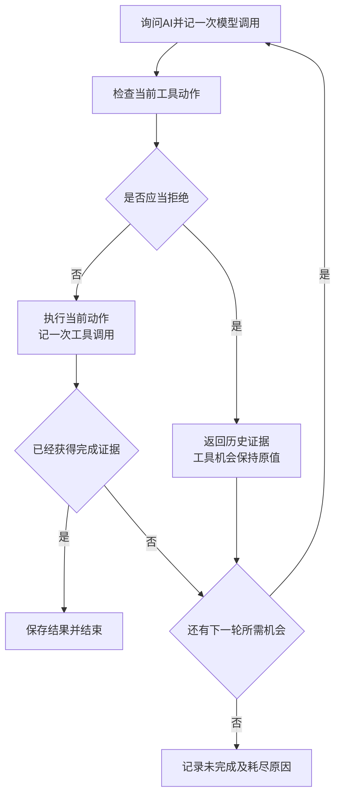

# 工具调用失败后，有必要让 AI 决定下一步吗？——一次固定规则与模型决策的对照实验

**公开 GitHub 仓库：https://github.com/YoreJ/-**

## 1　研究问题及其与课程知识的联系

工具调用失败以后，有些处理办法可以提前写好。例如，编号错误时修正编号，一个数据源没有记录时换另一个，临时超时时再试一次。那么，把下一步交给 AI 决定，能否增加任务完成机会，或者减少无效调用？

本作业从 Workflow 与 Agent 的相关讨论出发，把课程知识落实到三个具体问题上：工具失败后，哪些决定提前写进程序，哪些决定交给模型，以及能否通过固定检查限制模型的动作。温度查询是测试这些问题的载体。

最初曾预期模型能够更灵活地处理连续故障。但讨论发现，固定规则也可以反复读取结果、更新状态和选择下一步。若只给规则程序写几条简单分支，比较容易受到规则覆盖程度影响。因此，我们认真实现了固定规则程序，并统一各程序可以获得的信息。

本轮观察任务结果、工具调用次数、模型调用次数，以及模型是否提出可以根据历史确定无效的动作。研究过程中提出的历史检查器作为一个具体改进，加入比较。结论依据这些实现和案例展开，Workflow 与 Agent 的一般边界仍超出本轮证据。

## 2　哪些内容是模拟的，哪些是真实调用

任务要求取得指定站点、指定日期的温度。站点、温度、主数据源、备用数据源和故障，都由本地 Python 程序设置。所谓工具，是查询站点标准编号和查询温度的本地函数。

真实网络调用发生在询问第三方 AI 时。程序把任务、工具说明、已有调用历史和剩余机会发送出去，AI 返回下一步动作，本地程序执行后，再把结果加入历史。

例如，测试站点 `Station-A` 的标准编号为 `S17`，查询日期是 `2026-01-15`，备用数据源能够返回的温度预设为 `18.4℃`。本例的“查询超时”由模拟函数直接返回错误标记，第三方 AI 请求则正常返回。

提前设置结果，是为了让三种程序面对一致、可重复的环境。模拟器分别记录每个数据源、站点、日期和变量的有效查询次数，按既定顺序返回结果。查询其他日期或另一个数据源，不会消耗当前请求的超时。模型只能看到已经发生的反馈，看不到未来安排。

每个案例都为三种程序重新建立相同环境和起始历史。已有审计核对了初始检查点一致，程序测试也检查了被拒绝动作不会推进环境。这样可以在当前环境中公平比较，但预设案例的范围仍然限制结论。

## 3　三种程序怎样决定下一步

### 3.1　固定规则程序

固定规则程序记住标准编号、已经确认缺失的数据源，以及每个具体查询累计超时的次数。

每次工具返回后，共同执行程序先判断是否取得符合任务的温度，或者是否已经获得两个数据源都缺失的完整证据。满足其中一种，就收集结果并结束。尚未完成而工具机会耗尽，则记录未完成。

需要继续时，固定规则程序按以下顺序选择动作。

1. **先解决编号问题。** 历史中还没有成功解析出的标准编号，就查询编号；已有解析结果，就使用最近一次成功得到的编号。旧编号失败后，用标准编号继续查询最近使用的数据源。
2. **明确没有记录时切换。** 某源已经确认缺少目标记录，就查询另一个尚未确认缺失的数据源。
3. **第一次超时后重试。** 同一个查询在当前数据源只超时过一次，就重试一次。
4. **累计至少两次超时后考虑切换。** 另一个数据源尚未确认缺失时，切换过去。
5. **只剩一个可能有记录的数据源时继续尝试。** 另一个数据源已经确认缺失，就继续查询当前数据源，直到成功或机会用完。
6. **尚无查询历史时才默认主源优先。** 切换后按照当前反馈继续处理。

计数包含共同起点中已经发生的超时，切换不会清空记录。因此，切到备用源后，它首次超时会先重试；也累计至少两次超时后，才可能切回尚未确认缺失的主源。这些规则使相同历史始终得到相同动作。

### 3.2　由模型自己决定的程序

这一程序每次把当前任务、工具约定、完整历史及剩余机会交给 AI，由 AI 提出一个动作。程序执行后，再把结果加入历史。

模型提前知道错误语义和两条避免无效查询的约定。完整选择顺序由模型根据当前信息作出，例如是否在重复超时后切换数据源。

### 3.3　加了检查步骤的模型程序

这一程序使用相同模型、提示词和生成设置。AI 提出动作后，本地检查步骤判断它是否已经被历史证据排除。允许的动作继续执行；被拒绝的动作连同证据反馈给模型，重新选择继续消耗模型调用。

三种程序使用相同模拟工具，区别集中在动作的选择方式，以及是否额外检查当前提案。

## 4　一个已经运行的案例

### 4.1　共同失败起点

本例要求查询 `Station-A` 在 `2026-01-15` 的温度。

开始恢复前，初始化程序已执行两步：确认标准编号是 `S17`，然后查询主数据源，得到 `NO_RECORD`。这个错误码表示参数有效，但该数据源没有目标记录。

两条历史一起交给三种程序。报告中的恢复次数从这里开始计算，初始化步骤单独保存。模型此时知道主源没有记录，尚不知道备用源将发生什么。

模拟器的隐藏安排是，主源始终缺少目标记录，备用源第一次有效查询返回超时，第二次返回 `18.4℃`。

### 4.2　模型实际怎样恢复

第一次询问 AI 时，程序提供任务、两条历史、工具约定，以及四次工具机会和六次模型机会。模型实际选择查询备用数据源，编号为 `S17`，日期为 `2026-01-15`。这消耗一次模型调用。

本地程序执行查询，模拟器返回 `TIMEOUT`，表示本次未取得结果。这消耗一次工具调用。此时还剩三次工具机会、五次模型机会。

程序将超时加入历史，再次询问 AI。模型实际选择以相同参数重试备用源，又消耗一次模型调用。本地工具第二次返回成功，温度为 `18.4℃`，再消耗一次工具调用。

共同执行程序确认结果符合任务，就保存并结束。本例恢复阶段共使用两次模型调用、两次工具调用。AI 两次返回的都是查询动作，温度来自模拟工具。

### 4.3　三种处理方式的比较

| 环节 | 固定规则程序 | 由模型自己决定的程序 | 加了检查步骤的模型程序 |
|---|---|---|---|
| 主源没有记录后 | 按规则查询备用源 | AI 选择备用源 | AI 选择后先检查 |
| 备用源首次超时后 | 按规则重试一次 | AI 选择重试 | AI 选择后再次检查 |
| 返回温度后 | 共同程序收集结果 | 共同程序收集结果 | 共同程序收集结果 |
| 恢复阶段工具调用 | 2 次 | 2 次 | 2 次 |
| 恢复阶段模型调用 | 0 次 | 2 次 | 2 次 |
| 额外检查 | — | — | 2 次，均放行 |

三种程序选择了相同的两步。固定规则提前规定了处理顺序，另外两种程序分别真实询问了 AI。

第一次额外检查允许执行，是因为缺失证据来自主源，而当前查询备用源。第二次也允许，是因为备用源此前只是超时，仍可能成功。因此，这个案例没有出现退回重选。

## 5　历史检查器的具体改进

### 5.1　按错误含义判断当前动作

重复动作有时浪费机会，有时却是合理重试。检查器要解决的是，当前动作是否已经被确定的历史证据排除。

**第一条规则，拒绝再次使用已经确认无效的编号。** 旧编号 `OLD7` 返回 `INVALID_ID`，即编号无效后，在共享编号体系下再次使用它查询任一源，都可以拒绝。修正为 `S17` 后，旧编号证据不再适用于新编号。

**第二条规则，拒绝重复查询已经确认缺失的同一记录。** 数据源、标准站点、日期、变量和固定数据版本必须全部匹配。换到备用源或改变日期，需要各自的证据；新日期的结果也无法完成原日期的任务。

超时只表示本次没有取得结果，因此同参数重试应当允许。切换数据源则不能使已经无效的旧编号变得有效。

这些判断依赖运行前确认的条件：两源共享编号体系，编号验证先于记录查询，数据在任务期间保持不变，编号解析始终成功。条件变化后，需要重新限定证据范围。

### 5.2　拒绝后仍由模型选择

检查器只返回拒绝原因、命中的约定、历史记录编号和匹配字段。它保留模型的替代选择权。

为计算重选代价，恢复阶段最多执行四次工具、询问模型六次。提案被拒绝时，已经消耗一次模型机会，工具机会保持原值。重新提案另扣一次模型机会，格式错误也计入。

最后一次模型调用得到的合法动作仍可处理。工具返回后先检查完成证据，再判断次数耗尽。接口异常单独标记运行无效，用量无法确认时保留为未知。

图示展示格式合法的工具动作。剩余次数的判断位于当前动作处理之后，所以本轮恰好用完最后一次模型额度，也不会直接丢弃当前合法动作。主动结束动作按已有证据和声明判分。

### 5.3　验证到了哪一步

人工预写错误动作，可以检查拒绝、反馈、重选和预算流程。现有四十六项程序测试全部通过，覆盖了已列出的具体情况，包括编号修正、切源、改日期、超时重试、拒绝不改变环境及最后一次调用仍可执行。

其他输入和故障组合尚未全面覆盖。人工构造动作也无法估计正常使用中的干预机会，因此真实试跑另行观察模型自然提出的动作。

## 6　为什么选择这八个案例

八例是人工选择的流程检查案例。编号修复、主源缺失和单次超时分别检查基本动作；连续故障检查程序能否把这些处理连接起来；最后两例检查完整缺失证据和持续不确定性下的结束状态。

这些安排适合认真编写的固定规则。错误少、含义明确，只有两个数据源，历史短，每种错误都有容易规定的处理办法。这一条件应当与结果一起解释。

八例没有覆盖全部组合。两源持续超时、错误含义不清、工具说明不完整、长历史、数据更新和更多工具之间的选择，都没有得到完整的真实模型比较。程序对部分遗漏情况可以作确定推演，推演与已运行结果分别保留。

真实调用前，案例、规则和检查器冻结为 v0.1。两种模型程序得到相同的充分说明，都提前知道两条检查约定，请求中没有案例编号、所属程序和未来安排。

原 GPT 型号被网关拒绝后，经作者授权，改用成功模型列表中的 `claude-sonnet-4-6`。配置和全部响应返回的型号字符串一致，底层身份无法独立核实。两组均使用温度 0、输出上限 512、超时六十秒，客户端自动重试关闭。

独立连通性检查通过后，按预定交替顺序完成十六次正式任务。连通性检查与早期接口探测单独保存。

## 7　任务结果和实际资源消耗

### 7.1　八个案例的结果类别逐案相同

| 案例 | 设置的情况 | 固定规则程序 | 由模型自己决定的程序 | 加检查步骤的模型程序 |
|---|---|---|---|---|
| 01 | 编号错误后修复 | 取得温度 | 取得温度 | 取得温度 |
| 02 | 主源没有记录 | 取得温度 | 取得温度 | 取得温度 |
| 03 | 主源单次超时 | 取得温度 | 取得温度 | 取得温度 |
| 04 | 编号错误、主源缺失、备用源超时 | 取得温度 | 取得温度 | 取得温度 |
| 05 | 主源连续两次超时 | 取得温度 | 取得温度 | 取得温度 |
| 06 | 主源缺失、备用源首次超时 | 取得温度 | 取得温度 | 取得温度 |
| 07 | 两源均缺失 | 确认无记录 | 确认无记录 | 确认无记录 |
| 08 | 主源持续超时、备用源缺失 | 未完成 | 未完成 | 未完成 |

这里可以确认的是，六个温度获取案例、一个缺失确认案例和一个持续不可用案例中，三种程序的结果类别逐案相同。不同目标状态分别报告，整体能力和一般可靠性仍需其他证据。

### 7.2　调用、耗时和用量

| 指标 | 固定规则程序 | 由模型自己决定的程序 | 加检查步骤的模型程序 |
|---|---:|---:|---:|
| 工具调用 | 17 | 16 | 16 |
| 模型调用 | 0 | 17 | 17 |
| 网关报告输入合计 | 0 | 85,866 | 85,877 |
| 网关报告输出 | 0 | 898 | 898 |
| 恢复阶段耗时合计 | 0.685 毫秒 | 47,106.113 毫秒 | 44,802.457 毫秒 |
| 额外检查耗时合计 | — | — | 0.201 毫秒 |
| 金额 |  |  |  |

本轮逐案结果类别没有改善，同时两种模型程序各增加十七次模型调用。人的开发和维护成本，以及换任务后的表现没有比较。

正式模型请求共三十四次，独立连通性检查另用一次。正式任务接口异常和模型格式错误均为零。

规则组时间来自此前独立本地运行，亚毫秒读数只作为已有记录。检查耗时覆盖检查函数包围区间，其他处理未全部单独计时。两模型组总耗时相差约 2.304 秒，其中包含网络等待的调用区间相差约 2.292 秒，现有单次计时无法把差异归因于检查器。

### 7.3　案例 08 的提前结束

固定规则程序在主源再次超时后查询备用源，得知备用源缺失，再把剩下两次工具机会用于主源，最后因次数耗尽而结束。

两种模型程序均在三次工具调用后提交“未完成”。结束前剩一次工具和三次模型机会，结束动作再消耗一次模型机会。

这支持结果表述符合证据，任务状态仍为未完成。固定规则多出的一次工具调用，来自模型主动停止，与检查器无关。停止时机是否更合理尚未验证。隐藏安排规定主源持续超时，但模型看不到该事实，实验也未给出成功概率与任务收益的决策标准。

### 7.4　检查十七次、拒绝零次

| 提案及检查项目 | 由模型自己决定的程序 | 加检查步骤的模型程序 |
|---|---:|---:|
| 全部提案 | 17 | 17 |
| 温度查询 | 14 | 14 |
| 编号解析 | 2 | 2 |
| 结束动作 | 1 | 1 |
| 可拦截查询／适用查询提案 | 0／14 | 0／14 |
| 检查入口执行次数 | — | 17 |
| 实际拒绝次数 | — | 0 |

对原始模型的十四个温度查询，按照各次提案前的历史逐条检查，没有发现命中两条拒绝条件的动作。检查组也有十四个适用查询，另三个动作进入检查函数后直接放行。

因此，检查步骤正常执行了十七次，并发生本地耗时，但没有拒绝动作。真实运行没有提供退回后重新选择的样本，无法实测其任务收益和成本交换。

两模型程序都提前得到充分说明。提示不清、历史很长或模型忘记约定时的表现尚未检验，充分提示的独立影响也未单独比较。

### 7.5　网关计量仍有疑问

token 是接口计量文本处理量的单位。官方定义将普通输入、缓存写入和缓存读取相加，缓存写入内部细分已包含在父字段中。[3](https://platform.claude.com/docs/en/build-with-claude/prompt-caching)

按该定义重新求和，原始响应、账本、任务日志和汇总一致，未发现客户端重复累计缓存细分。但网关是否准确报告底层用量，仍未独立核实。

请求本身存在冗余，包括反复发送完整历史、在两个位置记录已执行动作，以及重复说明部分工具语义。另一方面，客户端未发送缓存控制字段，三十四次请求却均报告非零缓存读写，普通输入每次恒为六。每组可见文本累计 66,094 字符，字符数也无法直接换算 token。上游提示、分词器和字段转换缺少独立证据，故保留“网关报告量”口径，金额留空。

## 8　具体设计贡献及结论范围

**本轮结论限定在错误明确、处理路径有限、历史短且说明充分的任务中。固定规则已经取得相同结果，模型增加了调用，却没有显示额外的任务完成收益。更复杂情况下会怎样，本轮没有回答。**

本作业的具体设计包括四项。按错误语义限定历史证据范围，使超时重试与确定无效动作得到区分；只拒绝当前动作并返回证据，使替代选择继续由模型完成；分别核算工具与模型次数，使重选成本进入比较；分开验证人工机制和自然机会，使两类证据各有明确用途。

这些设计有已有研究基础。Alshiekh 等的 shielding 用外部模块依据规范监测和修正学习器动作。[1](https://arxiv.org/abs/1708.08611) Sentry 第 3.1 节包含检查动作格式、提供上下文并要求模型重新生成的机制。[2](https://arxiv.org/html/2610.02994v1) 本作业的原创性定位为结合具体错误语义、作用范围和预算的一次设计与实验验证。

研究过程还排除了几种容易误读的比较方式。“模型诊断、规则决策”的中间组因信息可能不对等而放弃，改用统一结构化错误。连续故障的实际运行说明规则循环可以覆盖这些路径。逐步检查记录说明，本轮成功路径没有被拒绝步骤改变。案例 08 的差异则被定位到主动结束。审计进一步区分了检查耗时、网络等待和网关报告量。

八例为固定构造，部分起点相同，轨迹内动作相互依赖。现有结果采用描述性统计，关于普遍可靠性和总体干预频率的推断尚无随机抽样依据。

本轮保留当前结果。重复试跑作为后续计划，可预先固定次数，在原八例上检查零触发能否复现。

## 9　协作过程与结语

作者通过另一个 AI 生成追问，再转发给本对话 AI，推进问题讨论和方案修订。技术方案在这一交互过程中形成，作者负责转发需求、确认取舍并审阅阶段性结果。

本对话 AI 参与方案展开、Python 编码、本地执行、接口兼容处理、日志分析、资料核查和报告写作。第三方被测 AI 则在正式请求中读取公开信息，返回下一步动作。问题生成、技术实现、运行解释和报告撰写均有 AI 参与，完整对话将另行上传。

对最初问题的回答是，在当前错误明确、处理路径有限的任务中，固定规则已经取得相同结果。模型增加了调用，没有显示额外的任务完成收益。我们提出的检查步骤通过了已经覆盖的具体功能测试，但真实运行没有遇到需要拒绝的动作，退回重选的实际收益仍未得到验证。

**个人反思待作者补充。**

## 附录　实现与证据位置

以下路径以拟上传仓库根目录为基准，已核对文件存在。文件名保留内部标记，正文使用完整名称。

| 核查内容 | 相对路径及查看位置 |
|---|---|
| 实验实现与固定规则顺序 | `experiment.py` 中的 `Rules.choose`、`run` |
| 提示词、冻结及修改记录 | `model_prompt.txt`、`frozen/v0.1/manifest.json`、`CHANGES.md` |
| 逐案结果与调用统计 | `results/claude-pilot-20261109/experiment/summary.json` 中的 `rows`、`groups` |
| 本文详细案例的固定规则轨迹 | `results/api-preparation-program-check/rule_baseline/06-R.json` |
| 同例两种模型程序轨迹 | `results/claude-pilot-20261109/experiment/runs/06-M.json`、同目录的 `06-MC.json` |
| 案例 08 的终止过程 | 上述规则目录的 `08-R.json`，模型轨迹目录的 `08-M.json`、`08-MC.json` |
| 动作分类、查询分母与检查耗时 | `results/claude-pilot-20261109/result-audit.json` |
| 一致性检查及用量分项 | `results/claude-pilot-20261109/audit.json` |
| 逐次请求与原始响应 | `results/claude-pilot-20261109/experiment/request_ledgers/` |
| 实际顺序、型号和生成设置 | `results/claude-pilot-20261109/experiment/manifest.json` |
| 型号变更与独立连通性检查 | `results/claude-pilot-20261109/model-change.json`、同一结果根目录的 `connectivity/attempt-01/result.json` |
| 人工机制、预算及接口测试 | `test_experiment.py`、`test_model_connection.py`、`test_run_real.py` |
| 四十六项测试通过记录 | `results/claude-pilot-20261109/offline-program-tests.txt` |
| 引用核验记录 | `results/claude-pilot-20261109/reference-check.json` |

每条轨迹保留任务、动作、工具返回、检查结果及前后剩余次数，读者可以逐步核对过程。汇总与审计用于核对统计口径，人工动作测试与真实模型结果分别保存。

## 参考文献

[1] Alshiekh, M., Bloem, R., Ehlers, R., Könighofer, B., Niekum, S., & Topcu, U. (2017). *Safe Reinforcement Learning via Shielding*. arXiv:1708.08611，预印本。[原文及元数据](https://arxiv.org/abs/1708.08611)

[2] Ji, C., Lu, A., Zhang, Q., & Olukotun, K. (2026). *Sentry: Learning to Recover from LLM Agent Failures at Test Time*. arXiv:2610.02994v1，预印本。[摘要及元数据](https://arxiv.org/abs/2610.02994)、[全文](https://arxiv.org/html/2610.02994v1)

[3] Anthropic.（无日期）. *Prompt caching*. Claude Platform Docs。[官方文档](https://platform.claude.com/docs/en/build-with-claude/prompt-caching)

**核验说明**　已实际访问上述一手页面。文献［1］按 2017 年预印本引用。Sentry 的题名、四位作者、2026 年提交时间及全文第 3.1 节已核对，正文引用限于动作格式检查与要求重新生成的机制。文献［3］核对了输入求和公式及缓存细分定义。核验记录日期为 2026 年 11 月 9 日。
